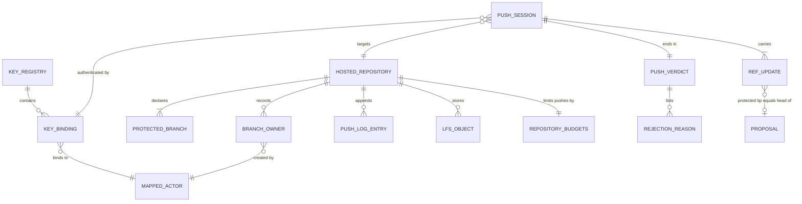
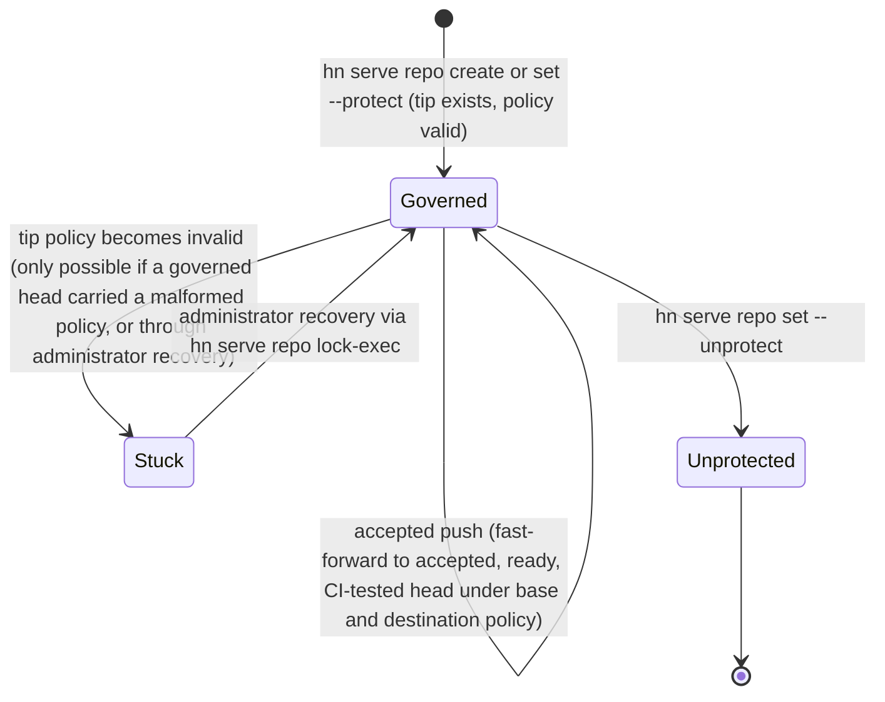
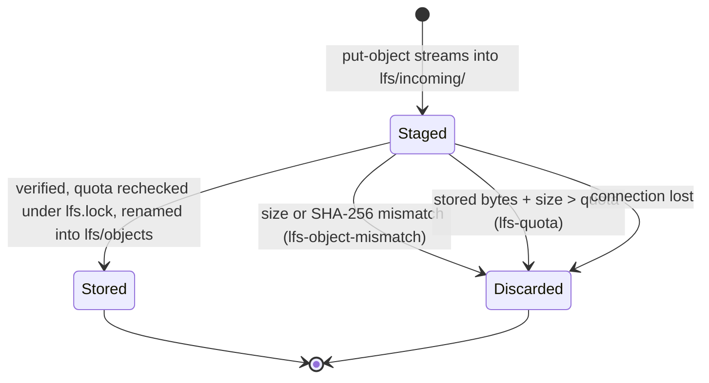

# Data Model: hn serve

This model covers the entities `hn serve` adds and the existing Hubnot entities it reads. Signed Hubnot facts keep their current shape: the mission adds no event kind and changes no signed field. Everything new on the server is unsigned server state, which grants transport access and attribution only (C-006). Exact file schemas are in [contracts/server-state.md](contracts/server-state.md).

## Entity relationships

## Server entities

### Key registry and key binding

The key registry is one file, `state/registry.json`, owned by the server user. Each key binding has:

| Field | Type | Rule |
|----|----|----|
| `fingerprint` | string | `SHA256:` followed by 43 characters of unpadded standard base64, computed from the key blob. Unique across the registry |
| `publicKey` | string | One OpenSSH public key line without options: key type, base64 blob, optional comment removed. The blob's embedded type must equal the key type |
| `actor` | string | Full 64-hex actor fingerprint (`validActorFingerprint`) |
| `added` | string | RFC 3339 UTC timestamp, informational |

Invariants: one fingerprint binds to exactly one actor; an actor may hold several bindings; the file is mode 0600 in a 0700 directory; unknown fields, duplicate fingerprints, duplicate public keys, a symlink or an unsafe mode make every `hn serve` command refuse to run (NFR-008). Supported key types are `ssh-ed25519`, `sk-ssh-ed25519@openssh.com`, `ecdsa-sha2-nistp256`, `ecdsa-sha2-nistp384`, `ecdsa-sha2-nistp521`, `sk-ecdsa-sha2-nistp256@openssh.com` and `ssh-rsa`.

### Mapped actor

The actor a session is attributed to. It is a lookup result and never stored apart from bindings. The wrapper exports it to hooks as `HN_SERVE_ACTOR`, and it appears in every rejection line and push log entry (FR-006). Policy roles come only from policy documents; being mapped grants no role.

### Hosted repository

A bare repository at `repositories/NAME.git` with configuration in `state/repos/NAME/config.json`.

| Field | Type | Default | Rule |
|----|----|----|----|
| `name` | string | | `[A-Za-z0-9][A-Za-z0-9._-]{0,99}`, no `..`, no trailing `.git` in the stored name, unique |
| `protected` | list of ref names | `["refs/heads/main"]` | Sorted, unique, each `refs/heads/` followed by a valid branch name; at least one; the first entry is the default protected branch and `HEAD` points to it |
| `lfsQuotaBytes` | integer | 1073741824 | Positive |
| `budgets` | replication budgets | `defaultReplicationBudgets()` | Same five fields and validation as `ReplicationBudgets` |

Invariants: the marker ref `refs/hn/serve/v1` exists and points at the `hn-serve/1` blob; each protected branch exists and has a valid `.hn/policy.json` at its tip when it is added; the repository directory and every state path are real directories (no symlinks).

### Protected branch

A ref in `protected`. Its lifecycle has no deletion and no creation through push.

Every rejected push leaves the state and tip unchanged. `Stuck` is the OQ-11 case: every update is refused with `protected-policy-invalid` until an administrator repairs the tip outside the governed push path.

### Branch owner

One record per ordinary (unprotected) branch created through a push, stored in `state/repos/NAME/branches.json`.

| Field | Type | Rule |
|----|----|----|
| `ref` | string | `refs/heads/...`, not protected |
| `owner` | string | Full actor fingerprint of the mapped actor whose push created the branch |
| `created` | string | RFC 3339 UTC |

```mermaid
stateDiagram-v2
    [*] --> Unowned: branch imported at repository creation
    [*] --> Owned: push creates branch (post-receive records owner)
    Owned --> Owned: fast-forward by any mapped actor; forced update by owner or maintainer
    Unowned --> Unowned: fast-forward by any mapped actor; forced update by maintainer
    Owned --> [*]: deletion by owner or maintainer (record removed)
    Unowned --> [*]: deletion by maintainer
```

A branch whose record is missing behaves as `Unowned`. "Maintainer" means an actor in `maintainers` of the policy at the tip of the default protected branch, read at verdict time.

### Push session, ref update and push verdict

A push session is one `git receive-pack` run under the repository lock. Its ref updates come from the `pre-receive` stdin lines `OLD NEW REF`. Each ref update is classified once:

| Class | Ref pattern |
|----|----|
| `protected` | a ref listed in `protected` |
| `actor` | `refs/hn/actors/<64-hex>` |
| `proposal` | `refs/hn/proposals/<64-hex>` |
| `memory` | `refs/hn/memory/<64-hex actor>/<64-hex stream>` |
| `tag` | `refs/tags/*` |
| `branch` | other `refs/heads/*` |
| `reserved` | everything else, including `refs/hn/serve/*`, other `refs/hn/*`, `refs/notes/*` and malformed `refs/hn/*` names |

The push verdict is `accepted` when every ref update passes, and `rejected` otherwise. A rejected verdict carries one rejection reason per failing ref update, ordered by ref name. Rules per class and reason precedence are in [contracts/push-verdict.md](contracts/push-verdict.md).

### Rejection reason

| Field | Meaning |
|----|----|
| `ref` | Full ref name |
| `actor` | Mapped actor, full fingerprint |
| `code` | Stable reason code from the catalogue |
| `ids` | Full event IDs or commit IDs involved, comma-separated, possibly empty |
| `missing` | Missing evidence kinds from `proposal`, `review`, `ci`, `acceptance`, possibly empty |
| `next` | One quoted next action |
| sentence | One plain-language sentence printed on the following line |

### Push log entry

One JSON object per line in `state/repos/NAME/push.log`, appended under the repository lock by `post-receive` for accepted pushes and by `pre-receive` for rejected pushes. Fields: `time`, `actor`, `key`, `verdict` (`accepted` or `rejected`), `updates` (list of `{ref, old, new}`), `codes` (list of reason codes). The log is informational and is never read by the verdict.

### Advancement request

A protected-branch push that carries push options.

| Option | Value | Rule |
|----|----|----|
| `hn-advance` | full candidate event ID | Required for an advancement request; at most once |
| `hn-expected-tip` | full commit ID | Optional; when present it must equal the ref update's old value |

An advancement request may contain exactly one ref update, which must be a protected branch. The pusher must be a maintainer under both the candidate's base policy and the destination policy, and the named candidate's signed head must equal the new value.

### LFS object and quota

An LFS object is a file at `state/repos/NAME/lfs/objects/OID[0:2]/OID[2:4]/OID` whose SHA-256 equals its 64-hex lowercase OID and whose size equals the size declared at upload. Stored bytes are the sum of object file sizes under `lfs/objects/`.

Only `Stored` objects are downloadable or counted. Staged files older than one hour are removed at the start of the next LFS session for that repository.

## Client entities

### Replication selection (changed)

`ReplicationSelection` keeps `version: 1` and gains one field.

| Field | Type | Rule |
|----|----|----|
| `allTrusted` | bool, omitted when false | Mutually exclusive with `all`. May combine with `actors`, `proposals` and `memories`. Satisfies the "at least one selector" rule by itself |

New per-ref outcome status `not-advertised`: produced only in all-trusted mode, for an exact actor or proposal selector the remote does not advertise. It is not a failure and promotes nothing.

### Proposal evaluation (refactored)

`ProposalEvaluation` is unchanged. The new internal entry point `evaluateProposalUnderPolicy(proposal, events, policy, decisionDigest)` computes it for any policy, matching decisions and merge facts by `decisionDigest`. `evaluateProposal` passes the base policy and the base digest. The server's destination evaluation passes the destination policy and the base digest.

### Fast-forward merge fact

An ordinary `proposal.merged` event with `head` equal to the candidate's head and `commit` equal to that same head. The signer must be a maintainer under the base policy, as today. Clients interpret `commit == head` as "the protected branch was fast-forwarded to the head".
