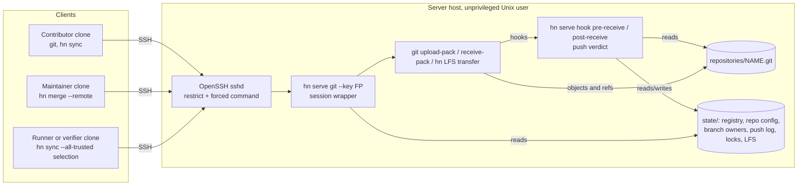
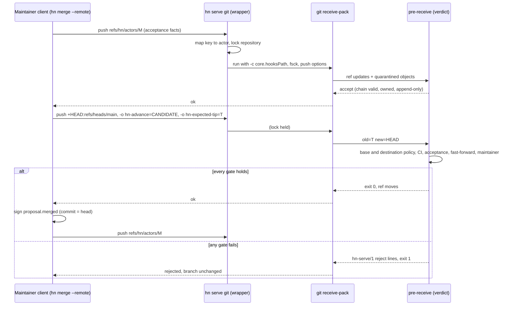

# Implementation Plan: hn serve, a governed local Git server

**Branch**: `mission/hn-serve` (planning base and merge target) | **Date**: 2026-10-24 | **Spec**: [spec.md](spec.md)
**Input**: `kitty-specs/hn-serve-01M5P0NP/spec.md`, with all eleven open questions confirmed by the maintainer and OQ-6 tightened in FR-011.

Planning ran non-interactively. The maintainer delegated every planning decision within the `.kittify` charter. Each choice the spec leaves open is recorded as a resolved plan-flow Decision Moment under `kitty-specs/hn-serve-01M5P0NP/decisions/` and summarized in [research.md](research.md). No planning question is deferred, so this plan carries no clarification markers.

## Summary

`hn serve` is an optional set of `hn` subcommands that turns an unprivileged Unix account into a Git host. OpenSSH authenticates each connection and runs the forced command `hn serve git --key <fingerprint>` from a managed `authorized_keys` block. That wrapper maps the key to a Hubnot actor, accepts only Git fetch, Git push and Git LFS transfer for one hosted repository, takes a per-repository lock for pushes, and runs the installed `git receive-pack` with server-owned hooks. The `pre-receive` hook classifies every ref update and calls the validation code that client replication already uses. A protected branch moves only when its new tip is the signed head of a proposal that is ready and accepted under both its base policy and the destination policy, and that head carries the trusted CI results those policies require. A non-zero hook exit makes Git reject every ref and discard the quarantined objects, which gives the all-or-nothing verdict.

On the client, `hn merge PROPOSAL --remote REMOTE` becomes the advancement request: it publishes the maintainer's actor chain, pushes the proposal head to the protected branch with push options naming the candidate and the expected tip, and after the server confirms the fast-forward signs `proposal.merged` with its result commit equal to the proposal head. `hn replication select REMOTE --all-trusted` imports every actor chain and proposal that an identified `hn serve` remote advertises, and every imported ref still goes through client quarantine and validation. Git LFS objects travel over the `git-lfs-transfer` SSH protocol into per-repository storage with a byte quota.

## Technical Context

**Language/Version**: Go 1.26 (`go.mod` declares `go 1.26`; the quality-gate host runs go1.26.8 linux/amd64), existing module `hubnot`, flat root `package main`.
**Primary Dependencies**: Go standard library only, no `go.mod` change. Runtime tools already required or assumed by the spec: Git (2.53.0 on the gate host) for the smart protocol and hooks, OpenSSH `sshd` for authentication and forced commands, and the Git LFS client (3.7.1) for LFS tests.
**Storage**: Bare Git repositories under `$HOME/.hn-serve/repositories/`. Owner-only server state under `$HOME/.hn-serve/state/`: versioned JSON registry, per-repository configuration and branch owners, an append-only JSON Lines push log, lock files, and LFS objects. A managed block in `$HOME/.ssh/authorized_keys`. No database and no daemon.
**Testing**: Black-box Go tests that build the `hn` binary and drive the public `hn`, `git` and `git lfs` CLIs against real temporary hosted repositories through a generated SSH command shim that runs the exact forced command from the generated `authorized_keys` entry, plus one real unprivileged `sshd` test that skips with a visible reason when `sshd` is unavailable. Unit tests cover parsers and decoders as contract coverage. Full gate: `gofmt -l .` empty, `go test -race ./...`, `go vet ./...`, `go build ./...`, `git diff --check`.
**Target Platform**: Linux and other Unix hosts with OpenSSH, Git and `flock(2)` through `syscall.Flock`. Clients on any platform that runs `hn` and Git over SSH.
**Project Type**: Single Go CLI application.
**Performance Goals**: NFR-001, a push verdict under 5 seconds at the 95th percentile over 20 runs for a hosted repository with 1,000 events and a push adding 50 events plus one protected update. The hook reads hosted events with the existing batched verified reader and re-walks only the appended range of each pushed actor chain.
**Constraints**: All-or-nothing verdicts (FR-012), fail closed on every malformed or unexpected input (NFR-003, NFR-008), runs only as a non-root user and writes only below its state directory, repositories root and `authorized_keys` (NFR-004), never signs facts (C-006), never creates commits (C-005), and changes nothing for clients of ordinary remotes (FR-016, FR-019, C-001).
**Scale/Scope**: Seven implementation concerns. About ten new `serve_*.go` source files, targeted changes to six existing files, about nine new test files, one new guide and four updated documents. LFS is the last concern and may move to its own mission (C-010).

## Charter Check

*GATE: checked before Phase 0 research and re-checked after Phase 1 design.*

The charter in `.kittify/charter/charter.md` and its five project directives apply directly. The table records how the design meets each one.

| Charter rule | How the plan satisfies it | Result |
|----|----|----|
| Go, standard library first, narrow interfaces | No new dependency. SSH key fingerprints, pkt-line framing, the LFS protocol, JSON state and file locks use `crypto/sha256`, `encoding/base64`, `encoding/json`, `bufio` and `syscall.Flock`. The verdict engine sits behind one function boundary between hook input and rejection lines. | Pass |
| HN-001 repository-native boundary | `hn serve` is an optional command. No existing command calls it. Clients detect it only through an advertised ref, and every existing workflow over an ordinary remote is unchanged. The server keeps Git as content store and transport. | Pass |
| HN-002 evidence integrity | The server holds no signing identity. The merge fact is signed by the maintainer's client and binds the exact candidate, head, base policy digest and acceptance decisions, as `proposal.merged` already does. Server verdicts are never evidence. | Pass |
| HN-003 hostile input and least authority | Pushed objects are checked in Git's quarantine before any ref moves, with `receive.fsckObjects` enabled and replication budgets applied. `SSH_ORIGINAL_COMMAND` has a closed grammar and never reaches a shell. The wrapper rebuilds the environment so a client cannot forge the mapped actor. The server refuses uid 0. | Pass |
| HN-004 immutable conflict recovery | A proposal whose head no longer descends from the protected tip is refused with `protected-not-fast-forward` and directed to `hn proposal revise`. The server never merges or rebases. Actor chains are append-only and proposal refs are immutable. | Pass |
| HN-005 protocol and docs move together | New `docs/serve-v0.md`, plus updates to `docs/threat-model.md`, `docs/replication-v0.md`, `docs/governance-v0.md` and `docs/protocol-v0.md` in the same mission. Documented examples are extracted and executed by tests, following the existing `docs/issues-v1.md` pattern. | Pass |
| Quality gates and black-box tests | Acceptance tests use only the public `hn`, `git` and `git lfs` CLIs through the forced command. Tests that existed before this mission keep their assertions (NFR-007). | Pass |
| DIRECTIVE_024 locality | Existing files change only where reuse requires it: one extraction in `policy.go`, one new mode in `governance.go`, and selection changes in `replication.go`, `quarantine.go` and `commands.go`. | Pass |

No violation needs a Complexity Tracking entry. **Post-design re-check**: the Phase 1 contracts add no dependency, no service, no new event kind and no change to signed bytes. The single protocol-relevant change is the meaning of a `proposal.merged` fact whose `commit` equals its `head`, which existing validation already accepts and which `docs/governance-v0.md` will document. The gate still passes.

**Supply-chain check**: the plan adds, upgrades and removes no dependency in any ecosystem, so registry authenticity, package freshness and lifecycle-script review have nothing to examine, and no adversarial-squad pass is required for dependency decisions. Runtime reliance on the system's OpenSSH, Git and Git LFS is an existing spec assumption (C-002) and is covered in the threat-model update.

## Architecture

### System context



The administrator edits state only through `hn serve repo` and `hn serve key`, which run as the same Unix user and rewrite the managed `authorized_keys` block.

### Push and advancement flow



### Component boundaries

Each component has one responsibility and talks to the next through a narrow interface. The verdict engine is the deep module of this mission: callers hand it the hook's ref updates, the mapped actor, push options and repository configuration, and it returns either acceptance or an ordered list of rejections. All Hubnot domain rules for hosted refs live behind that boundary.

| Component | Responsibility | Inputs | Outputs | Depends on |
|----|----|----|----|----|
| Server state (`serve_state.go`) | Layout, mode and symlink checks, registry, repository config, branch owners, push log, locks | Files under `$HOME/.hn-serve` | Typed values or a fail-closed error | `identity_keyring.go` private-file helpers |
| SSH keys (`serve_keys.go`) | Parse OpenSSH public keys, compute `SHA256:` fingerprints, render the managed `authorized_keys` block | Key text, registry | Fingerprints, file bytes | Standard library |
| Administration (`serve_admin.go`) | `hn serve repo` and `hn serve key` subcommands | CLI arguments | State changes, rewritten `authorized_keys` | Server state, SSH keys, policy parsing |
| Session wrapper (`serve_session.go`) | Parse `SSH_ORIGINAL_COMMAND`, refuse anything else, build the environment, lock, run Git or the LFS server | `--key`, `SSH_ORIGINAL_COMMAND`, state | Exit status, stderr | Server state |
| Hooks (`serve_hooks.go`) | Read hook stdin and push options, call the verdict, print lines, record owners and push log after success | Hook protocol | Exit status | Verdict engine, server state |
| Verdict engine (`serve_verdict.go`, `serve_protected.go`) | Classify refs and apply the per-class rules, including protected-branch evaluation | Ref updates, actor, options, config | `[]serveRejection` | `quarantine.go`, `store.go`, `issue_read.go`, `policy.go`, `lineage.go`, `memory_store.go` |
| Rejection lines (`serve_reasons.go`) | Reason-code catalogue, line rendering and parsing | Rejections | `hn-serve/1` lines | Standard library |
| LFS server (`serve_lfs.go`) | `git-lfs-transfer` protocol, staged verified storage, quota | pkt-lines on stdin and stdout | Objects on disk | Server state |
| Client integration (`serve_client.go` plus edits) | Identify `hn serve` remotes, advancement request, fast-forward merge fact, all-trusted selection | Remote name | Pushes, signed fact, selection file | `governance.go`, `replication.go`, `quarantine.go` |

### Reuse of existing validation

The hook runs inside `git receive-pack` with Git's quarantine environment, so plain `git --git-dir=<hosted repo>` calls see both hosted and pushed objects. That lets the hook call the existing functions with the hosted repository as both the quarantine and the accepted directory. The mapping below is the plan's answer to the instruction to reuse existing validation paths.

| Server rule | Existing code reused | Change needed |
|----|----|----|
| Actor chain signatures, sequence, parents, tree shape (FR-007) | `validateQuarantinedActor`, `validateQuarantinedEventTree`, `loadStoredEventAt`, `validateActorChains` | Add a range variant that walks `old..new` and joins the hosted prefix from the batched reader, so only appended commits are re-read |
| Event relationships and dependencies (FR-007) | `replicationEventDependency`, `validateExactEventReferenceClosure`, `validateIssueRelationships`, `ProjectIdentityContinuity` | Add an option that skips the code-ref dependency for a candidate whose code ref is not hosted and not in the push. The code ref is checked when it arrives |
| Hosted event set | `collectIssueEvents` (batched `rev-list` plus `cat-file --batch`, full signature and relationship validation) | None. Its name is issue-specific but it returns every verified event |
| Budgets (NFR-002) | `measureQuarantinedSelectionUnderBudgets`, `enforceReplicationBudgets`, `defaultReplicationBudgets` | None |
| Memory refs (FR-010) | `parseMemoryRef`, `loadMemoryStreamAt` | None |
| Proposal readiness and acceptance under base policy (FR-008) | `evaluateProposal`, `buildLineageIndex`, `proposalHead`, `loadPolicy`, `loadPipeline` | None |
| Readiness and acceptance under destination policy (C-004) | `evaluateProposal` | Extract `evaluateProposalUnderPolicy(proposal, events, policy, decisionDigest)`; `evaluateProposal` calls it with the base policy and keeps its exact behavior |
| Merge fact (FR-015) | `appendProposalMergeEvent`, `validateProposalMergeBinding`, `validateMergeEvent` | None. A fast-forward fact sets `commit` to the head |
| Private files | `ensurePrivateDirectory`, `readPrivateFileBounded`, `decodePrivateJSON`, `writePrivateFileAtomic` | None. Error messages say "private identity"; the serve layer wraps them with serve-specific context |

### Domain rules and invariants

The invariant in the spec holds because the only way a protected ref moves through the governed path is a `pre-receive` acceptance computed while the repository lock is held, and the lock is held from before `receive-pack` advertises refs until after it updates them. The full ref-class rules, reason codes and their precedence are in [contracts/push-verdict.md](contracts/push-verdict.md). Three rules carry the most risk and are summarized here.

1. **Destination evaluation reuses signed facts.** Maintainers sign decisions against the base policy digest. The destination check therefore counts the same signed decisions, reviews and CI results, but applies the destination policy's maintainers, trusted reviewers, trusted runners, pipelines and thresholds. Evidence signed by an actor who is absent from the destination policy does not count toward it.
2. **Candidate code arrives after the candidate.** `hn sync` publishes actor refs before proposal refs in separate pushes. The actor push is accepted without the candidate's code ref, and the later proposal-ref push must equal the hosted candidate's signed head and descend from its base. A protected update requires the hosted code ref to match (`CodeMatches`), so a candidate without code can never advance a branch.
3. **Ordinary-branch ownership is server state.** `post-receive` records the creating actor for each new unprotected branch in `state/repos/NAME/branches.json` and removes the record on deletion. A branch with no record (pre-existing, or a failed `post-receive`) accepts forced updates and deletions only from maintainers listed in the policy at the default protected branch tip, which fails closed.

### Client changes

`hn merge PROPOSAL` with no new flag keeps its current `--no-ff` merge and repair path (FR-016). The new form is `hn merge PROPOSAL --remote REMOTE [--branch BRANCH]`, with `main` as the default branch. It refuses remotes that do not advertise `refs/hn/serve/v1` with the expected marker blob, runs the existing local readiness, lineage, acceptance and maintainer checks, and then follows [contracts/advancement.md](contracts/advancement.md). If the remote tip already contains the head, the command takes the fast-forward repair path and records a missing merge fact once. A rerun after the fact exists reports success without writing.

`hn replication select REMOTE --all-trusted` stores `"allTrusted": true` in the existing version 1 selection file, omitted when false so existing files stay byte-identical. `hn sync` rechecks the marker on every run, requests every advertised actor and proposal ref, and treats unadvertised refs as normal. See [contracts/all-trusted-selection.md](contracts/all-trusted-selection.md).

## Project Structure

### Documentation (this mission)

```
kitty-specs/hn-serve-01M5P0NP/
├── spec.md                         # confirmed specification
├── plan.md                         # this file
├── research.md                     # Phase 0 decisions, spikes and risks
├── data-model.md                   # Phase 1 entities, state files, lifecycles
├── quickstart.md                   # Phase 1 administrator and participant walkthrough
├── contracts/
│   ├── serve-cli.md                # hn serve subcommands, forced command grammar, exit behavior
│   ├── server-state.md             # on-disk layout, registry and config schemas, authorized_keys block
│   ├── push-verdict.md             # ref classes, rules, reason codes, line format, precedence
│   ├── advancement.md              # hn merge --remote wire shape and merge-fact recording
│   ├── all-trusted-selection.md    # server identification and client selection mode
│   └── lfs-transfer.md             # git-lfs-transfer subset, storage and quota
├── decisions/                      # Decision Moments from specify and plan
└── tasks.md                        # produced later by /spec-kitty.tasks
```

### Source code (repository root)

The repository uses one flat `package main` with feature-prefixed files, so the plan adds `serve_*.go` files beside the existing ones.

```
hubnot/
├── main.go                    # CHANGE: route "serve", usage lines for hn serve, hn merge --remote, --all-trusted
├── serve_commands.go          # NEW: cmdServe dispatcher, uid-0 refusal, shared flag parsing
├── serve_state.go             # NEW: layout, registry, repo config, branch owners, push log, flock locks
├── serve_keys.go              # NEW: OpenSSH public-key parsing, SHA256 fingerprints, authorized_keys block
├── serve_admin.go             # NEW: hn serve repo create|list|show|set|lock-exec, hn serve key add|remove|list
├── serve_session.go           # NEW: hn serve git --key: command grammar, environment, lock, exec
├── serve_hooks.go             # NEW: hn serve hook pre-receive|post-receive
├── serve_verdict.go           # NEW: ref classification and per-class rules
├── serve_protected.go         # NEW: protected-branch evaluation under base and destination policy
├── serve_reasons.go           # NEW: reason-code catalogue, hn-serve/1 line rendering and parsing
├── serve_lfs.go               # NEW: git-lfs-transfer server, staged storage, quota
├── serve_client.go            # NEW: remote identification, advancement request, fast-forward merge fact
├── policy.go                  # CHANGE: extract evaluateProposalUnderPolicy
├── governance.go              # CHANGE: hn merge --remote and --branch, dispatch to serve_client.go
├── replication.go             # CHANGE: AllTrusted field, --all-trusted flag, validation, show output
├── quarantine.go              # CHANGE: all-trusted request resolution, not-advertised status, range actor validation, server code-ref option
├── commands.go                # CHANGE: hn sync rechecks identification for all-trusted, treats not-advertised as success
├── serve_harness_test.go      # NEW: server home, client keys, SSH shim, real-sshd helper
├── serve_unit_test.go         # NEW: grammar, fingerprint, registry and config decoding, reason-line round trip
├── serve_admin_test.go        # NEW: US2, FR-002 to FR-005, NFR-008
├── serve_push_test.go         # NEW: US1, FR-006 to FR-013, FR-022, NFR-002, NFR-003
├── serve_advance_test.go      # NEW: US3, FR-014 to FR-016, NFR-005, NFR-006
├── serve_replication_test.go  # NEW: US4, FR-017 to FR-019, SC-004 Phase 0 flow
├── serve_lfs_test.go          # NEW: US5, FR-020, FR-021
├── serve_sshd_test.go         # NEW: one real unprivileged sshd round trip (skips with reason)
├── serve_quality_test.go      # NEW: NFR-001 timing, NFR-004 written-path audit, documented examples
└── docs/
    ├── serve-v0.md            # NEW: setup, administration, ref classes, reason codes, advancement, recovery
    ├── threat-model.md        # CHANGE: server trust boundary, key registry, forced command, LFS
    ├── replication-v0.md      # CHANGE: all-trusted selection, server identification
    ├── governance-v0.md       # CHANGE: destination policy, fast-forward merge fact, hn merge --remote
    └── protocol-v0.md         # CHANGE: refs/hn/serve/v1, hn-serve/1 rejection lines, push options
```

**Structure Decision**: single Go CLI in the repository root, extended with `serve_*.go` source and test files and documentation under `docs/`. No new package, directory or module.

## Implementation Concern Map

> These concerns describe architectural areas. `/spec-kitty.tasks` decides how to cut them into executable work packages.

### IC-01: Server state, key registry and administration

- **Purpose**: Give the administrator a safe, fail-closed way to host repositories and bind SSH keys to actors, and keep `authorized_keys` generated from that state.
- **Relevant requirements**: FR-001, FR-002, FR-003, FR-004, NFR-004, NFR-008, C-001, C-002, OQ-1, OQ-5, OQ-7, OQ-11.
- **Affected surfaces**: `serve_commands.go`, `serve_state.go`, `serve_keys.go`, `serve_admin.go`, `main.go`, `serve_harness_test.go`, `serve_unit_test.go`, `serve_admin_test.go`.
- **Sequencing/depends-on**: none.
- **Risks**: `authorized_keys` is shared with any keys the administrator added by hand, so the rewrite must preserve outside lines byte for byte and refuse symlinks and group-writable files. `sshd` `StrictModes` rejects unsafe home and `.ssh` modes, which the guide must explain.

### IC-02: Forced-command session wrapper

- **Purpose**: Accept exactly the supported Git and LFS requests for one hosted repository, attribute them to the mapped actor, serialize pushes, and start Git with server-controlled configuration.
- **Relevant requirements**: FR-005, FR-006, FR-022, NFR-003, NFR-004, NFR-005.
- **Affected surfaces**: `serve_session.go`, `serve_state.go` (locks), `serve_admin_test.go`, `serve_push_test.go`, `serve_sshd_test.go`.
- **Sequencing/depends-on**: IC-01.
- **Risks**: Holding the lock for the whole `receive-pack` session means a slow upload delays other pushes to the same repository; the 120-second wait budget and `repository-busy` reason bound that. Git must not read hooks or configuration from the hosted repository, so the wrapper passes `core.hooksPath` and the other settings with `-c` and sets `GIT_CONFIG_NOSYSTEM=1`.

### IC-03: Push verdict for actor, proposal, memory, tag and ordinary-branch refs

- **Purpose**: Check every non-protected ref update with the existing replication validators, enforce ownership and immutability rules, and produce one structured rejection line per failing ref.
- **Relevant requirements**: FR-006, FR-007, FR-010, FR-011, FR-012, FR-013, NFR-002, NFR-003, C-006, C-007, OQ-2, OQ-6.
- **Affected surfaces**: `serve_hooks.go`, `serve_verdict.go`, `serve_reasons.go`, `quarantine.go` (range validation, code-ref option), `serve_push_test.go`, `serve_unit_test.go`.
- **Sequencing/depends-on**: IC-02.
- **Risks**: The replication validators were written for a client quarantine and accepted refs under `refs/hn/remotes/`. The server passes the hosted repository for both directories and relies on Git's quarantine environment; a test must prove that objects from a rejected push are absent afterwards. Missing base or head commits must surface as `dependency-missing` with the missing commit named.

### IC-04: Protected-branch governance and destination policy

- **Purpose**: Allow a protected branch to move only to the signed head of a proposal that is ready and accepted under both policies, carries trusted CI, is not blocked, and fast-forwards the current tip.
- **Relevant requirements**: FR-008, FR-009, FR-012, FR-013, FR-022, C-004, C-005, NFR-001, NFR-005, OQ-11.
- **Affected surfaces**: `serve_protected.go`, `policy.go` (extraction), `serve_verdict.go`, `serve_push_test.go`, `serve_advance_test.go`, `serve_quality_test.go`.
- **Sequencing/depends-on**: IC-03.
- **Risks**: The `evaluateProposal` extraction touches a function used by `hn proposal status`, `hn decide` and `hn merge`; existing tests must stay green without assertion changes. Destination evaluation must load pipeline definitions at the proposal head for pipelines that only the destination policy requires, and a missing definition must reject.

### IC-05: Advancement request and fast-forward merge fact

- **Purpose**: Let a maintainer advance a protected branch through `hn merge --remote` and record `proposal.merged` with the head as its result commit, including recovery after interruption.
- **Relevant requirements**: FR-014, FR-015, FR-016, NFR-006, OQ-4.
- **Affected surfaces**: `serve_client.go`, `governance.go`, `main.go`, `serve_advance_test.go`, `docs/governance-v0.md`.
- **Sequencing/depends-on**: IC-04.
- **Risks**: The client must parse `hn-serve/1` lines from `git push` stderr, which Git prefixes with `remote: ` and pads with trailing spaces. The forced refspec is required so Git sends the update to the server for a structured verdict; the server's fast-forward check and expected-tip check replace Git's client-side refusal.

### IC-06: Fact advertisement and all-trusted selection

- **Purpose**: Identify `hn serve` remotes and let clients import every advertised actor chain and proposal without naming each one, while client validation stays unchanged.
- **Relevant requirements**: FR-017, FR-018, FR-019, NFR-006, SC-004, OQ-3, OQ-10.
- **Affected surfaces**: `replication.go`, `quarantine.go`, `commands.go`, `serve_client.go`, `serve_admin.go` (marker ref), `serve_replication_test.go`, `docs/replication-v0.md`.
- **Sequencing/depends-on**: IC-01 for the marker ref; the end-to-end tests depend on IC-03, and the Phase 0 flow test (SC-004) depends on IC-05.
- **Risks**: `hasFailures` and the `hn sync` summary must treat the new `not-advertised` status as success, without changing outcomes for existing selections. Existing `hn replication show` assertions must keep passing, so the new line prints only when the mode is set.

### IC-07: Git LFS transfer and quota

- **Purpose**: Store and serve LFS objects over the SSH transfer protocol, verify content before it becomes downloadable, and enforce the per-repository quota.
- **Relevant requirements**: FR-020, FR-021, C-003, C-010, OQ-8.
- **Affected surfaces**: `serve_lfs.go`, `serve_session.go` (dispatch), `serve_state.go` (LFS layout, quota setting), `serve_lfs_test.go`, `docs/serve-v0.md`.
- **Sequencing/depends-on**: IC-02. It is separable and may move to its own mission without blocking IC-01 to IC-06.
- **Risks**: The `git-lfs-transfer` protocol is a proposal document implemented by Git LFS 3.x clients, so the implementation follows observed client behavior in tests as well as the document. The Git LFS client multiplexes SSH by default, which the shim does not support; tests set `lfs.ssh.automultiplex=false`.

### Cross-cutting: documentation and quality evidence

Documentation is updated in the concern that changes the behavior, as HN-005 and DIRECTIVE_037 require: IC-01 to IC-04 write the corresponding sections of `docs/serve-v0.md` and `docs/threat-model.md`, IC-05 updates `docs/governance-v0.md`, IC-06 updates `docs/replication-v0.md`, and the reason-code and wire changes update `docs/protocol-v0.md`. `serve_quality_test.go` extracts fenced examples marked with `<!-- example: ... -->` comments from `docs/serve-v0.md` and runs them, measures NFR-001, and audits written paths for NFR-004. The final integration gate runs the full regression suite for NFR-007.

## Validation and rollout

Each concern lands with its tests and documentation. The integrated candidate on `mission/hn-serve` must pass `gofmt -l .` with no output, `go test -race ./...`, `go vet ./...`, `go build ./...` and `git diff --check`, with every pre-existing test unmodified. Rollout is opt-in by construction: nothing changes for a repository until an administrator creates a hosted repository and a participant points a remote at it.

## Risks

The risks most likely to cause rework are listed with their mitigations. The research file carries the full premortem.

| Risk | Effect | Mitigation |
|----|----|----|
| Git hook environment differs across Git versions (quarantine variables, push options) | Validation sees no pushed objects, or advancement options are lost | Spike on Git 2.53.0 confirmed both. The wrapper sets `receive.advertisePushOptions=true`; tests assert quarantine discard after rejection. The guide states the minimum Git version as 2.11, when quarantine and push options both shipped |
| Session-wide lock serializes slow uploads | Pushes wait behind a slow client | 120-second wait budget, `repository-busy` reason, fetches never take the lock |
| Proposal code ref published after its candidate | Actor push rejected for a dependency the client sends next | Documented server exception for the code-ref dependency only; the protected check still requires matching code |
| `evaluateProposal` extraction changes behavior | Regression in status, decide or merge | Extraction is behavior-preserving, and existing governance tests run unchanged |
| Tests run as root in some CI environments | Every server test would fail because `hn serve` refuses uid 0 | Tests skip with a visible reason when euid is 0. A test-only override, honored only with `HN_INTERNAL_TESTING=1`, exercises the refusal path |
| Identity rotation or device keys | A successor actor's pushes are rejected until its SSH key is bound | Guide documents binding a key per actor; one key maps to one actor by design (OQ-1) |
| Plain `git push` without `--atomic` when a ref update fails at the filesystem level after `pre-receive` accepted | Partial update | The lock rules out concurrent ref changes, so only I/O failure remains. The guide recommends `--atomic` and `hn merge --remote` pushes a single ref |
