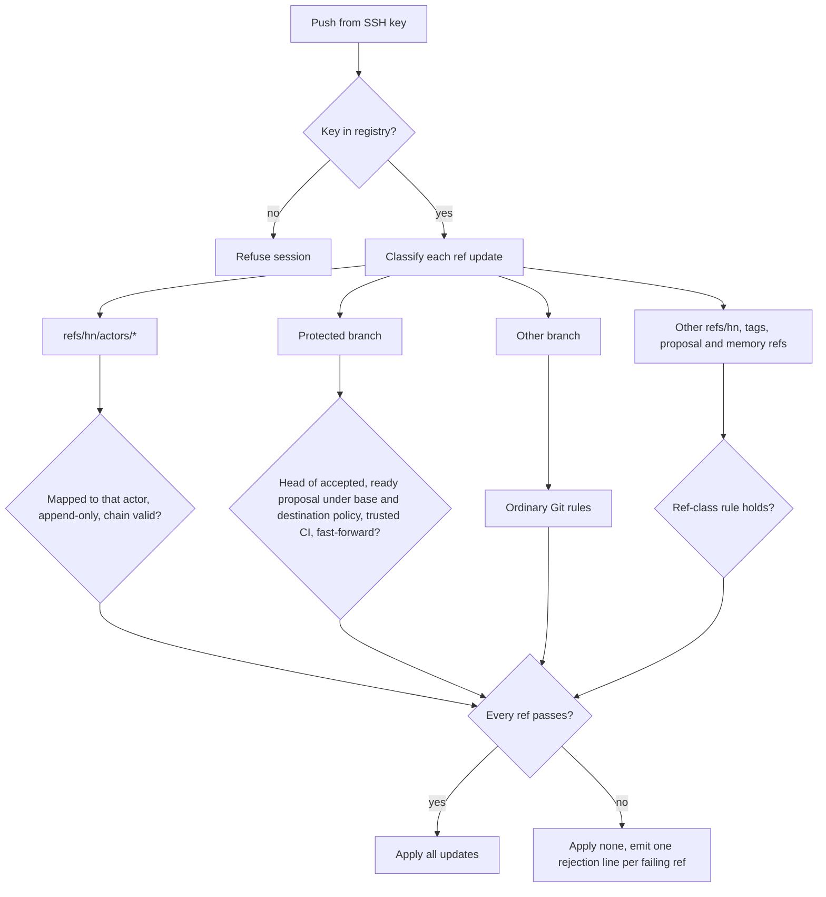

# Mission Specification: hn serve: governed local Git server

**Mission Branch**: `mission/hn-serve`  
**Created**: 2026-10-24  
**Status**: Specified; open questions confirmed by the maintainer on 2026-10-24 (OQ-6 tightened)  
**Input**: Mission brief `../notes/mission-1-hn-serve-brief.md` ingested by `spec-kitty intake`. Its "Design decisions" section is treated as the maintainer's discovery answers. Every choice the brief leaves open was made by the specifying agent under delegated non-interactive instruction and is listed under [Open questions for maintainer confirmation](#open-questions-for-maintainer-confirmation).

## Problem and intent

Hubnot governs proposals on the client. `hn merge` checks policy and evidence locally, but any credential with push access can update `main` directly. The Phase 0 run on the rust-pingpong test project found three further gaps that slow multi-agent work: participants must select every actor and every proposal by hand before facts import; a selected actor that has not published yet makes `hn sync` fail; and the merged commit on `main` was a new `--no-ff` merge commit with no CI evidence (finding 10).

This mission adds an optional `hn serve` command. It hosts bare repositories over SSH, maps each SSH key to a Hubnot actor, refuses pushes that would move a protected branch without the governance evidence Hubnot already defines, advances protected branches only to tested commits, and advertises every validated fact so clients can import without per-proposal selection. Plain `git` and `hn` clients keep working against it, and every existing workflow over an ordinary Git remote keeps working without it.

**Primary actors**: the server administrator (the Unix account that runs `hn serve`), contributing agents and people (mapped actors that push branches and facts), maintainers (actors listed in policy who accept proposals and ask the server to advance a protected branch), and runners and verifiers (clients that import facts).

**Invariant**: after any successful push, every protected branch tip is the signed head of a proposal that is accepted and ready under both its signed base policy and the destination branch's policy as it stood immediately before the update, and that head carries the required trusted CI evidence.

## Domain Language

| Canonical term | Meaning | Avoid |
|----|----|----|
| Hosted repository | A bare repository that `hn serve` administers below its repositories root | "project", "remote repo" |
| Key registry | The server-side record binding SSH public-key fingerprints to full actor fingerprints | "user database", "ACL" |
| Mapped actor | The full 64-hex Hubnot actor fingerprint the key registry binds to the authenticating SSH key | "user", "account" |
| Protected branch | A branch ref of a hosted repository whose updates must pass the governed check | "locked branch" |
| Push verdict | The server's all-or-nothing accept or reject outcome for one push | "hook result" |
| Rejection reason | One structured line per rejected ref, carrying a stable reason code | "error message" |
| Advancement request | A maintainer's request that the server fast-forward a protected branch to an accepted proposal's head | "server merge", "auto-merge" |
| Base policy | `.hn/policy.json` at the proposal's signed base commit (existing rule) | |
| Destination policy | `.hn/policy.json` at the protected branch tip being replaced | "current main policy" |
| All-trusted selection | The new client replication mode that imports every actor chain and proposal an `hn serve` remote advertises | "--all", "trust the server" |

## User Scenarios & Testing

### User Story 1: Contributors push freely, protected branches stay governed (Priority: P1)

A contributing agent pushes its feature branch and its own actor chain, which the server accepts. The same agent then pushes directly to `main`, and the server rejects the push with a reason naming the missing proposal, review, CI and acceptance evidence. The agent also tries to push another actor's chain, which the server rejects.

**Why this priority**: closing the direct-push bypass of client-side governance is the reason this mission exists.

**Independent Test**: create a hosted repository, register two keys for two actors, then drive real `git push` and `hn sync` from temporary clones. Assert each verdict, each rejection line, and that every ref on the server is byte-identical after each rejected push.

**Acceptance Scenarios**:

1. **Given** a mapped actor A with a new feature branch and new events on `refs/hn/actors/<A>`, **When** A pushes both, **Then** the push is accepted and both refs advance.
2. **Given** A's local `main` is one commit ahead of the server's `main` with no proposal for that commit, **When** A pushes `main`, **Then** the whole push is rejected, `main` is unchanged, and the rejection line for `refs/heads/main` names the missing proposal, review, CI and acceptance evidence.
3. **Given** actor B is mapped to a different key, **When** A pushes `refs/hn/actors/<B>`, **Then** the push is rejected with an actor-key-mismatch reason and B's chain is unchanged.
4. **Given** A pushes an actor chain whose newest event has a broken signature, **When** the server checks it, **Then** the push is rejected with an actor-chain-invalid reason that names the full event ID.
5. **Given** A's push rewrites already-hosted events on `refs/hn/actors/<A>`, **When** the server checks it, **Then** the push is rejected because actor chains are append-only.
6. **Given** actor B created branch `feature/b` on the server, **When** A force-pushes or deletes `feature/b`, **Then** the push is rejected with a `branch-not-owner` reason and the branch is unchanged; **When** B or a policy maintainer does the same, **Then** it is accepted.

---

### User Story 2: An administrator hosts repositories and maps keys (Priority: P1)

The administrator runs `hn serve` under its own unprivileged Unix user, creates a hosted repository seeded from an existing repository, and registers each participant's SSH public key against a full actor fingerprint. Participants then clone and push with ordinary `git` over SSH. A key that is not registered cannot fetch or push.

**Why this priority**: every other story depends on hosting and on attributing a push to an actor.

**Independent Test**: run the `hn serve` administration subcommands in a temporary server home, inspect the generated `authorized_keys` entries, and connect real `git` clients through the forced command.

**Acceptance Scenarios**:

1. **Given** an empty server home, **When** the administrator creates a hosted repository from an existing repository and registers a key for actor A, **Then** the managed `authorized_keys` entry for that key uses `restrict` and the forced command `hn serve git --key <fingerprint>`, and A can clone the repository.
2. **Given** an SSH key absent from the key registry, **When** it attempts a fetch or push, **Then** the server refuses it before any repository data is sent or received.
3. **Given** a registered key, **When** its SSH session requests a shell or any command other than Git fetch, Git push or LFS transfer for a hosted repository, **Then** the server refuses the request and no repository changes.
4. **Given** a registered key, **When** it requests a repository path outside the repositories root or a repository that is not hosted, **Then** the server refuses the request.
5. **Given** the administrator removes a key binding, **When** that key next connects, **Then** it is refused.

---

### User Story 3: A maintainer advances main to the tested commit without push rights (Priority: P1)

A maintainer accepts a proposal that is ready and asks the `hn serve` remote to advance `main`. The server fast-forwards `main` to the exact proposal head that CI tested. A fresh `git clone` plus `hn sync` reproduces the same review, CI, acceptance and merge evidence. If `main` has moved and the proposal head no longer descends from it, the server refuses, and the author revises the proposal onto the current tip, which then needs fresh evidence.

**Why this priority**: it replaces the untested `--no-ff` merge commit (finding 10) and removes the need for anyone to hold unconditional push rights to `main`.

**Independent Test**: build a proposal with one trusted approval, one trusted CI pass and one maintainer acceptance in temporary clones, request advancement through the public CLI, then verify server refs and a fresh verifier clone.

**Acceptance Scenarios**:

1. **Given** a proposal whose head descends from the server's `main` and which is ready and accepted under both base policy and destination policy, **When** the maintainer requests advancement, **Then** the server's `main` equals the proposal head, no new commit is created, and the maintainer's client records a `proposal.merged` fact whose result commit equals that head.
2. **Given** step 1 completed, **When** a new clone with no Hubnot identity runs `hn sync` and `hn proposal status <full-candidate-id>`, **Then** it verifies every event and reports the same review, CI, acceptance and merge evidence.
3. **Given** `main` advanced after the proposal was opened so the head no longer descends from it, **When** the maintainer requests advancement, **Then** the server refuses with a not-fast-forward reason naming the current tip and directing a proposal revision.
4. **Given** the destination policy now requires two approvals while the proposal's base policy required one, **When** advancement is requested with one approval, **Then** the server refuses with a destination-policy reason naming the unmet threshold.
5. **Given** a ready proposal without the required trusted CI result, **When** any mapped actor pushes `main` to its head, **Then** the push is rejected naming the missing CI evidence.
6. **Given** two maintainers request advancement of different ready proposals at the same moment, **When** both reach the server, **Then** exactly one advances `main` and the other is refused with a stale-tip reason.

---

### User Story 4: Runners and verifiers discover new work without selecting it (Priority: P2)

A runner clone selects the `hn serve` remote with the new all-trusted selection. When an implementer opens a brand-new proposal and a maintainer requests CI, the runner's next `hn sync` imports both without any per-actor or per-proposal selection. An actor that has not published yet causes no failure.

**Why this priority**: it removes the manual selection work that slowed every Phase 0 participant, while still validating every fact on the client.

**Independent Test**: from temporary clones, publish a new proposal and run request to the server, then run `hn sync` in a runner clone that saved only the all-trusted selection.

**Acceptance Scenarios**:

1. **Given** a runner clone with the all-trusted selection saved for the server remote, **When** a new proposal and a maintainer-signed run request appear on the server, **Then** the runner's next `hn sync` promotes both and `hn runner once` can execute the request.
2. **Given** the all-trusted selection, **When** a participant registered on the server has not yet published any events, **Then** `hn sync` exits successfully and reports no failure for that actor.
3. **Given** the all-trusted selection plus an exact `--memory` selection, **When** `hn sync` runs, **Then** only the exactly selected memory stream imports.
4. **Given** a remote that is an ordinary Git remote, **When** a client saves the all-trusted selection for it, **Then** the command refuses and names the remote.
5. **Given** an existing exact or `--all` selection, **When** the client syncs against `hn serve`, **Then** the result is identical to the same selection against an ordinary remote holding the same refs.
6. **Given** the rust-pingpong Phase 0 flow, **When** it runs end to end against `hn serve`, **Then** no participant runs an `hn replication select` command naming an actor or proposal and no participant pushes `main` directly.

---

### User Story 5: Hosted repositories store Git LFS objects within a quota (Priority: P3)

A participant with Git LFS tracks a large file, pushes, and another participant clones and receives it. Uploads that would exceed the repository's quota are refused.

**Why this priority**: useful for real projects, and separable. It is the final work package and may split into its own mission without blocking stories 1 to 4.

**Independent Test**: use the Git LFS client against a hosted repository through the forced command, upload and download objects, and exercise the quota boundary.

**Acceptance Scenarios**:

1. **Given** a hosted repository with LFS enabled, **When** a mapped actor pushes a commit with an LFS-tracked file, **Then** a second clone downloads byte-identical content.
2. **Given** an upload whose content does not hash to its declared object ID, **When** it completes, **Then** the server discards it and reports an object-mismatch reason.
3. **Given** a quota of N bytes and stored objects totalling N minus 10 bytes, **When** a 10-byte object is uploaded, **Then** it is accepted; **When** an 11-byte object is uploaded instead, **Then** it is refused before it becomes downloadable.
4. **Given** an LFS client that requests file locking, **When** it calls a locking operation, **Then** the server answers that locking is unsupported.

### Push verdict overview

### Edge Cases

- Push that mixes a valid feature branch with an invalid `main` update: the whole push is rejected and the feature branch does not move.
- Deletion or rewind of a protected branch or an actor chain: rejected.
- Proposal head already equal to the current protected tip: the advancement request reports the branch as already advanced, and the maintainer command records a missing merge fact through the repair path of FR-015.
- Proposal superseded by a revision, lineage already merged, or a maintainer's current rejection: protected update rejected naming the blocking event.
- Base policy or destination policy missing or malformed: protected update rejected (see OQ-11).
- Proposal whose candidate code ref on the server differs from its signed head: rejected.
- Evidence signed by actors listed in the proposal's base policy but removed from the destination policy: does not count toward the destination policy check.
- An actor chain that references events from chains the server does not hold: rejected with a dependency-missing reason naming the full missing ID.
- Pushes exceeding server-side budgets: rejected with an over-budget reason naming budget, limit and measured value.
- Concurrent pushes to the same protected branch: serialized; the loser receives a stale-tip reason.
- Registry file with unsafe permissions, unknown fields, duplicate keys, or a key bound to two actors: the server refuses to serve and the administration command reports the defect.
- `SSH_ORIGINAL_COMMAND` containing extra arguments, shell metacharacters, `..` path segments, or symlinked repository paths: refused.
- Server started as uid 0: refuses to start.
- Interrupted advancement: the branch moved but the client never recorded `proposal.merged`; rerunning the maintainer command records it after re-verification.
- LFS upload interrupted midway: partial content never becomes downloadable and does not count toward the quota.

## Requirements

### Functional Requirements

| ID | Title | User Story | Priority | Status |
|----|-------|------------|----------|--------|
| FR-001 | Optional hosting command | `hn serve` hosts a directory of bare repositories for Git smart-protocol fetch and push over SSH. No existing `hn` command gains a dependency on it, and every existing workflow over an ordinary Git remote behaves as before. | High | Open |
| FR-002 | Repository administration | `hn serve repo` subcommands create a hosted repository seeded by importing an existing repository, list hosted repositories, and show and set each repository's protected branches and LFS quota. Pushes never create repositories (OQ-7, OQ-11). | High | Open |
| FR-003 | Key registry administration | `hn serve key` subcommands add, remove and list bindings from a full SSH public-key fingerprint to a full 64-hex actor fingerprint. Short or malformed fingerprints are refused. One key binds to exactly one actor; an actor may have several keys. The registry is owner-only server state stored outside every hosted repository (OQ-1). | High | Open |
| FR-004 | Managed authorized_keys | After each registry change, the server rewrites its managed block in its own user's `authorized_keys`. Each managed entry carries `restrict` and the forced command `hn serve git --key <fingerprint>`. Lines outside the managed block are preserved byte for byte. | High | Open |
| FR-005 | Forced-command dispatch | `hn serve git --key <fingerprint>` accepts only Git fetch, Git push and Git LFS transfer requests for one hosted repository below the repositories root, and refuses every other request, unknown key and unsafe path without changing any repository. | High | Open |
| FR-006 | Push attribution | Every push is attributed to the mapped actor of the authenticating key, and that actor appears in the server's push log and in every rejection line. | High | Open |
| FR-007 | Actor chain check | An update to `refs/hn/actors/<actor>` is accepted only from a key mapped to that actor, only as an append to the hosted chain, and only when the complete incoming chain passes the same signature, sequence, parent and relationship validation used for replication import. | High | Open |
| FR-008 | Protected-branch check | An update to a protected branch is accepted only when the new tip equals the signed head of a proposal the server holds, the proposal is ready and accepted with no current maintainer rejection under its signed base policy, it is also ready and accepted under the destination policy, it is neither superseded nor in a merged lineage, and the new tip descends from the current tip. | High | Open |
| FR-009 | Tested commit only | A protected branch moves only to a commit that carries the required trusted CI results. The server never creates a commit. A proposal whose head does not descend from the current tip must be revised onto it and gather fresh evidence. | High | Open |
| FR-010 | Rules for other governed ref classes | Proposal refs are accepted only when equal to a validated candidate's signed head and never move or disappear afterwards; memory refs only from a key mapped to the owning actor after `hn-memory/0` validation; all other `refs/hn/*` refs are refused; tags are create-only; protected branches and actor chains are never deleted or rewound (OQ-6). | High | Open |
| FR-011 | Ordinary branches | Any mapped actor may create a branch that is not protected, and the server records the creating actor as the branch owner in its own state. Fast-forward updates are accepted from any mapped actor. Forced (non-fast-forward) updates and deletions are accepted only from the branch owner or from an actor listed as a maintainer in the policy at the tip of the repository's protected default branch; anyone else is rejected with reason `branch-not-owner` (OQ-6). Branches that existed before the repository was hosted have no owner and only maintainers may force-update or delete them. | Medium | Open |
| FR-012 | All-or-nothing verdict | A push is checked completely before any ref becomes visible. If any ref update fails, no ref changes and no pushed object becomes reachable from a hosted ref. | High | Open |
| FR-013 | Structured rejection reasons | Each rejected ref produces one versioned machine-readable line on the remote message channel with the ref, the mapped actor, a stable reason code, full IDs involved, the missing evidence kinds (proposal, review, CI, acceptance) and a next action, followed by one plain sentence. Reason codes are documented (OQ-2). | High | Open |
| FR-014 | Advancement request | A maintainer can ask the server, through the public `hn` CLI, to advance a named protected branch to an accepted proposal's head. The request publishes the maintainer's actor chain and names the full candidate ID. The server keeps the valid facts and advances the branch only when FR-008 and FR-009 hold for a pusher mapped to a maintainer in both base and destination policy; otherwise it reports a structured refusal and the branch does not move (OQ-4). | High | Open |
| FR-015 | Merge fact for a fast-forward | After a confirmed advancement, the maintainer's client signs and publishes `proposal.merged` with its result commit equal to the proposal head. Rerunning the same command after an interruption re-verifies and records a missing fact exactly once. The server holds no signing identity. | High | Open |
| FR-016 | Client merge unchanged | `hn merge` against a repository with no `hn serve` remote keeps its current behavior, including its `--no-ff` merge and repair path. | High | Open |
| FR-017 | Fact advertisement | The server advertises every actor chain and proposal ref it holds, all of which passed FR-007 and FR-010 on arrival, and identifies itself so a client can tell an `hn serve` remote from an ordinary one. | High | Open |
| FR-018 | All-trusted selection | `hn replication select <remote> --all-trusted` saves a mode that imports every advertised actor chain and proposal from an `hn serve` remote. It is refused for remotes that do not identify as `hn serve`, cannot combine with `--all`, can combine with exact selectors, treats not-yet-advertised refs as normal, excludes memory streams, and still sends every ref through client quarantine, validation and the saved per-ref budgets (OQ-3). | High | Open |
| FR-019 | Existing selections unchanged | Exact selections, `--all` and the no-selection compatibility mode produce the same outcomes against `hn serve` as against an ordinary remote holding the same refs. | High | Open |
| FR-020 | LFS transfer | Hosted repositories serve Git LFS uploads and downloads over the Git LFS SSH transfer protocol to mapped keys. Uploaded content is verified against its object ID before it becomes downloadable. | Medium | Open |
| FR-021 | LFS quota | Each hosted repository has an LFS storage quota, default 1 GiB, set with `hn serve repo`. An upload that would make stored bytes exceed the quota is refused before it becomes downloadable. Locking operations answer unsupported (OQ-8). | Medium | Open |
| FR-022 | Protected-update serialization | Updates that touch the same protected branch are checked and applied one at a time per hosted repository; a push checked against a tip that has since moved is refused with a stale-tip reason. | High | Open |
| FR-023 | Documentation with tested examples | A new serve guide covers setup, administration, ref-class rules, reason codes, advancement and recovery. The threat model, replication guide, governance guide and protocol notes are updated in the same mission, and their examples are exercised by tests. | High | Open |

### Non-Functional Requirements

| ID | Title | Requirement | Category | Priority | Status |
|----|-------|-------------|----------|----------|--------|
| NFR-001 | Push verdict time | For a hosted repository holding 1,000 Hubnot events, a push adding up to 50 events and one protected-branch update reaches its verdict in under 5 seconds at the 95th percentile over 20 runs on the quality-gate test host. | Performance | Medium | Open |
| NFR-002 | Bounded incoming data | Each pushed actor, proposal and memory ref is measured against server budgets that default to the replication defaults (10,000 events, 100,000 objects, 64 MiB largest object, 16 MiB largest attachment, 1 GiB total). A ref at a limit is accepted and one unit over is rejected; 100% of over-budget fixtures leave every ref unchanged. | Security | High | Open |
| NFR-003 | Fail-closed handling | 100% of fixtures for unknown keys, malformed or unsafe registry state, unsupported commands, unsafe paths, invalid signatures, missing dependencies and missing or malformed policy end in refusal with zero ref changes. | Security | High | Open |
| NFR-004 | Least privilege | The server runs entirely as its own unprivileged Unix user, refuses to start as uid 0, and writes only below its state directory, its repositories root and its own `authorized_keys`, verified by a test that inspects every path written during a full acceptance run. | Security | High | Open |
| NFR-005 | Race safety | In 50 repetitions of 10 concurrent pushes racing to advance one protected branch, exactly one push advances it each time and zero partial updates are observed. | Reliability | High | Open |
| NFR-006 | Client independence | A fresh clone with no Hubnot identity verifies 100% of events fetched from the server and computes the same readiness and merge results the server used, without trusting any server verdict. | Integrity | High | Open |
| NFR-007 | Regression gate | Formatting checks, `go test -race ./...`, `go vet ./...`, `go build ./...` and `git diff --check` pass for the integrated candidate, and 100% of tests that existed before this mission pass without modification of their assertions. | Quality | High | Open |
| NFR-008 | Private server state | Registry and server state files have mode 0600 and their directories 0700; any symlink, unexpected entry, unknown field or unsafe mode makes the server refuse to serve. | Security | High | Open |

### Constraints

| ID | Title | Constraint | Category | Priority | Status |
|----|-------|------------|----------|----------|--------|
| C-001 | Optional service | Hubnot must not require `hn serve`, a central service or a service database for any existing workflow (charter, HN-001). | Architecture | High | Open |
| C-002 | OpenSSH forced commands | `hn serve` does not implement SSH. It relies on OpenSSH with managed `authorized_keys` entries using `restrict` and forced commands, and runs the installed Git upload-pack and receive-pack programs for the smart protocol (brief design decision 3). | Technical | High | Open |
| C-003 | Standard library first | Work follows the charter's toolchain rule: standard library first, with no new third-party dependency, including for the LFS transfer protocol (brief design decision 4). | Technical | High | Open |
| C-004 | Both policies govern | A protected update must satisfy the proposal's signed base policy and the destination policy at the moment of the update (brief design decision 1). | Governance | High | Open |
| C-005 | No untested merge commit | The server never creates a merge commit and only fast-forwards protected branches to tested commits (brief design decision 2, finding 10). | Governance | High | Open |
| C-006 | No new authority | The server signs no facts and its verdicts are never evidence. Policy roles come only from policy documents; the key registry grants attribution and transport access only (HN-002, HN-003). | Security | High | Open |
| C-007 | Immutable history | Hosted actor chains and proposal refs are append-only or immutable; nothing rewrites signed history. Recovery creates successor events (HN-004). | Integrity | High | Open |
| C-008 | Protocol and docs move together | Any change to ref rules, merge-fact semantics, replication selection or trust boundaries updates its tests and the matching documentation in this mission (HN-005). | Process | High | Open |
| C-009 | Black-box testing | Acceptance tests drive the public `hn` and `git` CLIs against real temporary hosted repositories through the forced command (OQ-9). | Quality | High | Open |
| C-010 | LFS is last and separable | LFS is the final work package and may move to its own mission without blocking FR-001 to FR-019 and FR-022 to FR-023. | Scope | Medium | Open |
| C-011 | Excluded scope | Path-scoped approval rules, delegated CI requesters, scheduling, queues, remote runners, a web UI, a GitHub-compatible API, GitHub publishing, per-repository access lists, runner cycle isolation (finding 4) and shared identity across clones (finding 8) are out of scope (OQ-10). | Scope | High | Open |

### Key Entities

- **Hosted repository**: a bare repository below the repositories root, with its protected-branch set and LFS quota.
- **Key binding**: one SSH public-key fingerprint bound to one full actor fingerprint in the key registry.
- **Mapped actor**: the actor a push is attributed to.
- **Protected branch**: a branch ref whose updates require the governed check; defaults to `refs/heads/main`.
- **Push verdict**: the all-or-nothing outcome of one push, with one rejection reason per failing ref.
- **Advancement request**: a maintainer's request to fast-forward a protected branch to a named candidate's head.
- **Base policy and destination policy**: the two policy documents a protected update must satisfy.
- **All-trusted selection**: a saved client replication mode bound to one `hn serve` remote.
- **LFS object and quota**: content-addressed large-file content and the per-repository byte limit that bounds it.

## Success Criteria

### Measurable Outcomes

- **SC-001**: All six acceptance examples from the brief pass as executable tests through the public CLIs against real temporary hosted repositories.
- **SC-002**: Across the rejection fixture set, 100% of rejected pushes leave every hosted ref byte-identical, and each produces exactly one parseable rejection line per rejected ref.
- **SC-003**: Across the protected-branch fixture set, zero successful updates leave a protected tip without the required trusted CI evidence or without acceptance under both policies.
- **SC-004**: The rust-pingpong Phase 0 flow completes against `hn serve` with zero actor or proposal selection commands and zero direct pushes of `main` by any participant.
- **SC-005**: A fresh verifier clone reproduces 100% of the review, CI, acceptance and merge evidence for every advanced proposal.
- **SC-006**: Every requirement maps to implementation, tests and independent review evidence, and the full regression gate passes.

## Assumptions

- The server host has OpenSSH, Git and the `hn` executable installed, and the administrator can create a dedicated Unix user.
- Git LFS clients used for testing support the SSH transfer protocol.
- Participants still hold their own Hubnot signing keys in their clones; the key registry only attributes SSH sessions.
- A proposal's candidate code ref reaches the server through an ordinary push by its author before advancement is requested.
- A fast-forward `proposal.merged` fact, whose result commit equals the proposal head, is accepted by existing replication validation; any validation path that assumes a merge commit with the head as parent is updated and documented under C-008.

## Open questions for maintainer confirmation

**Maintainer review, 2026-10-24:** all eleven recommendations are confirmed as written, except OQ-6, which is tightened as recorded below and in FR-011.

Each item was decided by the specifying agent because the brief does not settle it. Each has a recorded Decision Moment under `decisions/`. Confirm or change them at spec review; a change updates the listed requirements before planning.

1. **OQ-1: Key registry storage and administration** (decision `01M5P0PJPYG5PT5K33YQZQ0HDC`; FR-003, FR-004, NFR-008). Recommendation: an owner-only, versioned JSON file in the server state directory outside every hosted repository, edited only through `hn serve key` subcommands run as the server Unix user. Full actor and SSH key fingerprints are required; one key maps to one actor and an actor may have several keys. The managed `authorized_keys` block is regenerated from the registry and never hand-edited.
2. **OQ-2: Rejection format** (decision `01M5P0PM67J5TM2TF6MCM313ME`; FR-012, FR-013). Recommendation: pushes are all-or-nothing. Git shows each ref of a rejected push as rejected, and the remote message channel carries one versioned line per rejected ref, for example `hn-serve/1 reject ref=refs/heads/main actor=<full> code=protected-no-proposal missing=proposal,review,ci,acceptance next="open a proposal for <commit>"`, followed by one plain sentence. Initial codes: `unknown-key`, `unhosted-repository`, `unsupported-command`, `actor-key-mismatch`, `actor-chain-invalid`, `actor-chain-rewrite`, `dependency-missing`, `protected-no-proposal`, `protected-not-ready`, `protected-destination-policy`, `protected-not-fast-forward`, `protected-stale-tip`, `protected-blocked`, `protected-policy-invalid`, `protected-deletion`, `proposal-ref-mismatch`, `proposal-ref-immutable`, `memory-key-mismatch`, `memory-invalid`, `reserved-ref`, `tag-immutable`, `branch-not-owner`, `over-budget`, `lfs-quota`, `lfs-object-mismatch`.
3. **OQ-3: Fan-out selector** (decision `01M5P0PNNRVRYCEXP0WSHA3MX7`; FR-017, FR-018, FR-019). Recommendation: a new `--all-trusted` mode, mutually exclusive with `--all` and refused for remotes that do not identify as `hn serve`. It is additive with exact actor and proposal selectors, treats refs that are not advertised yet as normal, uses the same per-ref budgets, and excludes memory streams, which still need exact `--memory` selection.
4. **OQ-4: What triggers server advancement and who signs the merge fact** (decision `01M5P0Q5YPNM1689REXHWSK7SR`; FR-014, FR-015). Recommendation: the maintainer runs `hn merge` against the `hn serve` remote. Their push carries their actor chain with the signed acceptance and an advancement request naming the full candidate. The server keeps the valid facts, then fast-forwards only when every gate holds. After a confirmed advance, the maintainer's client signs `proposal.merged` with result commit equal to the proposal head. The server holds no signing key, because existing merge-fact validation requires a base-policy maintainer signer. Direct protected pushes by any mapped actor pass under the same gates.
5. **OQ-5: Protected-branch configuration** (decision `01M5P0Q7EY3FXBGMNZBNJ3YKQR`; FR-002, FR-008). Recommendation: a per-repository server-side setting changed with `hn serve repo`, defaulting to `refs/heads/main` only, and never read from pushed repository content.
6. **OQ-6: Ref classes the brief does not name** (decision `01M5P0Q8ZS2451B40TM7SVS40C`; FR-010, FR-011). Recommendation: as stated in FR-010 and FR-011. **Maintainer change:** ordinary branches record their creating actor as owner; only the owner or a policy maintainer may force-update or delete them (reason `branch-not-owner`), so one agent cannot rewrite or remove another agent's work branch.
7. **OQ-7: Provisioning, access and root** (decision `01M5P0QACKKG97FP4437Z4E5G5`; FR-002, NFR-004). Recommendation: repositories are created only by `hn serve repo` subcommands; every mapped key may read and push to every hosted repository subject to the push check; there is no anonymous access; `hn serve` refuses to run as uid 0.
8. **OQ-8: LFS quota and locking** (decision `01M5P0QBVR1SJJQ14CS8R07RCJ`; FR-021). Recommendation: a 1 GiB default per repository counting stored verified object bytes, inclusive at the limit, refusal before an over-quota upload becomes downloadable, and locking answered as unsupported.
9. **OQ-9: SSH test harness** (decision `01M5P0TVXRMVKC397GTWBBFJP2`; C-009). Recommendation: real `git`, `git lfs` and `hn` clients reach the server through an SSH command shim that runs the exact forced command from the generated `authorized_keys` entry, plus one end-to-end test with a real unprivileged OpenSSH server that is skipped with a visible reason when `sshd` is unavailable.
10. **OQ-10: Phase 0 findings outside the brief scope** (decision `01M5P0TXDF26N2VFBHQD2R96VA`; C-011). Recommendation: leave runner cycle isolation (finding 4) and shared identity across clones (finding 8) for later missions. Against `hn serve`, all-trusted selection already removes the unpublished-actor failure that triggers finding 4.
11. **OQ-11: Protected-branch bootstrap and missing policy** (decision `01M5P0WJESWMFV0X2SETR4FZJ5`; FR-002, FR-008). Recommendation: the administrator seeds a new hosted repository by importing an existing repository; creating an absent protected branch by push is refused; if the current protected tip has no valid `.hn/policy.json`, every update to that branch is refused, and recovery is an explicit administrator action outside the governed push path.
