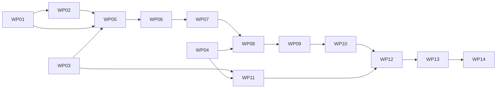

# Work Packages: hn serve, a governed local Git server

**Mission**: `hn-serve-01M5P0NP` | **Planning base and merge target**: `mission/hn-serve`
**Inputs**: [spec.md](spec.md), [plan.md](plan.md), [research.md](research.md), [data-model.md](data-model.md), [quickstart.md](quickstart.md), [contracts/](contracts/)
**Generated**: 2026-10-25T00:09:18Z, non-interactively, with every planning decision delegated to the tasks agent.

The plan's implementation concern map (IC-01 to IC-07) is cut into 14 work packages of 5 to 7 subtasks each. Each work package lands with its own tests and its own documentation, as HN-005 and C-008 require. LFS (IC-07) is the last work package, nothing depends on it, and it can move to its own mission without blocking FR-001 to FR-019 or FR-022 to FR-023 (C-010).

## Concern to work package map

| Concern | Work packages |
|----|----|
| IC-01 Server state, key registry and administration | WP01, WP02, WP05 |
| IC-02 Forced-command session wrapper | WP06 |
| IC-03 Push verdict for non-protected ref classes | WP03 (rejection-line protocol), WP04 (validator seams), WP07, WP08 |
| IC-04 Protected-branch governance and destination policy | WP04 (policy seam), WP09 |
| IC-05 Advancement request and fast-forward merge fact | WP10 |
| IC-06 Fact advertisement and all-trusted selection | WP03 (marker and identification), WP11, WP12 |
| Cross-cutting documentation and quality evidence | every WP for its own surface, consolidated in WP13 |
| IC-07 Git LFS transfer and quota | WP14 (last, separable) |

## Dependency graph and lanes

Expected lanes (computed by `finalize-tasks` from ownership; the values in `lanes.json` are authoritative):

- **lane-a (server)**: WP01, WP02, WP05, WP06, WP07, WP08, WP09, WP10, WP12, WP13, WP14. These share `docs/serve-v0.md` and a few `serve_*.go` files in strict dependency order, so they run in one worktree.
- **lane-b (client and validators)**: WP04, then WP11. They share `quarantine.go` in dependency order.
- **lane-c (protocol)**: WP03 alone.

WP03 and WP04 start immediately, in parallel with WP01. WP11 runs in parallel with WP05 to WP10. WP12 is the fan-in point.

## File ownership

No two work packages that can run at the same time own the same file. A file listed for several work packages is edited by them in dependency order, and each later owner changes only the part named in its prompt.

| File | Owners (in order) | What each owner changes |
|----|----|----|
| `main.go` | WP01, WP10 | WP01 routes `serve` and adds the three `hn serve` usage lines; WP10 adds the `hn merge PROPOSAL --remote` usage line |
| `serve_commands.go` | WP01, WP05, WP06, WP07 | WP01 creates the dispatcher; each later owner adds the one `case` for its subcommand |
| `serve_state.go` | WP01 | |
| `serve_keys.go` | WP02 | |
| `serve_reasons.go`, `serve_wire.go` | WP03 | |
| `policy.go` | WP04 | |
| `quarantine.go` | WP04, WP11 | WP04 adds the server validation seams; WP11 adds all-trusted request resolution and the `not-advertised` status |
| `serve_admin.go` | WP05 | |
| `serve_harness_test.go` | WP05, WP06 | WP05 creates server-home helpers; WP06 adds the SSH shim and client helpers |
| `serve_session.go` | WP06, WP14 | WP14 replaces only the `git-lfs-transfer` refusal arm |
| `serve_hooks.go` | WP07 | |
| `serve_verdict.go` | WP07, WP08, WP09 | WP07 creates the framework with fail-closed placeholder arms; WP08 and WP09 replace their arms |
| `serve_verdict_facts.go` | WP08 | |
| `serve_protected.go` | WP09 | |
| `serve_client.go`, `governance.go` | WP10 | |
| `replication.go` | WP11 | |
| `commands.go` | WP03, WP11 | WP03 routes only the three `git push` calls in `publishLocalFacts` through `servePushRef`; WP11 adds the `hn sync` identification recheck and output line |
| `serve_lfs.go` | WP14 | |
| `docs/serve-v0.md` | WP01, WP02, WP05, WP06, WP07, WP08, WP09, WP10, WP12, WP13, WP14 | Each owner writes the section named in its prompt |
| `docs/threat-model.md` | WP06, WP13, WP14 | WP06 adds the server trust boundary; WP13 consolidates verdict and client trust; WP14 adds LFS |
| `docs/protocol-v0.md` | WP03 | |
| `docs/governance-v0.md` | WP04 | |
| `docs/replication-v0.md` | WP11 | |
| `README.md` | WP05 | |
| Test files | one owner each | `serve_state_test.go` WP01, `serve_keys_test.go` WP02, `serve_reasons_test.go` WP03, `validation_seams_test.go` WP04, `serve_admin_test.go` WP05, `serve_session_test.go` WP06, `serve_push_test.go` WP07, `serve_facts_test.go` WP08, `serve_protected_test.go` WP09, `serve_advance_test.go` WP10, `replication_all_trusted_test.go` WP11, `serve_replication_test.go` WP12, `serve_quality_test.go` and `serve_sshd_test.go` WP13, `serve_lfs_test.go` WP14 |

All test files share `package main`, so every test helper name must be unique across the package. Prefix new helpers with the file's concern (`serveState...`, `serveKeys...`, `serveHarness...`, and so on).

## Subtask Index

| ID | Description | WP | Parallel |
|----|----|----|----|
| T001 | `cmdServe` dispatcher, uid-0 refusal, `main.go` route and usage | WP01 | |
| T002 | Server home layout resolution and fail-closed layout validation | WP01 | |
| T003 | Key registry types, decoding, encoding and invariants | WP01 | [P] |
| T004 | Repository config and branch-owner records | WP01 | [P] |
| T005 | Push log append and flock repository locks | WP01 | [P] |
| T006 | Hook script generation and validation | WP01 | |
| T007 | State unit tests and the serve guide skeleton with the state layout section | WP01 | |
| T008 | OpenSSH public key parsing | WP02 | |
| T009 | SHA256 fingerprints and fingerprint syntax | WP02 | |
| T010 | Managed `authorized_keys` line rendering | WP02 | |
| T011 | Managed block merge that preserves outside lines byte for byte | WP02 | |
| T012 | Safe write of `$HOME/.ssh/authorized_keys` | WP02 | |
| T013 | Key unit tests and the serve guide section on key bindings | WP02 | |
| T014 | Reason-code catalogue | WP03 | [P] |
| T015 | `hn-serve/1` rejection line rendering and sanitization | WP03 | |
| T016 | Strict line parser and client stderr extraction | WP03 | |
| T017 | Server marker constants, push option names and remote identification | WP03 | [P] |
| T018 | Protocol unit tests | WP03 | |
| T019 | `docs/protocol-v0.md` serve wire section | WP03 | |
| T020 | Extract `evaluateProposalUnderPolicy` from `evaluateProposal` | WP04 | [P] |
| T021 | Destination evaluation semantics: base digest, destination lists, destination-only pipelines | WP04 | |
| T022 | Range variant of quarantined actor validation | WP04 | [P] |
| T023 | Dependency check option for an absent proposal code ref | WP04 | |
| T024 | Prove a fast-forward `proposal.merged` fact validates unchanged | WP04 | |
| T025 | Seam unit tests and unchanged existing tests | WP04 | |
| T026 | `docs/governance-v0.md`: destination policy and fast-forward merge facts | WP04 | |
| T027 | `hn serve key add`, `remove` and `list` | WP05 | |
| T028 | `hn serve repo create` | WP05 | |
| T029 | `hn serve repo list` and `show` | WP05 | [P] |
| T030 | `hn serve repo set` | WP05 | |
| T031 | `hn serve repo lock-exec` | WP05 | [P] |
| T032 | Administration black-box tests and server-home harness | WP05 | |
| T033 | Serve guide administration section, tested examples, README link | WP05 | |
| T034 | `SSH_ORIGINAL_COMMAND` grammar parser | WP06 | [P] |
| T035 | `hn serve git --key` checks and refusal lines | WP06 | |
| T036 | Environment built from scratch and Git execution | WP06 | |
| T037 | Push lock with wait budget, fetch without lock, LFS refusal seam | WP06 | |
| T038 | SSH command shim and client helpers in the harness | WP06 | |
| T039 | Session black-box tests | WP06 | |
| T040 | Serve guide connection section and threat-model trust boundary | WP06 | |
| T041 | `hn serve hook pre-receive` and `post-receive` entry checks | WP07 | |
| T042 | Ref update and push option parsing | WP07 | |
| T043 | Ref classification, verdict context and all-or-nothing aggregation | WP07 | |
| T044 | Tag, ordinary branch and reserved ref rules | WP07 | |
| T045 | Branch-owner recording and push log | WP07 | |
| T046 | Push framework black-box tests | WP07 | |
| T047 | Serve guide section on ref classes, branches, tags and the push log | WP07 | |
| T048 | Actor chain rule | WP08 | |
| T049 | Proposal ref rule | WP08 | |
| T050 | Memory ref rule | WP08 | [P] |
| T051 | Wire fact rules into the verdict and share in-push facts | WP08 | |
| T052 | Fact-ref black-box tests including budgets | WP08 | |
| T053 | Serve guide section on Hubnot fact refs and budgets | WP08 | |
| T054 | Protected checks 1 to 5: deletion, creation, expected tip, destination policy, fast-forward | WP09 | |
| T055 | Candidate lookup, base policy, code ref and blocked checks (6 to 9) | WP09 | |
| T056 | Base and destination readiness, missing kinds, maintainer check, multi-candidate rule (10 to 12) | WP09 | |
| T057 | Wire the protected arm into the verdict | WP09 | |
| T058 | Governed proposal fixture builder | WP09 | |
| T059 | Protected-branch black-box tests | WP09 | |
| T060 | Serve guide protected-branch and recovery sections | WP09 | |
| T061 | `hn merge PROPOSAL --remote REMOTE [--branch BRANCH]` parsing and usage | WP10 | |
| T062 | Advancement steps 1 to 4 | WP10 | |
| T063 | Advancement steps 5 to 7 | WP10 | |
| T064 | Advancement steps 8 and 9 | WP10 | |
| T065 | Advancement black-box tests and interruption table | WP10 | |
| T066 | NFR-005 race test | WP10 | |
| T067 | Serve guide advancement section with tested example | WP10 | |
| T068 | `AllTrusted` selection field, validation and select-time identification | WP11 | |
| T069 | `hn replication show` all-trusted line | WP11 | [P] |
| T070 | All-trusted request resolution and `not-advertised` status | WP11 | |
| T071 | `hn sync` identification recheck and output | WP11 | |
| T072 | All-trusted client tests against ordinary remotes | WP11 | |
| T073 | `docs/replication-v0.md` all-trusted section with tested example | WP11 | |
| T074 | FR-017 advertisement and identification through the shim | WP12 | |
| T075 | US4-1 runner discovery and execution | WP12 | |
| T076 | US4-2 unpublished actor and FR-019 parity against hn serve | WP12 | |
| T077 | SC-004 Phase 0 flow end to end | WP12 | |
| T078 | Serve guide section for runners and verifiers | WP12 | |
| T079 | Documented-example coverage guard | WP13 | |
| T080 | NFR-001 verdict timing | WP13 | |
| T081 | NFR-004 written-path audit and NFR-008 mode audit | WP13 | |
| T082 | Real unprivileged sshd round trip | WP13 | |
| T083 | Requirement traceability and brief acceptance examples | WP13 | |
| T084 | `docs/threat-model.md` consolidation | WP13 | |
| T085 | Full regression gate and pre-existing test audit | WP13 | |
| T086 | pkt-line reader and writer | WP14 | |
| T087 | LFS session protocol, batch and session dispatch | WP14 | |
| T088 | Staged uploads, verification, verify-object and get-object | WP14 | |
| T089 | LFS quota checks and staged-file cleanup | WP14 | |
| T090 | LFS black-box tests | WP14 | |
| T091 | Serve guide LFS section and threat-model LFS paragraph | WP14 | |

---

## Phase 1: Foundations

### WP01: Server state foundation and the `hn serve` entry point

**Prompt**: [tasks/WP01-server-state-foundation.md](tasks/WP01-server-state-foundation.md) | **Priority**: P1 | **Concern**: IC-01 | **Estimated prompt size**: 393 lines (dense prose)
**Goal**: every `hn serve` subcommand refuses uid 0, resolves one fixed server home, and validates the whole state layout before it does anything, with typed and fail-closed access to the registry, repository config, branch owners, push log, locks and hook scripts.
**Independent test**: `go test -run 'TestServeState' ./...` exercises every defect in `contracts/server-state.md` against a temporary `HOME`.
**Requirements**: FR-001, FR-003, NFR-004, NFR-008, C-001, C-003.

T001 `cmdServe` dispatcher, uid-0 refusal, `main.go` route and usage (WP01)
T002 Server home layout resolution and fail-closed layout validation (WP01)
T003 Key registry types, decoding, encoding and invariants (WP01)
T004 Repository config and branch-owner records (WP01)
T005 Push log append and flock repository locks (WP01)
T006 Hook script generation and validation (WP01)
T007 State unit tests and the serve guide skeleton with the state layout section (WP01)

**Implementation sketch**: dispatcher and uid check first, then layout and validation, then the three JSON records, then locks and push log, then hook scripts, then tests and the guide skeleton.
**Parallel opportunities**: T003, T004 and T005 touch separate types in `serve_state.go` and can be drafted together.
**Dependencies**: none.
**Risks**: validation that is too strict blocks administration commands that must regenerate hooks; the prompt defines the regeneration order.

### WP02: SSH public keys and the managed authorized_keys block

**Prompt**: [tasks/WP02-ssh-keys-authorized-keys.md](tasks/WP02-ssh-keys-authorized-keys.md) | **Priority**: P1 | **Concern**: IC-01 | **Estimated prompt size**: 259 lines (dense prose)
**Goal**: parse OpenSSH public keys, compute `SHA256:` fingerprints identical to `ssh-keygen -l -E sha256`, render the managed block, and rewrite `authorized_keys` while preserving every outside byte.
**Independent test**: `go test -run 'TestServeKeys' ./...`, including a cross-check against `ssh-keygen` when it is installed.
**Requirements**: FR-003, FR-004, C-002, C-003.

T008 OpenSSH public key parsing (WP02)
T009 SHA256 fingerprints and fingerprint syntax (WP02)
T010 Managed `authorized_keys` line rendering (WP02)
T011 Managed block merge that preserves outside lines byte for byte (WP02)
T012 Safe write of `$HOME/.ssh/authorized_keys` (WP02)
T013 Key unit tests and the serve guide section on key bindings (WP02)

**Implementation sketch**: pure parsing and rendering functions first, then the merge, then the one disk-writing function, then tests and docs.
**Parallel opportunities**: T008 to T010 are independent pure functions.
**Dependencies**: WP01 (the serve guide skeleton it extends).
**Risks**: line-ending and missing-final-newline preservation; the prompt lists golden cases.

### WP03: Rejection-line protocol, server marker and remote identification

**Prompt**: [tasks/WP03-rejection-protocol-and-marker.md](tasks/WP03-rejection-protocol-and-marker.md) | **Priority**: P1 | **Concern**: IC-03 and IC-06 shared protocol | **Estimated prompt size**: 241 lines (dense prose)
**Goal**: one shared vocabulary for server and client: the reason-code catalogue, `hn-serve/1` line rendering and parsing, the marker ref and blob, push option names, and the client check that a remote identifies as `hn serve`.
**Independent test**: `go test -run 'TestServeReasons|TestServeWire' ./...` round-trips every code and the contract's worked example.
**Requirements**: FR-013, FR-017, C-008.

T014 Reason-code catalogue (WP03)
T015 `hn-serve/1` rejection line rendering and sanitization (WP03)
T016 Strict line parser and client stderr extraction (WP03)
T017 Server marker constants, push option names and remote identification (WP03)
T018 Protocol unit tests (WP03)
T019 `docs/protocol-v0.md` serve wire section (WP03)

**Implementation sketch**: catalogue, renderer, parser, wire constants and identification, then tests, then protocol notes.
**Parallel opportunities**: the whole WP runs in parallel with WP01, WP02 and WP04.
**Dependencies**: none.
**Risks**: a parser that is looser than the renderer lets clients accept malformed lines; tests must reject every grammar violation.

### WP04: Validation seams for destination policy and server-side actor checks

**Prompt**: [tasks/WP04-validation-seams.md](tasks/WP04-validation-seams.md) | **Priority**: P1 | **Concern**: IC-03 and IC-04 prerequisites | **Estimated prompt size**: 291 lines (dense prose)
**Goal**: behavior-preserving changes to `policy.go` and `quarantine.go` that let the server evaluate a proposal under any policy, re-validate only the appended range of an actor chain, and accept a candidate whose code ref arrives in a later push.
**Independent test**: `go test -run 'TestValidationSeams' ./...` plus the unchanged existing suite.
**Requirements**: FR-007, FR-008, FR-015, C-004, C-006.

T020 Extract `evaluateProposalUnderPolicy` from `evaluateProposal` (WP04)
T021 Destination evaluation semantics: base digest, destination lists, destination-only pipelines (WP04)
T022 Range variant of quarantined actor validation (WP04)
T023 Dependency check option for an absent proposal code ref (WP04)
T024 Prove a fast-forward `proposal.merged` fact validates unchanged (WP04)
T025 Seam unit tests and unchanged existing tests (WP04)
T026 `docs/governance-v0.md`: destination policy and fast-forward merge facts (WP04)

**Implementation sketch**: policy extraction with tests, then quarantine range variant, then the dependency option, then the merge-fact proof, then the governance guide.
**Parallel opportunities**: the whole WP runs in parallel with WP01 to WP03; T020 and T022 touch different files.
**Dependencies**: none.
**Risks**: `evaluateProposal` backs `hn proposal status`, `hn decide` and `hn merge`; existing tests must pass without assertion changes (NFR-007).

---

## Phase 2: Hosting and sessions

### WP05: Repository and key administration commands

**Prompt**: [tasks/WP05-repository-and-key-administration.md](tasks/WP05-repository-and-key-administration.md) | **Priority**: P1 | **Concern**: IC-01 | **Estimated prompt size**: 283 lines (dense prose)
**Goal**: the administrator can create, list, show and configure hosted repositories, bind and unbind SSH keys, and run recovery commands under the repository lock, with `authorized_keys` rewritten after every registry change.
**Independent test**: `go test -run 'TestServeAdmin' ./...` drives the built `hn` binary against a temporary server home.
**Requirements**: FR-002, FR-003, FR-004, FR-023, NFR-008.

T027 `hn serve key add`, `remove` and `list` (WP05)
T028 `hn serve repo create` (WP05)
T029 `hn serve repo list` and `show` (WP05)
T030 `hn serve repo set` (WP05)
T031 `hn serve repo lock-exec` (WP05)
T032 Administration black-box tests and server-home harness (WP05)
T033 Serve guide administration section, tested examples, README link (WP05)

**Implementation sketch**: key commands first (they exercise WP01 and WP02 end to end), then repository creation, inspection, settings and recovery, then tests and docs.
**Parallel opportunities**: T029 and T031 are independent once T028 exists.
**Dependencies**: WP01, WP02, WP03.
**Risks**: a failed `repo create` must leave nothing behind; the prompt defines staging and rollback.

### WP06: Forced-command session wrapper and SSH test harness

**Prompt**: [tasks/WP06-forced-command-session.md](tasks/WP06-forced-command-session.md) | **Priority**: P1 | **Concern**: IC-02 | **Estimated prompt size**: 277 lines (dense prose)
**Goal**: `hn serve git --key FINGERPRINT` accepts exactly Git fetch and Git push for one hosted repository, attributes the session to the mapped actor, serializes pushes under the repository lock, and starts Git with server-controlled configuration and a rebuilt environment.
**Independent test**: `go test -run 'TestServeSession' ./...` clones and fetches through a shim that runs the exact forced command from the generated `authorized_keys`.
**Requirements**: FR-005, FR-006, FR-022, NFR-003, NFR-004, C-002, C-009.

T034 `SSH_ORIGINAL_COMMAND` grammar parser (WP06)
T035 `hn serve git --key` checks and refusal lines (WP06)
T036 Environment built from scratch and Git execution (WP06)
T037 Push lock with wait budget, fetch without lock, LFS refusal seam (WP06)
T038 SSH command shim and client helpers in the harness (WP06)
T039 Session black-box tests (WP06)
T040 Serve guide connection section and threat-model trust boundary (WP06)

**Implementation sketch**: grammar, ordered checks, environment and exec, lock, then the harness shim, tests and docs.
**Parallel opportunities**: T034 is a pure function that can be written and tested first.
**Dependencies**: WP05.
**Risks**: Git invokes the shim with differing argument shapes for fetch and push (see research spike); a client must never influence `HN_SERVE_ACTOR`.

---

## Phase 3: Push verdict (User Story 1, P1)

### WP07: Hook entry points and push verdict framework

**Prompt**: [tasks/WP07-hook-and-verdict-framework.md](tasks/WP07-hook-and-verdict-framework.md) | **Priority**: P1 | **Concern**: IC-03 | **Estimated prompt size**: 250 lines (dense prose)
**Goal**: `pre-receive` classifies every ref update, applies the tag, ordinary-branch and reserved-ref rules, rejects the whole push when any ref fails with one `hn-serve/1` line per failing ref, and `post-receive` records branch owners and the push log.
**Independent test**: `go test -run 'TestServePush' ./...` pushes through the shim and asserts byte-identical refs after every rejection.
**Requirements**: FR-006, FR-010, FR-011, FR-012, FR-013, NFR-003.

T041 `hn serve hook pre-receive` and `post-receive` entry checks (WP07)
T042 Ref update and push option parsing (WP07)
T043 Ref classification, verdict context and all-or-nothing aggregation (WP07)
T044 Tag, ordinary branch and reserved ref rules (WP07)
T045 Branch-owner recording and push log (WP07)
T046 Push framework black-box tests (WP07)
T047 Serve guide section on ref classes, branches, tags and the push log (WP07)

**Implementation sketch**: hook entry, input parsing, classification and aggregation with placeholder arms for actor, proposal, memory and protected refs, then the simple class rules, then post-receive bookkeeping, then tests and docs.
**Parallel opportunities**: T044 and T045 are independent once T043 exists.
**Dependencies**: WP06.
**Risks**: objects from a rejected push must be unreachable afterwards; a test proves Git quarantine discarded them.

### WP08: Actor chain, proposal and memory ref rules

**Prompt**: [tasks/WP08-hubnot-fact-ref-rules.md](tasks/WP08-hubnot-fact-ref-rules.md) | **Priority**: P1 | **Concern**: IC-03 | **Estimated prompt size**: 210 lines (dense prose)
**Goal**: pushed Hubnot facts pass the same validation as replication import before they become visible: actor chains are owned, append-only, signed and complete; proposal refs equal their candidate's signed head and never move; memory refs belong to their actor and pass `hn-memory/0`; every ref stays inside the repository budgets.
**Independent test**: `go test -run 'TestServeFacts' ./...` covers US1-1, US1-3, US1-4, US1-5 and the NFR-002 budget boundary.
**Requirements**: FR-007, FR-010, FR-012, NFR-002, NFR-003, C-007.

T048 Actor chain rule (WP08)
T049 Proposal ref rule (WP08)
T050 Memory ref rule (WP08)
T051 Wire fact rules into the verdict and share in-push facts (WP08)
T052 Fact-ref black-box tests including budgets (WP08)
T053 Serve guide section on Hubnot fact refs and budgets (WP08)

**Implementation sketch**: actor rule on top of the WP04 seams, proposal and memory rules, wiring with the in-push fact set, then tests and docs.
**Parallel opportunities**: T050 is independent of T048 and T049.
**Dependencies**: WP07, WP04.
**Risks**: `hn sync` publishes the actor ref before the proposal ref in separate pushes; the code-ref exception must accept the first push and still reject a protected update without hosted code.

### WP09: Protected-branch governance under base and destination policy

**Prompt**: [tasks/WP09-protected-branch-governance.md](tasks/WP09-protected-branch-governance.md) | **Priority**: P1 | **Concern**: IC-04 | **Estimated prompt size**: 230 lines (dense prose)
**Goal**: a protected branch moves only by fast-forward to the signed head of a proposal that is ready and accepted under both its base policy and the destination policy, carries the required trusted CI, and is not blocked.
**Independent test**: `go test -run 'TestServeProtected' ./...` covers US1-2, US3-4, US3-5 and the protected-branch fixture set for SC-003.
**Requirements**: FR-008, FR-009, FR-012, FR-013, FR-022, C-004, C-005, C-006.

T054 Protected checks 1 to 5: deletion, creation, expected tip, destination policy, fast-forward (WP09)
T055 Candidate lookup, base policy, code ref and blocked checks (6 to 9) (WP09)
T056 Base and destination readiness, missing kinds, maintainer check, multi-candidate rule (10 to 12) (WP09)
T057 Wire the protected arm into the verdict (WP09)
T058 Governed proposal fixture builder (WP09)
T059 Protected-branch black-box tests (WP09)
T060 Serve guide protected-branch and recovery sections (WP09)

**Implementation sketch**: follow the contract's step table in order, then wire it, build the fixture, test every step and document.
**Parallel opportunities**: T058 can be drafted alongside T054 to T056.
**Dependencies**: WP08.
**Risks**: a destination-only pipeline must be loaded at the head and its absence must reject with `missing=ci`.

---

## Phase 4: Advancement (User Story 3, P1)

### WP10: Advancement request and fast-forward merge fact

**Prompt**: [tasks/WP10-advancement-and-merge-fact.md](tasks/WP10-advancement-and-merge-fact.md) | **Priority**: P1 | **Concern**: IC-05 | **Estimated prompt size**: 235 lines (dense prose)
**Goal**: `hn merge PROPOSAL --remote REMOTE` publishes the maintainer's facts, asks the server to fast-forward the protected branch to the tested head, and records `proposal.merged` with its result commit equal to that head, exactly once even after interruption.
**Independent test**: `go test -run 'TestServeAdvance' ./...` covers US3-1, US3-2, US3-3, US3-6, the interruption table and NFR-005.
**Requirements**: FR-014, FR-015, FR-016, NFR-005, NFR-006, C-005.

T061 `hn merge PROPOSAL --remote REMOTE [--branch BRANCH]` parsing and usage (WP10)
T062 Advancement steps 1 to 4 (WP10)
T063 Advancement steps 5 to 7 (WP10)
T064 Advancement steps 8 and 9 (WP10)
T065 Advancement black-box tests and interruption table (WP10)
T066 NFR-005 race test (WP10)
T067 Serve guide advancement section with tested example (WP10)

**Implementation sketch**: flag parsing that leaves the existing path untouched, then the nine contract steps, then tests, race test and docs.
**Parallel opportunities**: T066 can be written while T065 is in review.
**Dependencies**: WP09.
**Risks**: Git prefixes relayed hook output with `remote: ` and pads it; the client must parse lines with the WP03 extractor.

---

## Phase 5: Fan-out (User Story 4, P2)

### WP11: All-trusted selection on the client

**Prompt**: [tasks/WP11-all-trusted-selection.md](tasks/WP11-all-trusted-selection.md) | **Priority**: P2 | **Concern**: IC-06 | **Estimated prompt size**: 201 lines (dense prose)
**Goal**: `hn replication select REMOTE --all-trusted` saves a mode that imports every advertised actor chain and proposal from an identified `hn serve` remote, while every ref still passes client quarantine and validation and existing selections behave exactly as before.
**Independent test**: `go test -run 'TestReplicationAllTrusted' ./...` against ordinary bare remotes with and without a hand-written marker.
**Requirements**: FR-017, FR-018, FR-019, NFR-006, C-008.

T068 `AllTrusted` selection field, validation and select-time identification (WP11)
T069 `hn replication show` all-trusted line (WP11)
T070 All-trusted request resolution and `not-advertised` status (WP11)
T071 `hn sync` identification recheck and output (WP11)
T072 All-trusted client tests against ordinary remotes (WP11)
T073 `docs/replication-v0.md` all-trusted section with tested example (WP11)

**Implementation sketch**: selection storage and validation, show output, request resolution, sync behavior, tests, docs.
**Parallel opportunities**: the whole WP runs in parallel with WP05 to WP10.
**Dependencies**: WP03, WP04.
**Risks**: existing selection files and show output must stay byte-identical (FR-019, NFR-007).

### WP12: Fan-out against hn serve and the Phase 0 flow

**Prompt**: [tasks/WP12-fan-out-and-phase0-flow.md](tasks/WP12-fan-out-and-phase0-flow.md) | **Priority**: P2 | **Concern**: IC-06 | **Estimated prompt size**: 180 lines (dense prose)
**Goal**: prove end to end that a runner or verifier discovers new work from a real hosted repository without selecting it, and that the rust-pingpong Phase 0 flow completes with no actor or proposal selection and no direct push of `main`.
**Independent test**: `go test -run 'TestServeReplication' ./...`.
**Requirements**: FR-017, FR-018, FR-019, NFR-006.

T074 FR-017 advertisement and identification through the shim (WP12)
T075 US4-1 runner discovery and execution (WP12)
T076 US4-2 unpublished actor and FR-019 parity against hn serve (WP12)
T077 SC-004 Phase 0 flow end to end (WP12)
T078 Serve guide section for runners and verifiers (WP12)

**Implementation sketch**: advertisement test, discovery test, parity test, the full Phase 0 flow, then docs.
**Parallel opportunities**: T074 to T076 are independent tests.
**Dependencies**: WP10, WP11.
**Risks**: a participant without a key binding cannot publish; the fixture binds a key for every participant, runners included.

---

## Phase 6: Quality evidence

### WP13: Quality evidence, real sshd round trip and threat model

**Prompt**: [tasks/WP13-quality-evidence-and-threat-model.md](tasks/WP13-quality-evidence-and-threat-model.md) | **Priority**: P1 | **Concern**: cross-cutting | **Estimated prompt size**: 212 lines (dense prose)
**Goal**: measured evidence for NFR-001 and NFR-004, one real OpenSSH round trip, a guard that every documented example is executed, requirement traceability, the consolidated threat model, and a green regression gate on the integrated candidate.
**Independent test**: `go test -race -run 'TestServeQuality|TestServeSSHD' ./...`, then the full gate.
**Requirements**: FR-023, NFR-001, NFR-004, NFR-007, C-001, C-009, C-011.

T079 Documented-example coverage guard (WP13)
T080 NFR-001 verdict timing (WP13)
T081 NFR-004 written-path audit and NFR-008 mode audit (WP13)
T082 Real unprivileged sshd round trip (WP13)
T083 Requirement traceability and brief acceptance examples (WP13)
T084 `docs/threat-model.md` consolidation (WP13)
T085 Full regression gate and pre-existing test audit (WP13)

**Implementation sketch**: example guard, timing, path audit, sshd test, traceability, threat model, full gate.
**Parallel opportunities**: T080 to T082 are independent tests.
**Dependencies**: WP12.
**Risks**: the timing test must be stable on the gate host; the prompt fixes the fixture and the measurement.

---

## Phase 7: Large files (User Story 5, P3, separable)

### WP14: Git LFS transfer and quota

**Prompt**: [tasks/WP14-git-lfs-transfer-and-quota.md](tasks/WP14-git-lfs-transfer-and-quota.md) | **Priority**: P3 | **Concern**: IC-07 | **Estimated prompt size**: 208 lines (dense prose)
**Goal**: hosted repositories serve Git LFS uploads and downloads over `git-lfs-transfer`, verify content before it becomes downloadable, enforce the inclusive per-repository quota, and answer locking as unsupported.
**Independent test**: `go test -run 'TestServeLFS' ./...` with the Git LFS 3.x client through the shim.
**Requirements**: FR-020, FR-021, C-003, C-010.

T086 pkt-line reader and writer (WP14)
T087 LFS session protocol, batch and session dispatch (WP14)
T088 Staged uploads, verification, verify-object and get-object (WP14)
T089 LFS quota checks and staged-file cleanup (WP14)
T090 LFS black-box tests (WP14)
T091 Serve guide LFS section and threat-model LFS paragraph (WP14)

**Implementation sketch**: framing, then session commands, then storage, then quota, then tests and docs.
**Parallel opportunities**: none inside the WP; the WP itself is separable.
**Dependencies**: WP13 (scheduling only: LFS is last by mission rule C-010; technically it needs only WP06).
**Separability**: no WP depends on WP14. If it moves to its own mission, WP06's `git-lfs-transfer` refusal stays in place, FR-020 and FR-021 stay open, and every other requirement is unaffected.

---

## MVP and sequencing notes

- **MVP**: WP01 to WP09 close the direct-push bypass (US1, US2) and govern protected branches. WP10 completes US3.
- **Size check**: 14 WPs, 5 to 7 subtasks each, prompts of 180 to 393 lines with long, dense lines. No WP exceeds 10 subtasks or 700 lines.
- **Gate for every WP**: `gofmt -l .` prints nothing, `go vet ./...`, `go build ./...`, `go test -race ./...` and `git diff --check` pass, and no pre-existing test assertion changes (NFR-007).
