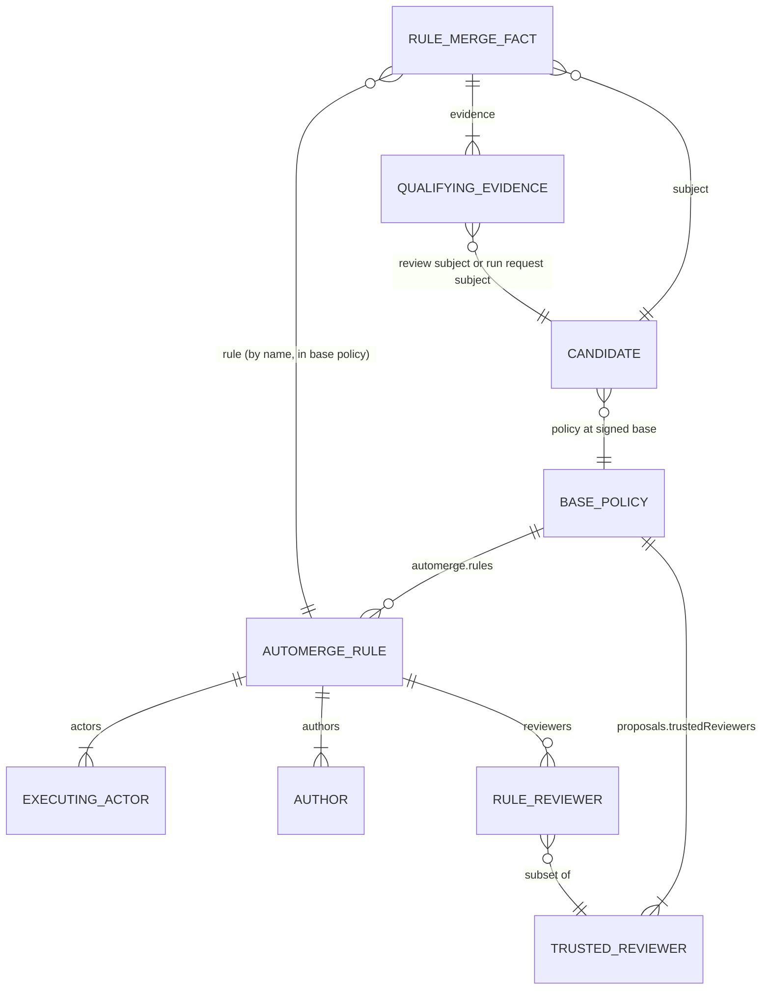

# Data Model: Standing acceptance for automerge rules

**Mission**: `standing-acceptance-01M5VD2K` | **Branch**: `feat/standing-acceptance`

This mission adds no storage and no event kind. It extends one policy entity, adds one optional field to one event kind, and adds in-memory evaluation values that every verifier computes in the same way. Names in `code` are the Go identifiers the plan proposes.

## Entity relationships



## Policy entities

### Automerge rule (changed)

`AutomergeRule` in `protected_checks.go`, one entry of `automerge.rules` in `.hn/policy.json`.

| Field | JSON | Type | Rule |
|----|----|----|----|
| `Name` | `name` | string | Existing. Rule-name grammar (`validPipelineName`), unique in the policy |
| `TargetBranch` | `targetBranch` | string | Existing. `validPolicyBranch` |
| `Actors` | `actors` | `[]string` | Existing. 1 to 64 distinct full fingerprints. Under acceptance mode `maintainers` each must be a base-policy maintainer; under `rule`, any actor |
| `Authors` | `authors` | `[]string` | Existing. 1 to 64 distinct full fingerprints |
| `Paths` | `paths` | `[]string` | Existing. 1 to 64 literal selectors (`validatePolicyPaths`). Under `rule`, none may be `.hn`, inside `.hn/`, or overlap a `protectedChecks.paths` selector |
| `Acceptance` | `acceptance` | `AutomergeAcceptance` | New, optional. Exactly `"maintainers"` or `"rule"`. Absent means `maintainers`. `null`, `""`, other strings and non-strings are refused |
| `Reviewers` | `reviewers` | `AutomergeReviewers` | New, optional. When present: 1 to 64 distinct full fingerprints, each in `proposals.trustedReviewers`, with at least `proposals.requiredApprovals` members. `null` and `[]` are refused. Allowed in both modes |

Policy-level rule, new: a policy that contains a rule with acceptance mode `rule` must have `proposals.requiredApprovals` of at least 1 (FR-004). The policy digest stays `eventID` of the exact file bytes, so adding or removing fields always changes the digest.

### Acceptance mode

`AutomergeAcceptance` (string kind). It decides two things: whether a merge under the rule needs maintainer acceptance decisions (`maintainers`), and whether the rule carries standing acceptance (`rule`). `func (a AutomergeAcceptance) Standing() bool` returns true only for `rule`.

### Rule reviewers

`AutomergeReviewers` (`[]string` kind). When the field is set, only approvals from these actors count toward the rule's approval threshold, in both modes. A current change request from any `proposals.trustedReviewers` actor still blocks execution, whether or not the actor is listed here. When the field is absent, the counting reviewers are `proposals.trustedReviewers`.

### Base policy and target policy (existing, newly compared on hn serve)

The base policy is `.hn/policy.json` at the candidate's signed base. The target policy is the file at the tip a merge would replace: the checked-out branch locally, and the destination tip on `hn serve`. Standing acceptance applies only when the two digests are equal.

## Event entities

### Rule merge fact (new shape of an existing kind)

A `proposal.merged` event that carries a canonical rule claim and is valid through path (b). The field is new; every other field already exists. No row below is a new parse-time refusal: decoding is unchanged, and a payload that does not meet the `rule` row simply carries no claim.

| Field | Meaning for a rule merge fact | Recognition rule |
|----|----|----|
| `kind` | `proposal.merged` | Existing |
| `actor`, `publicKey`, `sequence`, `previous`, `timestamp` | The executing actor's chain position | Existing |
| `subject` | Candidate event ID | Existing: full event ID |
| `policy` | Base policy digest | Existing: full event ID |
| `head` | Candidate's signed head | Existing: Git object ID; must equal the candidate head (`validateProposalMergeBinding`) |
| `commit` | Result commit: a two-parent merge commit (local) or the head itself (`hn serve` fast-forward) | Existing: Git object ID |
| `evidence` | Qualifying approval and passing run-result IDs, sorted, unique | Existing: unique full event IDs |
| `rule` | Name of the rule in the base policy | New, `Event.Rule` with `json:"-"`: set by `parseMergeRuleClaim` only on `proposal.merged`, only when exactly one top-level key equals `rule` under case folding, that key is spelled exactly `rule`, and its value is a JSON string matching the rule-name grammar. Any other shape leaves it empty |

### Acceptance merge fact (existing, unchanged)

A `proposal.merged` event valid through path (a): today's check passes, so a maintainer signed it and its evidence lists enough maintainer acceptance decisions. This holds whatever its `rule` field says. When it also carries a canonical rule claim, the claim is an unverified annotation that status may report and that never affects validity.

### Merge authority (verdict)

`admitMergeFact` returns `mergeByMaintainers` for a fact that passes path (a) and `mergeByRule` for a fact that fails path (a) and passes path (b). Status output, the publication-only rerun and the pre-sign self-check read it. A fact that passes neither is refused.

### Qualifying evidence

An event ID in a rule merge fact's `evidence` qualifies when it meets one of these two descriptions. Anything else fails path (b).

| Evidence kind | Qualifies when |
|----|----|
| Counting approval | `review.submit`, `subject` = candidate, `verdict` = `approve`, actor in `proposals.trustedReviewers`, actor in rule `reviewers` when set, and actor different from the candidate author under acceptance mode `rule` |
| Passing run result | `run.result`, `outcome` = `passed`, actor in the pipeline's `trustedRunners`; its `subject` is a `run.request` with `subject` = candidate, `commit` = head, `pipeline` in the base policy, `definition` = digest of `.hn/pipelines/<pipeline>.json` at the head, and a signer that is a maintainer or a listed requester of that pipeline (`mayRequestRun`) |

Cardinality: at most one counting approval per reviewer, and at most one passing result per trusted runner per pipeline. Threshold: the number of distinct counting reviewers is at least `proposals.requiredApprovals`, and for every pipeline the number of distinct passing runners is at least its `requiredResults`.

## Evaluation values (in memory)

### Rule inputs

`ruleInputs`, built by each caller from its own object access and passed to both pure functions.

| Field | Source |
|----|----|
| `Policy`, `PolicyDigest` | Base policy at `proposal.Event.Base` (`loadPolicy` locally, `loadReplicationPolicyAt` in quarantine and on the server) |
| `Proposal` | Candidate event |
| `RuleName` | Requested rule (CLI flag, `hn-rule` option, or the fact's `rule`) |
| `Changed` | Changed paths from base to head, computed once per fact, bounded by 8 MiB |
| `PipelineDefinitions` | Digest of each base-policy pipeline definition at the head |
| `ByID` / `Events` | Fact index (validation) or current event set (live evaluation) |

### Rule acceptance evaluation

`ruleAcceptance`, the result of `evaluateRuleAcceptance` (live).

| Field | Meaning |
|----|----|
| `Rule` | The matched rule, nil when absent from the base policy |
| `Standing` | True when acceptance mode is `rule` |
| `CountedReviewers` | Rule reviewers or trusted reviewers, sorted |
| `Approvals` | Current counting approvals |
| `Pipelines` | Per pipeline: required count, latest passing result per trusted runner, latest failing result per trusted runner |
| `Vetoes` | Current trusted change requests (any trusted reviewer), current trusted failures, current maintainer rejections, by event ID |
| `Unmet` | Ordered blocker sentences: missing rule, wrong mode for the request, target branch, author, path, policy or protected change, thresholds |
| `Evidence` | The exact evidence list a rule merge fact would carry |

### Rule fact verdict

`validateRuleMergeFact` returns nil or a `ruleFactError{Check string, EventID string, Detail string}`. `Check` is one of the stable names in [contracts/rule-merge-fact.md](contracts/rule-merge-fact.md#check-names). Callers wrap it in their existing error style, and `hn serve` renders it under `actor-chain-invalid`.

### Merge authority (client)

The rule authority carried in `proposalMergeGuard` for `hn automerge`. It holds the rule name and a function that, given the identity and a fresh evaluation, returns the `ruleAcceptance` or a refusal. With no authority, `mergeProposal` keeps its maintainer-acceptance checks.

### Advancement request (changed)

`servePushOptions` in the hook gains `Rule string`. `serveAdvanceBinding` on the client gains `Rule string`. A request with `Rule` set is a rule advancement request.

## Invariants

0. A `proposal.merged` fact is valid when path (a) passes or, failing that, when it carries a canonical rule claim and path (b) passes. Path (a) is today's check, unchanged. Every event that verified before the mission still verifies with the same meaning.
1. A fact is valid through path (b) on a verifier only if `validateRuleMergeFact` returns nil for its base policy, candidate base and head, and listed evidence. The verifier must hold both commits in one store, and only path (b) needs them.
2. A rule merge fact's signer is an executing actor of the named rule in the base policy, and the rule's acceptance mode is `rule`.
3. No rule with acceptance mode `rule` can authorize a change to `.hn/policy.json`, any `.hn/pipelines/*.json` required by policy, or any protected-check path. Validation forbids such selectors, and runtime refuses such changes in both modes.
4. Standing acceptance moves a branch only when the target policy digest equals the base policy digest.
5. A fact's validity never depends on events outside its evidence. Vetoes affect execution and advancement only.
6. Policies and repositories without `acceptance` and `reviewers` produce the same eligibility, refusals and facts as before the mission.
7. At every landing boundary, a surface without path (b) rejects every fact that only path (b) admits.

## Lifecycle of a candidate under a standing rule

```mermaid
stateDiagram-v2
    [*] --> Open: hn proposal open
    Open --> Blocked: missing approvals or results, veto, author or path outside rule
    Blocked --> Open: new evidence or veto withdrawn
    Open --> Eligible: evaluateRuleAcceptance passes, target equals base, target policy equals base policy
    Eligible --> Blocked: change request, failure or rejection arrives
    Eligible --> Advanced: native merge commit (local) or fast-forward (hn serve)
    Advanced --> Recorded: rule merge fact recorded after pre-sign self-check
    Advanced --> Advanced: interruption; rerun same hn automerge command (repair)
    Recorded --> Merged: fact published (local merges need no publication step)
    Recorded --> Recorded: interruption; rerun with --remote takes the publication-only path
    Open --> NeedsRevision: target moved or target policy changed
    NeedsRevision --> [*]: hn proposal revise (new candidate)
    Merged --> [*]
```

`Advanced` with no fact is the repair state. The same `hn automerge --execute` command, with the same `--remote` when one was used, records the fact once under the existing repair conditions: not merged, not rejected, the rule still satisfied by current evidence, and the executing actor still listed. `Recorded` is a remote rule merge whose fact exists locally but may not be on the server yet. The same command with `--remote` takes the publication-only path when the identity is an executing actor of the rule and signed that fact: it publishes or republishes the fact and confirms the hosted branch, and signs, records and advances nothing.

## Lifecycle of a standing rule

```mermaid
stateDiagram-v2
    [*] --> Drafted: maintainer edits .hn/policy.json
    Drafted --> Refused: hn policy check fails (FR-001 to FR-005)
    Drafted --> Proposed: hn proposal open (manual path only; automerge refuses policy amendments)
    Proposed --> Adopted: review, maintainer acceptance, hn merge
    Adopted --> Amended: later amendment narrows, removes or changes the rule
    Amended --> [*]
```



Adoption grants standing acceptance only to candidates whose signed base contains the adopting policy. An amendment takes effect for pending candidates at once, because their base policy digest no longer equals the target policy digest. Facts recorded under the earlier policy stay valid, because each fact is judged against its own base policy.
