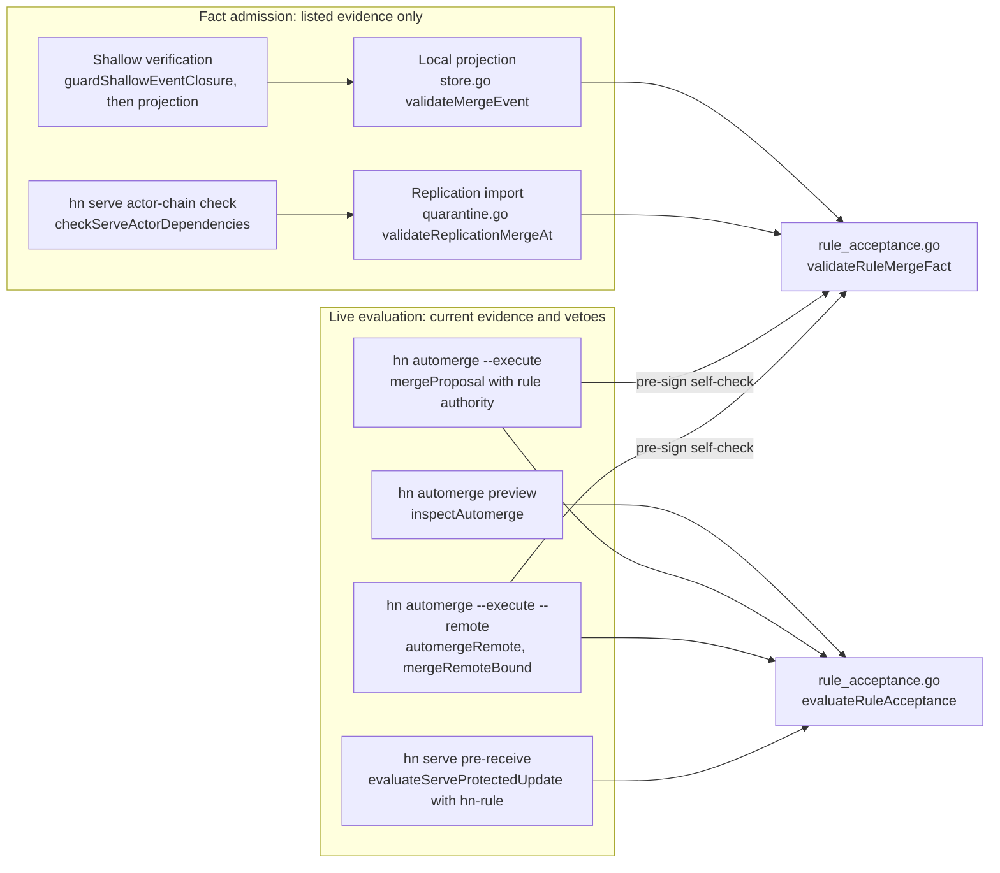

# Implementation Plan: Standing acceptance for automerge rules

**Branch**: `feat/standing-acceptance` (planning base and merge target) | **Date**: 2026-10-26 | **Spec**: [spec.md](spec.md)
**Input**: `kitty-specs/standing-acceptance-01M5VD2K/spec.md`, confirmed by the maintainer with OQ-1 to OQ-11 accepted as recommended (commit `c9c0194`).

Planning ran non-interactively. The maintainer delegated every remaining decision within the `.kittify` charter. Each choice the spec leaves open is recorded as a resolved plan-flow Decision Moment under `kitty-specs/standing-acceptance-01M5VD2K/decisions/` and summarized in [research.md](research.md). No planning question is deferred, so this plan carries no clarification markers.

## Summary

An automerge rule gains two optional fields. `acceptance` is either `maintainers` (the default, today's behavior) or `rule`. `reviewers` narrows which trusted reviewers' approvals count toward the rule. A rule with acceptance mode `rule` is the standing acceptance for every proposal that satisfies it: its executing actors need not be maintainers, and executing it requires no per-proposal `proposal.decision`. The executing actor records the existing `proposal.merged` event with a new optional `rule` field, and its `evidence` lists the qualifying approvals and passing run results instead of acceptance decisions.

All of the derivation lives in one new file, `rule_acceptance.go`, with two pure functions. `evaluateRuleAcceptance` judges current evidence, including vetoes, for the keyless preview, local execution and the `hn serve` protected-branch verdict. `validateRuleMergeFact` judges an immutable fact against only its listed evidence, for local event projection (`store.go`), replication import (`quarantine.go`, which the `hn serve` actor-chain check also calls) and, after the shallow dependency guard, shallow clones. The existing acceptance merge fact checks stay as they are and still run whenever `rule` is absent. On `hn serve`, an advancement request names the rule with a third push option, `hn-rule=NAME`. The server then evaluates the rule itself and requires the requester to be one of its executing actors. Direct pushes and advancement requests without `hn-rule` keep requiring maintainer acceptance.

## Technical Context

**Language/Version**: Go 1.26 (`go.mod` declares `go 1.26`; the quality-gate host runs go1.26.8 linux/amd64), existing module `hubnot`, flat root `package main`.
**Primary Dependencies**: Go standard library only, with no `go.mod` change. Runtime tools are already required: Git (2.53.0 on the gate host) for objects, diffs and the `hn serve` hooks, and OpenSSH only through the existing forced-command test harness.
**Storage**: No new storage. Policy stays in `.hn/policy.json` at the signed base commit, the new `proposal.merged` field travels in existing actor chains under `refs/hn/actors/*`, and `hn serve` state is unchanged.
**Testing**: Black-box Go tests that build the `hn` binary and drive the public `hn` and `git` CLIs against real temporary repositories, real temporary remotes and `hn serve` hosted repositories through the generated SSH command shim of `serve_harness_test.go`. Defective signed facts are built with the in-package `appendEvent` helper, or raw signed payloads where content validation would refuse the shape, as `serve_facts_test.go` and `automerge_test.go` already do. Every verdict is observed through the CLI. Unit tests cover the two pure functions and the decoders as contract coverage. Full gate: `gofmt -l .` empty, `go vet ./...`, `go build ./...`, `go test -race ./...`, `git diff --check`.
**Target Platform**: Every platform that runs `hn` and Git today. `hn serve` behavior applies to the Unix hosts that `docs/serve-v0.md` already supports.
**Project Type**: Single Go CLI application.
**Performance Goals**: NFR-006. Importing 20 rule merge facts into a repository of 1,000 events takes at most 1.5 times as long as importing 20 acceptance merge facts, at the 95th percentile over 20 runs. NFR-005 limits each fact to one changed-path computation, bounded by the existing 8 MiB limit, and changed paths and pipeline digests are memoized per `(base, head)` within one validation pass.
**Constraints**: Fail closed on every malformed or insufficient fact, policy and push (C-005). No new event kind, no re-encoding of signed bytes, and no change to the validity of historical facts (C-004). No edit to any existing test assertion (C-003). `hn serve` signs nothing (C-008). Policy amendments and protected-check changes always take the manual path (C-007).
**Scale/Scope**: Seven implementation concerns. One new source file (`rule_acceptance.go`), targeted changes to fourteen existing source files, eight new test files, and four updated documents.

## Charter Check

*GATE: checked before Phase 0 research and re-checked after Phase 1 design.*

The charter in `.kittify/charter/charter.md` and its five project directives apply directly. The table records how the design meets each one.

| Charter rule | How the plan satisfies it | Result |
|----|----|----|
| Go, standard library first, narrow interfaces | No new dependency. The rule derivation is one file of pure functions behind two entry points, and callers keep their own Git access. | Pass |
| HN-001 repository-native boundary | Standing acceptance is policy in the repository and a field in an existing signed event that Git transports. `hn serve` stays optional and only re-derives what every client derives. | Pass |
| HN-002 evidence integrity | A rule merge fact binds the candidate, head, result commit, base policy digest, rule name and the exact qualifying event IDs. Verifiers re-derive the rule from the base policy, the candidate's code and that evidence, and any non-qualifying item invalidates the fact. The client signs nothing it has not validated itself first (see [contracts/rule-merge-fact.md](contracts/rule-merge-fact.md)). | Pass |
| HN-003 hostile input and least authority | Every fact, policy and pushed ref is hostile. Unknown, misplaced, empty and case-variant `rule` keys are refused at parse time. An executing actor gains authority over exactly one named rule and nothing else (FR-019). A missing base or head commit becomes a missing dependency; it is never treated as an empty diff. | Pass |
| HN-004 immutable conflict recovery | No signed byte changes meaning. A changed target policy or a moved target sends the candidate to `hn proposal revise`, as automerge and `hn serve` already do. Interrupted merges record the missing fact once without a second merge. | Pass |
| HN-005 protocol and docs move together | `docs/governance-v0.md`, `docs/protocol-v0.md`, `docs/serve-v0.md` and `docs/threat-model.md` change in the concern that changes the behavior, and their examples are executed by tests (FR-023). | Pass |
| Quality gates and black-box tests | Acceptance tests drive only `hn`, `git` and the `hn serve` forced command. Every pre-existing test keeps its assertions (NFR-004), including the three that pin `hn serve` catalogues and traceability IDs (see Complexity Tracking). | Pass |
| DIRECTIVE_024 locality | Existing files change only where a rule must be honored: one branch at the top of each merge-fact validator, one authority hook in `mergeProposal`, one option in the push-option parser, and rule steps in the protected verdict. | Pass |
| DIRECTIVE_044 canonical sources | The rule derivation has one home. The acceptance-fact duplication that already exists between `store.go` and `quarantine.go` is left as is, because consolidating it would change error text that existing tests read. | Pass with one recorded tension |

**Post-design re-check**: the Phase 1 contracts add no dependency, no service, no new event kind and no new ref namespace. The protocol-relevant changes are the optional `rule` field of `proposal.merged`, the rule evidence semantics, the `hn-rule` push option and three reason codes. All four are documented in the contracts and assigned to documentation updates in IC-02 and IC-06. The gate still passes.

**Supply-chain check**: the plan adds, upgrades and removes no dependency in any ecosystem. Registry authenticity, package freshness and lifecycle-script review have nothing to examine, and no adversarial-squad pass is required for dependency decisions. The trust-design challenge that was performed is recorded in [research.md](research.md#adversarial-evidence).

## Complexity Tracking

| Violation | Why needed | Simpler alternative rejected because |
|----|----|----|
| Two `hn serve` reason catalogues (`serveReasonCatalogue` and a new `serveRuleReasonCatalogue`) and two documented reason tables in `docs/protocol-v0.md` | `TestServeReasonsCatalogueOrderAndLookups` pins the exact catalogue list with `reflect.DeepEqual`, and `TestServeReasonsDocsTableMatchesCatalogue` compares that list with the first documented table. C-003 forbids editing either assertion, and FR-016 names three new codes. | Appending to the existing catalogue fails the pinned assertion. Reusing existing codes contradicts FR-016. A new test keeps the two catalogues disjoint and each table equal to its catalogue, and `serveReasonLookup` consults both, so every runtime caller sees one set of codes. |

## Architecture

### Where the rule derivation is called from



The two functions share one set of helpers for counting approvals, qualifying run results and checking authors, paths, policy files and protected-check paths. `evaluateRuleAcceptance` also reports vetoes and the evidence set to sign. `validateRuleMergeFact` reports the first failed check by a stable check name (see [contracts/rule-merge-fact.md](contracts/rule-merge-fact.md)). Neither function runs Git. Callers supply the base policy, its digest, changed paths and pipeline definition digests through their existing object access: the working repository for local commands, quarantine plus accepted store for import, and the hosted repository inside Git's quarantine environment for `hn serve`.

### Rule advancement through hn serve

```mermaid
sequenceDiagram
    participant E as Executing actor client (hn automerge --execute --remote)
    participant S as hn serve (pre-receive verdict)
    E->>E: preview checks rule locally (keyless inspection)
    E->>S: hn sync: publish own facts, import hosted facts
    E->>E: inspect rule again against imported facts
    E->>S: push +H:refs/heads/main -o hn-advance=C -o hn-expected-tip=T -o hn-rule=NAME
    S->>S: steps 1-9 unchanged (stale tip, policy, fast-forward, candidate, code, blocked)
    S->>S: step 7a destination digest equals base digest
    S->>S: step 10 evaluateRuleAcceptance (vetoes, author, paths, thresholds)
    S->>S: step 12 protected baseline; step 13 requester is executing actor of NAME
    alt every check holds
      S-->>E: ok, main = H
      E->>E: build rule merge fact (commit = H), self-check with validateRuleMergeFact, sign
      E->>S: publish actor chain; actor-chain check runs validateRuleMergeFact
    else any check fails
      S-->>E: hn-serve/1 reject line (protected-rule-veto, protected-rule-not-satisfied, advance-not-rule-executor, ...)
    end
```

### Changes to existing code

Each row names the exact function the change touches. The mapping answers the instruction to ground the plan in the current code.

| File and function | Today | Change |
|----|----|----|
| `protected_checks.go` `AutomergeRule`, `validateOptionalPolicy` | Rule has five fields; every `actors` entry must be a maintainer (lines 84 to 88) | Add `Acceptance AutomergeAcceptance` and `Reviewers AutomergeReviewers`. Keep the maintainer requirement for acceptance mode `maintainers` only. Add FR-003 path safety, FR-004 and FR-005 checks. |
| `protected_checks.go` `validateProtectedDecisionAt` | Inlines the one-complete-store changed-path lookup (lines 271 to 277) | Extract `changedPathsInOneStore` without changing behavior; reuse it for rule facts. |
| `event.go` `Event`, `validateEventContent`, `verifyEvent` | `verifyEvent` uses plain `json.Unmarshal`, so unknown keys are ignored | Add `Rule string json:"rule,omitempty"` after `Evidence`. Restrict it to `proposal.merged` with the rule-name grammar. Add a top-level key scan for `rule` (decision `01M5VEZKK32DXWNPRAYGDMY3ZK`). |
| `policy.go` `validateMergeEvent` | Requires a maintainer signer and enough maintainer acceptance decisions | When `merge.Event.Rule != ""`, load pipeline digests and changed paths locally and call `validateRuleMergeFact`. Otherwise, unchanged. |
| `quarantine.go` `replicationEventDependencyWithOptions`, `validateReplicationMergeAt` | Absent evidence is a missing dependency; merge evidence must be decisions | For a rule fact, report an absent base or head commit as a missing dependency before validation, then call `validateRuleMergeFact` with quarantine-or-accepted object access. Acceptance facts are unchanged. |
| `shallow.go` `guardShallowEventClosure` | Treats every merge evidence ID as a `decision` dependency (lines 1012 to 1020) | For a rule fact, require each evidence ID as a `selected event fact`, plus the base commit, head commit and base policy blob. Acceptance facts are unchanged. |
| `store.go` `validateEventRelationships` | Calls `validateProposalMergeBinding` and `validateMergeEvent` | No change. The branch inside `validateMergeEvent` covers rule facts; a per-pass memo of changed paths and pipeline digests is added there. |
| `automerge.go` `inspectAutomerge`, `printAutomergeInspection` | Blocks on missing maintainer acceptances; checks the target policy digest | Under acceptance mode `rule`, replace the readiness and acceptance blockers with `evaluateRuleAcceptance` results; add rule-reviewer thresholds in both modes. Print acceptance mode, counted reviewers and whether maintainer acceptance is required. Recognize the contained-merge repair state for acceptance mode `rule`. |
| `automerge.go` `cmdAutomerge`, `automergeRemote` | Local execution goes through `mergeProposal`; remote rerun stops at the local-equals-hosted check | Pass a rule authority in `proposalMergeGuard`, add the local repair branch, add the remote repair branch, and send `hn-rule`. |
| `governance.go` `proposalMergeGuard`, `mergeProposal`, `appendProposalMergeEvent` | Requires accepted evidence and a maintainer identity in six places | With a rule authority, those six checks call the authority instead. Add `appendRuleMergeEvent`, which self-checks and then signs. With no guard, or an acceptance-mode guard, nothing changes. |
| `serve_client.go` `serveAdvanceBinding`, `mergeRemoteBound`, `serveAdvanceValidate`, `serveAdvanceRecord` | Maintainer and acceptance checks; no rule | Add `Rule` to the binding. With a rule, validation and recording use the rule authority, step 6 adds `hn-rule`, and rerun messages name `hn automerge`. |
| `serve_wire.go`, `serve_hooks.go` `parseServePushOptions` | Two options, limit 2 | Add `servePushOptionRule = "hn-rule"` and `servePushOptions.Rule`; limit 3; `hn-rule` requires `hn-advance`. Update `servePushOptionSentence`. |
| `serve_protected.go` `evaluateServeProtectedUpdate`, `candidate` | Steps 1 to 13, maintainer advancement | With `options.Rule`, add step 7a, replace step 10, skip step 11 and replace step 13 (decision `01M5VF0G52PH940GQ1BWX0X9TR`). |
| `serve_reasons.go` `serveReasonLookup` | One catalogue | Add `serveRuleReasonCatalogue` with three codes and consult it in lookups. |
| `policy_commands.go` `printPolicySource`, `compareOptionalPolicies` | Prints and compares five rule fields | Print acceptance mode and reviewers. Report acceptance and reviewer changes per rule. For acceptance mode `rule`, label the actors "Executing actors". Existing lines stay. |
| `policy.go` `cmdProposalStatus` | Prints `Status:   merged` | For a candidate with a rule merge fact, add one line naming the rule and the full signing actor. |

### Domain rules and invariants

The spec invariant holds because every surface that admits a rule merge fact calls `validateRuleMergeFact` with the base policy, the candidate's base and head and the listed evidence, and because the executing actor's client runs the same function on the fact before signing it. The full derivation, check names and refusal texts are in [contracts/rule-merge-fact.md](contracts/rule-merge-fact.md). Four rules carry the most risk.

1. **Execution and admission are judged differently on purpose.** Execution and the server verdict see vetoes: current trusted change requests, trusted failures and maintainer rejections. Fact admission sees only the signed fact and its listed evidence (FR-015, OQ-8). A rule merge fact therefore stays valid after a later withdrawal or rejection, as an acceptance merge fact does today.
2. **The evidence list is exact.** It names the current approval of each counting reviewer and, per pipeline, the latest passing result of each trusted runner, with nothing else. Any decision, change request, failed result, uncounted approval or result from an unauthorized request invalidates the whole fact (decision `01M5VEZXQ7GD8JJ4XNDZD6B2XD`).
3. **Standing acceptance never crosses a policy change.** A rule applies only when the target policy digest equals the base policy digest. Locally `inspectAutomerge` already enforces this. On `hn serve`, step 7a enforces it before any rule check (FR-017).
4. **An executing actor is bounded by construction.** Policy validation lets non-maintainers appear only in `actors` of an acceptance-mode `rule` rule. Every maintainer check that guards `hn decide`, `hn merge`, `hn merge --remote`, decision admission and the server's direct-push and acceptance paths stays unchanged. The executing actor can only reach the new authority through the rule it is listed in.

### Client output

The keyless preview adds three lines after the rule name in every mode: `Acceptance: rule (standing acceptance; no maintainer acceptance required)` or `Acceptance: maintainers (maintainer acceptance required)`, a `Counted reviewers:` list, and `Counted approvals: N/M`. Existing lines keep their text, and existing tests assert with substring checks (`assertOperationalContains`, `assertPolicyOutputContains`), so additive lines do not touch a frozen assertion. The exact formats are in [contracts/automerge-cli.md](contracts/automerge-cli.md) and [contracts/policy-rule-fields.md](contracts/policy-rule-fields.md).

## Project Structure

### Documentation (this mission)

```
kitty-specs/standing-acceptance-01M5VD2K/
├── spec.md                          # confirmed specification
├── plan.md                          # this file
├── research.md                      # Phase 0 code findings, decisions, premortem, adversarial evidence
├── data-model.md                    # Phase 1 entities, invariants, lifecycles
├── quickstart.md                    # Phase 1 maintainer, executing actor and verifier walkthrough
├── contracts/
│   ├── policy-rule-fields.md        # acceptance and reviewers schema, validation messages, policy show/check output
│   ├── rule-merge-fact.md           # proposal.merged rule field, evidence semantics, derivation, check names, fixtures
│   ├── automerge-cli.md             # preview, local and remote execution, repair, refusals
│   └── serve-rule-advancement.md    # hn-rule push option, protected verdict steps, reason codes
├── decisions/                       # Decision Moments from specify and plan
└── tasks.md                         # produced later by /spec-kitty.tasks
```

### Source code (repository root)

The repository uses one flat `package main` with feature-prefixed files, so the plan adds `rule_acceptance.go` and `standing_*_test.go` files beside the existing ones.

```
hubnot/
├── rule_acceptance.go             # NEW: evaluateRuleAcceptance, validateRuleMergeFact, shared counting helpers
├── protected_checks.go            # CHANGE: rule fields and decoders, validateOptionalPolicy, changedPathsInOneStore
├── event.go                       # CHANGE: Event.Rule, content rule, top-level key scan
├── policy.go                      # CHANGE: validateMergeEvent rule branch, status line
├── store.go                       # CHANGE: per-pass memo for changed paths and pipeline digests
├── quarantine.go                  # CHANGE: rule fact dependencies and validation branch
├── shallow.go                     # CHANGE: rule fact closure requirements
├── automerge.go                   # CHANGE: rule inspection, output, rule authority, local and remote repair, hn-rule
├── governance.go                  # CHANGE: proposalMergeGuard rule authority, appendRuleMergeEvent
├── serve_client.go                # CHANGE: rule binding in mergeRemoteBound and its steps
├── serve_wire.go                  # CHANGE: hn-rule constant
├── serve_hooks.go                 # CHANGE: parseServePushOptions, limit, sentence
├── serve_protected.go             # CHANGE: rule steps 7a, 10, 13
├── serve_reasons.go               # CHANGE: serveRuleReasonCatalogue and lookup
├── policy_commands.go             # CHANGE: show and check output
├── rule_acceptance_test.go        # NEW: unit contract coverage of both pure functions and decoders
├── standing_harness_test.go       # NEW: identities, rule policy fixture, defect-fact builder
├── standing_policy_test.go        # NEW: US2, FR-001 to FR-007
├── standing_automerge_test.go     # NEW: US1, US5, US6 local, FR-008 to FR-011, FR-017, FR-019 to FR-021
├── standing_fact_test.go          # NEW: US3, FR-012 to FR-015, NFR-001, NFR-002, NFR-005
├── standing_serve_test.go         # NEW: US4, US6 on hn serve, FR-016 to FR-018, FR-020 remote, NFR-003
├── standing_compat_test.go        # NEW: US7, FR-022, NFR-004, older-client build
├── standing_quality_test.go       # NEW: NFR-006 timing, documented examples, traceability, rule reason table
└── docs/
    ├── governance-v0.md           # CHANGE: rule fields, standing acceptance, limits, repair, traceability section
    ├── protocol-v0.md             # CHANGE: rule field and evidence of proposal.merged, hn-rule, rule reason table
    ├── serve-v0.md                # CHANGE: automerge rules section, rule advancement, reason codes
    └── threat-model.md            # CHANGE: acceptance authority moves to a policy rule; residual risks
```

**Structure Decision**: single Go CLI in the repository root, extended with one source file, `standing_*_test.go` test files and documentation under `docs/`. No new package, directory or module.

## Implementation Concern Map

> These concerns describe architectural areas. `/spec-kitty.tasks` decides how to cut them into executable work packages.

### IC-01: Policy fields, validation and inspection

- **Purpose**: Let a maintainer adopt a rule with acceptance mode `rule` and rule reviewers through an ordinary amendment, and refuse every rule whose standing acceptance could cover policy files or protected checks.
- **Relevant requirements**: FR-001, FR-002, FR-003, FR-004, FR-005 (validation part), FR-007, FR-022 (policy part), C-007, OQ-1, OQ-3, OQ-4.
- **Affected surfaces**: `protected_checks.go`, `policy_commands.go`, `standing_policy_test.go`, `rule_acceptance_test.go` (decoders), `docs/governance-v0.md` (rule fields).
- **Sequencing/depends-on**: none.
- **Risks**: Go's decoder calls `UnmarshalJSON` for `null` on named types, which the null refusal relies on; unit tests must cover `null`, `""`, `1`, `"Rule"` and absent. Existing tests build policies without the new fields and must keep passing. The maintainer-actor error text stays the same for acceptance mode `maintainers`.

### IC-02: Rule merge fact wire shape

- **Purpose**: Carry the rule name in `proposal.merged` without a new event kind, and refuse every misplaced, empty or case-variant `rule` key at parse time.
- **Relevant requirements**: FR-010 (shape), FR-022 (event part), C-004, OQ-5.
- **Affected surfaces**: `event.go`, `rule_acceptance_test.go` (parse cases), `standing_compat_test.go`, `docs/protocol-v0.md`.
- **Sequencing/depends-on**: none.
- **Risks**: The key scan runs on every non-resource event read, so it must be a single token walk with no allocation of values. A historical event of another kind carrying a `rule` key would become invalid; no Hubnot client ever wrote one, and NFR-004 reruns all existing fixtures to show that nothing else changes.

### IC-03: Shared rule evaluator

- **Purpose**: Implement the rule derivation once, for current evidence and for immutable facts, so every surface reaches the same verdict.
- **Relevant requirements**: FR-005 (counting), FR-006, FR-009 (eligibility part), FR-010 (evidence), FR-011, FR-012 (derivation), FR-015, NFR-002, OQ-2, OQ-5, OQ-8.
- **Affected surfaces**: `rule_acceptance.go`, `rule_acceptance_test.go`.
- **Sequencing/depends-on**: IC-01, IC-02.
- **Risks**: Approval counting must not reuse `ProposalEvaluation.Approvals`, which includes the author when `allowAuthorApproval` is true (`policy.go` line 373); it recounts from `currentReviews`. Pipeline counting must use the same request authorization as decisions (`mayRequestRun`) so D1 requesters count.

### IC-04: Fact admission on every verifier

- **Purpose**: Make local projection, replication import, shallow verification and the `hn serve` actor-chain check accept a rule merge fact only after the full derivation, and report missing evidence or commits as recoverable dependencies.
- **Relevant requirements**: FR-012, FR-013, FR-014, FR-015, NFR-001, NFR-002, NFR-005, NFR-006, OQ-10.
- **Affected surfaces**: `policy.go` (`validateMergeEvent`), `quarantine.go`, `shallow.go`, `store.go`, `protected_checks.go` (`changedPathsInOneStore`), `standing_harness_test.go`, `standing_fact_test.go`.
- **Sequencing/depends-on**: IC-03.
- **Risks**: Local projection runs on every command, so an invalid fact in the local store makes every command refuse, as an invalid acceptance fact does today. The memo keeps one changed-path computation per `(base, head)` per pass. The quarantine path must never fall back to a mixed store for base and head.

### IC-05: Local preview, execution and repair

- **Purpose**: Let an executing actor preview and execute a rule with acceptance mode `rule` locally, record the rule merge fact, repair an interrupted merge with the same command, and stay refused everywhere else.
- **Relevant requirements**: FR-005 (thresholds in both modes), FR-008, FR-009, FR-010 (recording), FR-011, FR-017 (local), FR-019, FR-020 (local), FR-021, NFR-003 (local), OQ-9.
- **Affected surfaces**: `automerge.go`, `governance.go`, `policy.go` (status line), `standing_automerge_test.go`, `docs/governance-v0.md` (execution, limits, repair).
- **Sequencing/depends-on**: IC-03; end-to-end verification tests depend on IC-04.
- **Risks**: `mergeProposal` is shared with `hn merge`. The rule authority must only replace the accepted and maintainer checks and must leave `hn merge` byte-identical in behavior. The executing actor must self-check the fact before signing, because a fact its own projection rejects would make every later command in that clone refuse.

### IC-06: hn serve rule advancement

- **Purpose**: Let `hn serve` advance a protected branch for an executing actor that names a rule, after evaluating the rule and its vetoes from hosted facts, and leave direct pushes and maintainer advancement unchanged.
- **Relevant requirements**: FR-016, FR-017 (server), FR-018, FR-020 (remote), NFR-002 (server agreement), NFR-003 (hosted refs), C-008, OQ-6, OQ-7.
- **Affected surfaces**: `serve_wire.go`, `serve_hooks.go`, `serve_protected.go`, `serve_reasons.go`, `serve_client.go`, `automerge.go` (`automergeRemote`), `standing_serve_test.go`, `docs/serve-v0.md`, `docs/protocol-v0.md` (push option and reason table).
- **Sequencing/depends-on**: IC-03 and IC-05 for the client; the published-fact acceptance tests depend on IC-04.
- **Risks**: The server reads pipeline definitions and changed paths inside Git's quarantine environment; tests must cover a candidate whose code ref arrives in the same push. `TestServePushOptions` compares against `servePushOptionSentence`, so the constant can change text without editing the test. `serve_replication_test.go` pins the push options `hn merge --remote` sends, and that path must not send `hn-rule`.

### IC-07: Compatibility, documentation and quality evidence

- **Purpose**: Prove that repositories without the new fields and clients built before the mission behave as the spec requires, measure import cost, and land the threat-model update and traceability with executable examples.
- **Relevant requirements**: FR-022, FR-023, NFR-004, NFR-006, NFR-007, SC-001 to SC-006, C-006, OQ-11.
- **Affected surfaces**: `standing_compat_test.go`, `standing_quality_test.go`, `docs/threat-model.md`, `docs/governance-v0.md` (traceability section), example markers in all four documents.
- **Sequencing/depends-on**: IC-01 to IC-06 for the end-to-end evidence. Documentation sections land with the concern that changes the behavior.
- **Risks**: The older-client test builds commit `7a47e6952a427ad7e3a3766c221fd334d9331950` and must skip with a visible reason when that object is absent. The `docs/serve-v0.md` traceability section is pinned to `hn serve` IDs, so this mission's rows go in `docs/governance-v0.md`. New example names must be unique across all documents for `TestServeQualityDocumentedExamplesAreExecuted`.

### Cross-cutting: documentation

Documentation is updated in the concern that changes the behavior, as HN-005 and DIRECTIVE_037 require. IC-01 writes the rule-field section of `docs/governance-v0.md`. IC-02 updates the `proposal.merged` and optional-policy text in `docs/protocol-v0.md`. IC-05 updates the execution, limits and repair text of `docs/governance-v0.md`. IC-06 rewrites the "Automerge rules" section of `docs/serve-v0.md`, which currently says the server does not evaluate automerge rules, and adds the push option and the rule reason table to `docs/protocol-v0.md`. IC-07 updates the "Optional protected checks and native automerge" and "Governance of protected branches" sections of `docs/threat-model.md` and adds the traceability section.

## Validation and rollout

Each concern lands with its tests and documentation. The integrated candidate on `feat/standing-acceptance` must pass `gofmt -l .` with no output, `go vet ./...`, `go build ./...`, `go test -race ./...` and `git diff --check`, with every pre-existing test unmodified. Rollout is opt-in by construction. Nothing changes for a repository until a maintainer-accepted amendment adds a rule with acceptance mode `rule`. Clients built before the mission reject such a policy and any rule merge fact, so a mixed team cannot mistake standing acceptance for a maintainer acceptance.

## Risks

The risks most likely to cause rework are listed with their mitigations. The full premortem is in [research.md](research.md#premortem).

| Risk | Effect | Mitigation |
|----|----|----|
| Live evaluation and fact validation drift apart | An executing actor signs a fact that its own projection or a verifier rejects, and that clone refuses every later command | Shared helpers in one file. A pre-sign self-check runs `validateRuleMergeFact` on the exact event before `appendEvent`. A property test runs execution over the valid fixtures and requires every recorded fact to pass validation on all four surfaces |
| Rule authority leaks into `hn merge` | A non-maintainer merges through the manual path | The authority exists only in a guard that `cmdAutomerge` builds. `cmdMerge` passes no guard. NFR-003 tests try every forbidden command |
| Projection cost grows with rule merges | Every command slows in busy repositories | One changed-path computation per `(base, head)` per pass, memoized pipeline digests, and the NFR-006 timing test in the full gate |
| Frozen assertions pin catalogues and traceability | A reason code or traceability row breaks an existing test | Separate rule reason catalogue and table, the push-option sentence constant, and traceability in `docs/governance-v0.md` (Complexity Tracking and decisions `01M5VF0M0JGZKDM1MAESM0HCZ2`, `01M5VF0W7NWESJH5RAD46NSYMN`) |
| A modified executing-actor client ignores vetoes on an ordinary remote | A rule merge that a change request should have blocked is recorded and verifies | Accepted by OQ-8: facts are judged by their own evidence, as acceptance facts are. `hn serve` enforces vetoes at advancement. The threat model documents the residual risk and recommends `hn serve` for protected branches |
| Older servers refuse `hn-rule` | Rule advancement fails against an un-upgraded server | Fails closed with `unsupported-command`. The client message names the server upgrade, and the guide documents the minimum version |
