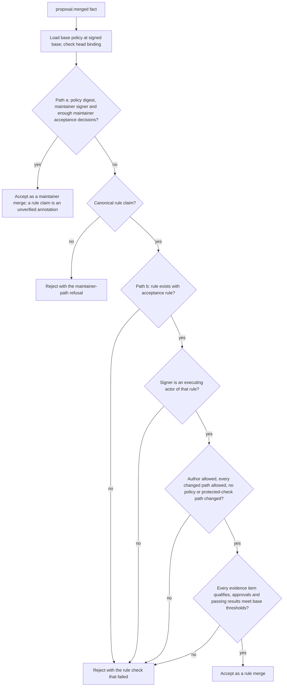

# Mission Specification: Standing acceptance for automerge rules

**Mission Branch**: `feat/standing-acceptance`  
**Created**: 2026-10-26  
**Status**: Confirmed (OQ-1 to OQ-11); amended after analysis by maintainer decisions A to F (see [Analysis remediation decisions](#analysis-remediation-decisions))  
**Input**: Mission brief `/tmp/mission2-brief.md` (byte-identical to `../notes/mission-2-standing-acceptance-brief.md`) and design decisions D2 to D4 of `../notes/design-approve-only-big-things.md`. The brief's scope, constraints and acceptance scenarios are treated as the maintainer's discovery answers. Every choice the brief leaves open was made by the specifying agent under delegated non-interactive instruction and is listed under [Open questions for maintainer confirmation](#open-questions-for-maintainer-confirmation). D1, pipeline `requesters`, already shipped in commit 7a47e69 and is not part of this mission.

## Problem and intent

Every Hubnot merge waits for a maintainer today. An automerge rule's executing actors must be base-policy maintainers (`protected_checks.go`, `validateOptionalPolicy`), and execution still requires the ordinary maintainer acceptances (`automerge.go`, blocker "current required maintainer acceptances are missing"). Every verifier then accepts a `proposal.merged` fact only when a base-policy maintainer signed it and it cites enough maintainer `accept` decisions (`policy.go`, `validateMergeEvent`). So an automerge rule saves a maintainer the merge step but still needs them to sign a decision for each proposal.

This mission lets a maintainer adopt, through one ordinary maintainer-accepted policy amendment, an automerge rule whose acceptance mode is `rule`. That rule is the standing acceptance for every proposal that satisfies it. An executing actor that is not a maintainer can then execute the rule, locally or through `hn serve`, and record a merge fact that names the rule. Every client and `hn serve` re-derives from the signed base policy, the candidate's code and the fact's listed evidence that the rule was satisfied, and rejects the fact otherwise. Maintainers keep approving policy amendments and protected-check changes, which always take the manual path.

**Primary actors**: the maintainer (adopts and amends rules through ordinary policy amendments, and can still reject a proposal), the executing actor (an actor named in a rule's `actors`, typically an integrator agent), authors and trusted reviewers (produce proposals and approvals that a rule counts), trusted runners (produce pipeline results), and verifiers (any client or `hn serve` that imports and checks facts).

**Invariant**: a `proposal.merged` fact is valid when either of two paths holds, and invalid when neither does.

- **Path (a), maintainer merge**: the fact passes today's validation exactly. Its `policy` is the base policy digest, a base-policy maintainer signed it, and its evidence holds enough current maintainer `accept` decisions. This holds whatever the fact's `rule` field says.
- **Path (b), rule merge**: the fact carries a canonical rule claim, and every verifier, starting from the candidate's signed base policy, its base and head commits and the fact's listed evidence, can re-derive all of the following. The named rule exists with acceptance mode `rule`. The signer is one of that rule's executing actors. The candidate's author and every changed path are allowed by the rule. No policy file or protected-check path changed. The evidence lists exactly the counting approvals and passing pipeline results, and they meet the base policy's thresholds.

A fact that passes path (a) is a maintainer merge and is displayed as one, even when it carries a rule claim. Every event kind other than `proposal.merged` keeps today's decoding and acceptance, so signed history that was valid before this mission stays valid.

## Domain Language

| Canonical term | Meaning | Avoid |
|----|----|----|
| Automerge rule | One entry of `automerge.rules` in `.hn/policy.json` (existing) | "merge policy" |
| Acceptance mode | The new rule field `acceptance`: `maintainers` (absent, today's behavior) or `rule` | "auto-accept", "approval mode" |
| Standing acceptance | The authority a rule with acceptance mode `rule` carries for every proposal that satisfies it, granted once by the policy amendment that adopted it | "blanket approval", "auto-approval" |
| Executing actor | An actor listed in a rule's `actors`; it may execute only that rule | "executor" in prose, "integrator", "bot" |
| Rule reviewers | The new optional rule field `reviewers`: the trusted reviewers whose approvals count toward that rule | "rule approvers", "model family" |
| Counting approval | A current `approve` review of the exact candidate from a reviewer the rule counts | "vote" |
| Rule claim | A `rule` field on `proposal.merged` in canonical form: exactly one top-level key equal to `rule` under case folding, spelled exactly `rule`, holding a JSON string that is a valid rule name. Any other shape is not a claim | "rule tag" |
| Rule merge fact | A `proposal.merged` event that carries a rule claim and is valid through path (b): it cites approvals and run results and no maintainer decision | "auto-merge event" |
| Acceptance merge fact (maintainer merge) | A `proposal.merged` event valid through path (a): a maintainer signed it and it cites enough maintainer acceptance decisions (existing). It may also carry a rule claim, which is then an unverified rule annotation | "normal merge" |
| Unverified rule annotation | A rule claim on an acceptance merge fact. It may be reported and never affects validity | "rule label" |
| Legacy history | Signed events that verified before this mission, including events whose payloads carry unknown or rule-named keys that today's decoder ignores | "old events" |
| Qualifying evidence | The exact approval and passing run-result event IDs that satisfy the rule's thresholds | "proof" |
| Base policy | `.hn/policy.json` at the candidate's signed base commit (existing) | "current policy" |
| Target policy | `.hn/policy.json` at the branch tip a merge would replace: the checked-out target locally, the destination tip on `hn serve` | "main policy" |
| Verifier | Any surface that admits facts: local event projection, replication import, shallow verification, and the `hn serve` push checks | "validator" in user-facing text |

## User Scenarios & Testing

### User Story 1: An executing actor merges an eligible ordinary change with no maintainer step (Priority: P1)

A repository's base policy has a rule `ordinary` with acceptance mode `rule` over `src/`, `tests/` and `docs/`. Its executing actor E is not a maintainer. An author listed in the rule opens a proposal that changes `src/` and `tests/`, a trusted reviewer approves it and a trusted runner reports a passing `test` result. E runs `hn automerge` with `--execute`. The target branch advances and E signs a rule merge fact. No maintainer signed anything for that proposal, and a fresh clone verifies the result.

**Why this priority**: removing the per-proposal maintainer decision for ordinary changes is the reason this mission exists.

**Independent Test**: in real temporary repositories, create maintainer, author, reviewer, runner and executor identities, adopt the rule through a maintainer-accepted policy amendment, then drive the proposal, review, run, automerge and verification steps through the public `hn` and `git` CLIs.

**Acceptance Scenarios**:

1. **Given** the policy and evidence above and zero `proposal.decision` events for the candidate, **When** E runs `hn automerge <candidate> --rule ordinary --execute` in a clean full clone whose checked-out `main` equals the signed base, **Then** `main` advances to a native two-parent merge commit and E's chain gains one `proposal.merged` with `rule` equal to `ordinary`, `policy` equal to the base policy digest, and `evidence` equal to the approval and passing run-result IDs.
2. **Given** scenario 1 completed and published with `hn sync`, **When** a different full clone with no Hubnot identity runs `hn sync` and `hn proposal status <candidate>`, **Then** it verifies every event and reports the candidate as merged by rule `ordinary` signed by E.
3. **Given** the same candidate and evidence under a rule identical except that `acceptance` is absent (so its executing actor must be a maintainer), **When** that maintainer runs the same command, **Then** it is refused with the existing missing-acceptance blocker and no ref or event changes.
4. **Given** the policy of scenario 1, **When** E runs `hn automerge <candidate> --rule ordinary` without `--execute`, **Then** the keyless preview shows acceptance mode `rule`, the reviewers the rule counts, that no maintainer acceptance is required, and no blockers, and it writes no event or ref.

---

### User Story 2: A maintainer adopts a standing rule, and unsafe rules are refused (Priority: P1)

A maintainer drafts a policy amendment that adds a rule with acceptance mode `rule` and a non-maintainer executing actor. `hn policy check` shows the new acceptance mode, executing actors, authors, paths and reviewers. The amendment is an ordinary proposal that needs review and maintainer acceptance and lands through `hn merge`; no rule can merge it. Policy validation refuses any rule whose standing acceptance could cover policy files or protected checks.

**Why this priority**: the policy amendment is the one maintainer act that grants standing acceptance, so it must be visible and must not be able to grant more than intended.

**Independent Test**: run `hn policy check --base main --file` and `hn policy show` on valid and invalid drafts in a temporary repository, then try to automerge the amendment proposal itself.

**Acceptance Scenarios**:

1. **Given** a draft adding rule `ordinary` with `"acceptance": "rule"`, a non-maintainer executing actor and `reviewers`, **When** the maintainer runs `hn policy check --base main --file .hn/policy.json`, **Then** it validates and the comparison lists the added rule with its acceptance mode, executing actors, authors, paths, target branch and reviewers as full identities.
2. **Given** the amendment opened as a proposal, **When** any executing actor runs `hn automerge` on it under any rule, **Then** it is refused as a policy amendment that requires manual merge; **When** a maintainer accepts it and runs `hn merge`, **Then** it lands as today.
3. **Given** a proposal whose head adds a rule with acceptance mode `rule`, **When** that proposal's author or the newly listed executing actor tries to use the new rule for that same proposal, **Then** it is refused because the rule does not exist in the signed base policy.
4. **Given** drafts where a rule with acceptance mode `rule` lists the path `.hn`, `.hn/`, `.hn/pipelines/` or `.hn/policy.json`, **When** policy validation runs, **Then** each is rejected with a message naming the rule and the path.
5. **Given** `protectedChecks.paths` containing `scripts/lint.sh`, **When** a rule with acceptance mode `rule` lists `scripts/`, or `protectedChecks.paths` contains `scripts/` and the rule lists `scripts/lint/run.sh`, **Then** validation rejects the rule as overlapping a protected path.
6. **Given** drafts with `acceptance` set to `"Rule"`, `""`, `null` or `1`; `reviewers` empty, containing a duplicate, containing an actor outside `proposals.trustedReviewers`, or with fewer members than `proposals.requiredApprovals`; acceptance mode `rule` with `proposals.requiredApprovals` equal to 0 in a policy without pipelines (decision `01M66YE8SNSPCYB1ER757D9251`); or acceptance mode `maintainers` (explicit or absent) with a non-maintainer executing actor, **When** validation runs, **Then** each draft is rejected with a message naming the rule and field.

---

### User Story 3: Every verifier rejects a forged or insufficient rule merge fact (Priority: P1)

A hostile or buggy actor publishes a `proposal.merged` fact that names a rule it cannot satisfy. Every verifier that checks acceptance merge facts today rejects it: a client running `hn sync`, a client reading its own store, a shallow clone during verification, and `hn serve` receiving the actor chain.

**Why this priority**: standing acceptance moves authority into a signed fact that a non-maintainer signs. If any verifier accepted a forged fact, a non-maintainer could close proposals and mislead every downstream reader.

**Independent Test**: build a fixture set of signed rule merge facts with exactly one defect each, publish each through a real temporary remote and through an `hn serve` hosted repository, and observe each verifier's verdict through the public CLI.

**Acceptance Scenarios**:

1. **Given** a `proposal.merged` fact signed by an actor who is not a maintainer (the executing actor E, or another actor for the signer defect) that cites approvals and run results and has exactly one of these defects: the named rule does not exist; the rule has acceptance mode `maintainers`; the signer is not an executing actor of the named rule; `policy` is not the base policy digest; an evidence ID is for another proposal; evidence includes a `proposal.decision`, a `request-changes` review, a failed result, or an approval from a reviewer the rule does not count; approvals fall below `proposals.requiredApprovals`; a required pipeline lacks enough passing trusted results; the author is not allowed by the rule; a changed path is outside the rule; `.hn/policy.json` or a protected-check path changed; or the `rule` key is not in canonical form (empty, `null`, not a string, a case variant, duplicated, or not a valid rule name), so the fact carries no rule claim and can only be judged as a maintainer merge, **When** a full clone imports the signer's chain with `hn sync`, **Then** import refuses that chain, names the fact's full event ID and the failed check, and promotes nothing from it.
2. **Given** the same fixtures, **When** a mapped actor pushes the signer's chain to an `hn serve` hosted repository, **Then** the push is rejected with `actor-chain-invalid` naming the fact, and every hosted ref is unchanged.
3. **Given** the same fixtures already present in a local store, **When** any command projects events, **Then** it refuses the fact as it refuses an invalid acceptance merge fact today.
4. **Given** a shallow clone that selected the signer's chain, **When** shallow verification reaches a rule merge fact, **Then** it requires each listed review, run result and the run request each result answers, and it refuses with recovery guidance when one is unavailable.
5. **Given** a rule merge fact whose evidence ID is absent from the import, **When** replication validates it, **Then** it reports a missing dependency naming the absent ID and how to select it, as it does for decision evidence today.
6. **Given** a `proposal.merged` fact signed by a maintainer that cites enough current maintainer acceptance decisions and also carries a rule claim, naming either a rule absent from the base policy or an existing standing rule, **When** each of the four verifiers admits it, **Then** every verifier accepts it as a maintainer merge, and `hn proposal status` reports it as a maintainer merge with the rule annotation marked as not verified.
7. **Given** signed legacy events that verified before this mission and carry unknown or rule-named keys (a `review.submit` with `"rule": "annotation"`, a `run.request` with `"RULE": "x"`, and maintainer merge facts with `"rule": null`, `"rule": 1`, `"Rule": "ordinary"` or two `rule` keys), **When** each of the four verifiers admits them, **Then** each accepts them exactly as before the mission; a resource event carrying a `rule` key is still refused as before.

---

### User Story 4: An executing actor advances a protected branch through hn serve (Priority: P1)

The repository is hosted on `hn serve` with `main` protected. E runs `hn automerge` with `--remote`. The server checks the named rule itself against the facts it holds, fast-forwards `main` to the exact tested head, and later accepts E's chain carrying the rule merge fact.

**Why this priority**: `hn serve` refuses protected-branch updates without maintainer acceptance today, so standing acceptance is unusable on a governed server until the server can verify it.

**Independent Test**: create a hosted repository with keys for every actor, adopt the rule, and drive `hn automerge --execute --remote` and a verifier clone through the forced-command test harness used by the hn serve mission.

**Acceptance Scenarios**:

1. **Given** a hosted repository with the rule policy of User Story 1 and a ready candidate, **When** E runs `hn automerge <candidate> --rule ordinary --execute --remote origin`, **Then** the server's `main` equals the candidate head, no new commit is created, E's client records a rule merge fact whose `commit` equals the head, and the server accepts E's chain when it is published.
2. **Given** scenario 1 completed, **When** a new clone with the all-trusted selection runs `hn sync` and `hn proposal status <candidate>`, **Then** it verifies every event and reports the merge by rule `ordinary`.
3. **Given** a trusted change request or a trusted pipeline failure for the candidate that reaches the server after E's import and before E's advancement request, **When** the advancement request arrives, **Then** the server refuses it with a rule-veto reason naming the blocking event and `main` is unchanged.
4. **Given** E pushes `main` directly to the candidate head without an advancement request, **When** the server checks the push, **Then** it is rejected for missing maintainer acceptance, as today.
5. **Given** an actor that is an executing actor of a different rule only, **When** it requests advancement naming rule `ordinary`, **Then** the server refuses with a not-rule-executor reason.
6. **Given** a maintainer amended the policy on `main` after the candidate's base so the destination policy digest differs from the base policy digest, **When** E requests advancement under the rule, **Then** the server refuses with a destination-policy reason directing a revision.
7. **Given** the server advanced `main` but E's client was interrupted before recording the fact, **When** E reruns the same command, **Then** it re-verifies the rule and records the missing rule merge fact exactly once without a second advancement.
8. **Given** the server advanced `main` and E's client recorded its rule merge fact but was interrupted before or after publishing it, **When** E reruns the same command, **Then** the command publishes the fact if the server lacks it, confirms that the hosted `main` contains the head, creates no second fact and makes no second advancement; a later identical rerun reports the same result and changes nothing.

---

### User Story 5: A rule counts only the reviewers it names (Priority: P2)

Gitium gives each model family its own reviewer actor and writes one rule per author family, for example authors `[sonnet-implementer]` with reviewers `[gpt-reviewer]`. An approval from a trusted reviewer outside the rule's `reviewers` does not count toward that rule. Hubnot needs no notion of a model family to support this.

**Why this priority**: cross-family review is how the lab keeps one model family from approving its own work, but rules without `reviewers` already deliver User Stories 1 to 4.

**Independent Test**: adopt a policy with two trusted reviewers and a rule naming one of them, then drive approvals and previews through the CLI.

**Acceptance Scenarios**:

1. **Given** `trustedReviewers` `[gpt-reviewer, sonnet-reviewer]`, `requiredApprovals` 1 and a rule with `reviewers` `[gpt-reviewer]`, **When** only sonnet-reviewer approves, **Then** preview and execution report the rule's approval threshold as unmet; **When** gpt-reviewer approves, **Then** the candidate becomes eligible.
2. **Given** the same policy, **When** sonnet-reviewer has a current change request, **Then** the rule is blocked even though sonnet-reviewer's approvals would not count toward it.
3. **Given** acceptance mode `rule` and `allowAuthorApproval` true, **When** the author is also a listed reviewer and approves its own candidate, **Then** that approval does not count toward the rule.
4. **Given** a rule with acceptance mode `maintainers` and `reviewers` set, **When** execution runs with maintainer acceptances present, **Then** only approvals from the rule's reviewers count toward the rule and the recorded fact is an ordinary acceptance merge fact.

---

### User Story 6: Maintainers keep the big things and the executing actor gains nothing else (Priority: P2)

Every existing blocker still applies under standing acceptance, and an executing actor can do nothing a maintainer does except execute its own rule.

**Why this priority**: these are the limits that make delegating acceptance to a rule safe; many are existing behavior that must keep working when the maintainer-acceptance requirement is removed.

**Independent Test**: from the User Story 1 fixture, introduce each blocker or forbidden command in turn and assert refusal, unchanged refs and no new countable event.

**Acceptance Scenarios**:

1. **Given** a current maintainer rejection of the candidate, **When** E executes the rule locally or through `hn serve`, **Then** it is refused naming the rejection.
2. **Given** a current trusted change request, a current trusted pipeline failure, or a required pipeline without enough passing trusted results, **When** E executes, **Then** it is refused naming each blocker.
3. **Given** an author outside the rule or a changed path outside the rule's allowlist, **When** E executes, **Then** it is refused naming the author or path.
4. **Given** a candidate that changes `.hn/policy.json` or a protected-check path and already has every review, CI result and maintainer acceptance, **When** E executes under any rule, **Then** it is refused for manual merge.
5. **Given** the target branch moved after the signed base, the worktree is dirty, an unfinished Git operation exists, or the clone is shallow or partial, **When** E executes, **Then** it is refused as today.
6. **Given** E holds its own signing identity, **When** E runs `hn decide <candidate> --accept`, `hn merge <candidate>`, `hn merge <candidate> --remote origin`, or `hn automerge <candidate> --rule <another-rule> --execute`, **Then** each is refused, no countable event is created, and no local or hosted branch moves.
7. **Given** a run request for the candidate signed by an actor that is neither a maintainer nor a listed `requesters` actor of that pipeline, **When** its result is the only passing result, **Then** the rule's pipeline threshold is unmet.

---

### User Story 7: Repositories that do not opt in, and older clients, are unaffected or fail closed (Priority: P3)

A repository that never adds `acceptance` or `reviewers` behaves exactly as before. A client built before this mission rejects a policy that uses the new fields and rejects every fact that is valid only through path (b), so it never mistakes standing acceptance for a maintainer acceptance. Older and newer clients agree on every fact that passes path (a) and on all legacy history.

**Why this priority**: required for a safe rollout, and mostly a consequence of strict parsing that already exists.

**Independent Test**: run the full existing test suite unmodified, and run an `hn` binary built from the mission's base commit against repositories produced by the new client.

**Acceptance Scenarios**:

1. **Given** a repository whose policy has no `acceptance` or `reviewers` field, **When** any existing command runs, **Then** its eligibility, refusals and recorded facts are the same as before the mission.
2. **Given** an older client, **When** it loads a policy containing `acceptance` or `reviewers`, including `"acceptance": "maintainers"`, **Then** it rejects the policy as containing an unknown field.
3. **Given** an older client, **When** it imports a chain containing a fact that is valid only through path (b), **Then** it rejects the fact, either because the base policy uses the new fields or because the signer is not a maintainer or the evidence lacks acceptance decisions.
4. **Given** a base policy with only fields the older client knows, and a maintainer-signed `proposal.merged` that cites enough maintainer acceptance decisions and also carries a rule claim, **When** the older client and the new client each import it, **Then** both accept it as a maintainer merge.
5. **Given** the signed legacy events of User Story 3 scenario 7 under a base policy the older client can read, **When** the older client and the new client each import them, **Then** both accept every one of them.

### How a verifier judges a merge fact

Path (a) is today's check, unchanged and run first on every surface. Path (b) runs only when path (a) fails and the fact carries a canonical rule claim. A surface that has not yet been extended with path (b) runs path (a) alone, so it rejects every fact that only path (b) would admit (FR-025).

### Edge Cases

- An executing actor that is also a maintainer executes a rule with acceptance mode `rule`: the recorded fact is a rule merge fact. It cites no maintainer decision, so it fails path (a) and is valid through path (b).
- A maintainer-signed fact that cites enough maintainer acceptance decisions also names a rule, whether or not that rule exists: it is a maintainer merge through path (a), on every client old or new, and the rule name is an unverified annotation.
- A candidate satisfies two rules: the executing actor names one explicitly, and the fact names that rule.
- A later amendment removes a rule or an executing actor: existing rule merge facts stay valid because they are judged against their own base policy; pending candidates on older bases are blocked because the target policy digest differs (OQ-6).
- A reviewer withdraws an approval after the merge: the fact stays valid, as immutable acceptance evidence does today; a withdrawal before execution blocks execution.
- A maintainer rejection published after the merge: the fact stays valid; the rejection is visible in status (OQ-8).
- Two executing actors execute the same candidate at once: the local expected-old ref lease or the server's stale-tip check lets exactly one advance; the other is refused.
- A candidate already merged by an acceptance merge fact and later by a rule merge fact: both facts for the same candidate are valid, as multiple merge facts for one candidate are today; a lineage with two different merged candidates is a merge conflict as today.
- A candidate with no changed paths: refused, as today.
- A rule merge fact whose `commit` equals the head (fast-forward through `hn serve`) or is a two-parent merge commit (local): both shapes are valid, as for acceptance merge facts.
- A verifier lacks the base or head commit: the fact is refused or reported as a missing dependency and never evaluated against an empty change list (OQ-10).
- Changed-path output exceeds the existing 8 MiB bound: the fact or execution is refused.
- A run result answers a request signed by a listed pipeline requester (D1): it counts; a request signed by an unlisted actor does not.
- A `rule` key that is empty, `null`, not a string, case-varied, duplicated or not a valid rule name: the fact carries no rule claim, so it is valid only through path (a). Nothing is refused at parse time because of a `rule` key.
- A `rule` key on any event kind other than `proposal.merged`: ignored, exactly as today's decoder ignores it. Hubnot never writes one. A resource event with a `rule` key stays refused by its strict decoder, as today.

## Requirements

### Functional Requirements

| ID | Title | User Story | Priority | Status |
|----|-------|------------|----------|--------|
| FR-001 | Acceptance mode field | Each automerge rule may carry `acceptance` with exactly the string `maintainers` or `rule`. Absence and `maintainers` behave as today. `null`, an empty string, other strings and non-string values are rejected (OQ-3). | High | Open |
| FR-002 | Non-maintainer executing actors | Under acceptance mode `rule`, a rule's `actors` need not be maintainers. Under acceptance mode `maintainers`, every executing actor must still be a base-policy maintainer. | High | Open |
| FR-003 | Path safety for standing acceptance | Policy validation rejects a rule with acceptance mode `rule` when any of its path selectors equals `.hn` or `.hn/`, lies inside `.hn/`, or overlaps any `protectedChecks.paths` selector as equal, ancestor or descendant. The refusal names the rule and the selector (OQ-4). | High | Open |
| FR-004 | Approval threshold under standing acceptance | A rule with acceptance mode `rule` uses `proposals.requiredApprovals` as its approval threshold. A value of 1 to 64 requires that many counted approvals; 0 means the rule needs no approval and merges on the pipeline gate alone, and policy validation then rejects the rule only when the policy defines no pipeline. Every other condition and veto still applies. Amended by decision `01M66YE8SNSPCYB1ER757D9251`, which supersedes the original refusal of 0 (OQ-1). | High | Open |
| FR-005 | Rule reviewers | Each rule may carry `reviewers`: 1 to 64 distinct full actor fingerprints, each also listed in `proposals.trustedReviewers`, with at least `proposals.requiredApprovals` members. When set, only approvals from those actors count toward the rule's approval threshold, in both acceptance modes. A current change request from any `proposals.trustedReviewers` actor still blocks the rule (OQ-3). | High | Open |
| FR-006 | Author approval under standing acceptance | Under acceptance mode `rule`, the candidate author's own approval never counts toward the rule, even when `allowAuthorApproval` is true (OQ-2). | High | Open |
| FR-007 | Policy inspection | `hn policy show` prints each rule's acceptance mode and full reviewer list. `hn policy check` reports added, removed and changed acceptance modes and reviewers per rule, in deterministic order. | Medium | Open |
| FR-008 | Preview | The keyless `hn automerge PROPOSAL --rule NAME` preview prints the rule's acceptance mode, the reviewers it counts and whether maintainer acceptance is required. Under acceptance mode `rule` the missing-acceptance blocker does not apply and approvals are counted as FR-005 and FR-006 define. Preview still writes nothing. | Medium | Open |
| FR-009 | Execution without per-proposal acceptance | Under acceptance mode `rule`, `hn automerge --execute`, local and with `--remote`, requires no maintainer decision for the candidate. Every other existing blocker still applies: counted approvals and required passing pipeline results, no current trusted change request, trusted failure or maintainer rejection, allowed author and changed paths, no policy amendment or protected-check change, exact signed base on the checked-out target, code ref matching the signed head, open lineage, clean worktree, and refusal of shallow, partial and mid-operation repositories. | High | Open |
| FR-010 | Rule merge fact | A merge under acceptance mode `rule` records `proposal.merged` with a new optional `rule` field naming the rule, `policy` equal to the base policy digest, and `evidence` listing exactly the qualifying approval and passing run-result IDs: at most one approval per counting reviewer and at most one result per trusted runner per pipeline. Hubnot writes `rule` only on `proposal.merged` and only in canonical form; verifiers recognize a rule claim only in that form, and a `rule` key on any other kind or in any other form keeps today's meaning (ignored). Merges under acceptance mode `maintainers` keep the existing acceptance merge fact with no `rule` field. No new event kind is introduced (OQ-5 as amended by decision `01M5VSEHEVA82N9T64ZH1P1Q2A`). | High | Open |
| FR-011 | Rule merge signer | A rule merge fact is valid only when its signer is an executing actor of the named rule in the base policy. A maintainer who executes a rule with acceptance mode `rule` also records a rule merge fact. | High | Open |
| FR-012 | Re-derivation by every verifier | The four fact-admission surfaces, local event projection, replication import validation, shallow verification and the `hn serve` actor-chain check, each accept a fact through path (b) only after re-deriving every condition of path (b) of the invariant from the base policy, the candidate's base and head commits and the listed evidence. The `hn serve` protected-branch verdict applies the same derivation to a rule advancement request (FR-016). A run result counts only when its request was signed by a base-policy maintainer or a listed requester of that pipeline and binds the exact candidate, head and pipeline-definition digest at the head. Under path (b), any evidence item that does not qualify fails the path. | High | Open |
| FR-013 | Evidence availability | Replication reports an absent evidence ID of a merge fact as a missing dependency naming the ID and its recovery, as it does for decision evidence. Shallow verification treats each listed review, run result and answered run request of a fact that needs path (b) as a required selected fact. Missing base or head commits matter only to path (b): a fact that passes path (a) never waits for them. | High | Open |
| FR-014 | Missing code objects | When a verifier needs path (b) for a fact and has neither the quarantine nor the accepted store holding both the base and head commits needed to derive changed paths, it reports a missing dependency or refuses with recovery guidance, and never evaluates an empty or partial change list (OQ-10). | High | Open |
| FR-015 | Scope of fact validation | Verifiers judge a rule merge fact only by its signed content, the base policy, the candidate's code and its listed evidence. Maintainer rejections, change requests and failures outside the evidence do not invalidate it; they block execution and server advancement (OQ-8). | Medium | Open |
| FR-016 | hn serve advancement under a rule | An advancement request may name a rule. For such a request, the server evaluates that rule itself from the base policy and the facts it holds, including current trusted change requests, trusted failures and maintainer rejections, and requires the requesting mapped actor to be an executing actor of that rule in place of the maintainer requirement. It applies every other existing protected-branch check. Refusals use documented stable reason codes, initially `advance-not-rule-executor`, `protected-rule-not-satisfied` and `protected-rule-veto` (OQ-7). | High | Open |
| FR-017 | Target policy must equal base policy | Standing acceptance applies only when the target policy digest equals the candidate's base policy digest, locally and on `hn serve`. Otherwise the update is refused and directs a revision (OQ-6). | High | Open |
| FR-018 | Direct protected pushes unchanged | A direct push of a protected branch, and an advancement request that names no rule, still require maintainer acceptances under both policies, as today (OQ-7). | High | Open |
| FR-019 | Bounded executing-actor authority | An executing actor that is not a maintainer cannot publish a decision that counts, cannot `hn merge` locally or with `--remote`, cannot merge a policy amendment or protected-check change, and cannot execute a rule that does not list it. Each attempt is refused before any countable event or ref change. | High | Open |
| FR-020 | Recovery of an interrupted rule merge | When code merged or the hosted branch advanced but the rule merge fact was not recorded, rerunning the same `hn automerge PROPOSAL --rule NAME --execute` command, with the same `--remote` when used, re-verifies the rule and records the missing fact exactly once under the existing repair conditions, with no second code merge or advancement. When the fact was recorded but not, or only partly, published, rerunning `hn automerge PROPOSAL --rule NAME --execute --remote REMOTE` takes a publication-only path: it is allowed only for an executing actor of NAME whose own valid rule merge fact for the proposal under NAME is in the local store; it skips the already-merged blockers, publishes or republishes the fact, and confirms that the hosted branch contains the fact's commit, without signing, creating another fact or advancing the branch. Without `--remote`, an already-merged candidate is refused as today. `hn merge` repair remains maintainer-only (OQ-9, decision `01M5VSEHFCZGQHQ14CKJ3MAMP7`). | Medium | Open |
| FR-021 | Status names the rule | `hn proposal status` for a candidate merged by a rule merge fact reports it as merged and names the rule and the signing executing actor in full. A maintainer merge fact that carries a rule claim is reported as a maintainer merge, with the rule name marked as not verified. | Medium | Open |
| FR-022 | Compatibility | Omitting `acceptance` and `reviewers` keeps today's behavior exactly. Clients that predate this mission reject policies containing either field and reject every fact valid only through path (b). Older and newer clients reach the same verdict on every fact that passes path (a) and on every legacy event. No existing signed bytes or historical facts are re-encoded or reinterpreted, and no event that verified before this mission stops verifying. | High | Open |
| FR-023 | Documentation with tested examples | `docs/governance-v0.md` (rule fields, standing acceptance, limits), `docs/protocol-v0.md` (the `rule` field and evidence of `proposal.merged`), `docs/serve-v0.md` (automerge rules section and new reason codes) and the trust-boundary text of `docs/threat-model.md` change in this mission, and their examples are exercised by tests (OQ-11). | High | Open |
| FR-024 | Union validity of merge facts | Every fact-admission surface judges a `proposal.merged` fact with one shared rule: it runs today's maintainer check (path a) first and unchanged, accepts the fact as a maintainer merge when that passes, otherwise accepts it as a rule merge only when it carries a rule claim and passes path (b), and otherwise rejects it. Strict rule evidence applies only to path (b). No surface implements its own variant (decision `01M5VSEHEVA82N9T64ZH1P1Q2A`). | High | Open |
| FR-025 | Fail-closed activation | At every independently landable work package boundary, a surface that does not yet implement path (b) rejects every fact valid only through path (b) and interprets no rule, and an `hn serve` build that parses `hn-rule` before it evaluates rules refuses every update carrying it. Boundary fixtures prove each state (decision `01M5VSEHF5B1FM9TB52KWKQGWZ`). | High | Open |

### Non-Functional Requirements

| ID | Title | Requirement | Category | Priority | Status |
|----|-------|-------------|----------|----------|--------|
| NFR-001 | Fail-closed verification | A fixture set of at least 14 signed rule merge facts, each with exactly one defect covering every condition of FR-010 to FR-014, is rejected 100% of the time by each of the four fact-admission surfaces in FR-012, with zero promoted facts and zero changed hosted refs. | Security | High | Open |
| NFR-002 | Verdict agreement | Two measured agreements, each 100%. (1) Fact agreement: for every fixture in the valid, invalid and legacy merge-fact sets, all four fact-admission surfaces reach the same accept or reject outcome. (2) Rule-satisfaction agreement: for every rule advancement fixture, under identical inputs (the same target branch tip, the same base and target policy, the same candidate code and the same fact set), the keyless preview, local execution and the `hn serve` verdict reach the same rule-satisfaction outcome. Executor authorization (the identity is listed in the rule's `actors`; `advance-not-rule-executor`) and transport and binding checks (remote identification, selection coverage, local target equal to the hosted tip, `hn-expected-tip`, fast-forward, hosted code ref, `hn-rule` support, protected baseline, worktree and repository state, the expected-old ref lease) are not part of this agreement; each is listed and tested on its own (decision `01M5VSEHFH0B1BSJ1NA923FKAA`). | Integrity | High | Open |
| NFR-003 | Executing-actor containment | 100% of the User Story 6 scenario 6 attempts by a non-maintainer executing actor end in refusal with zero new countable events, zero local branch movement and zero hosted ref changes. | Security | High | Open |
| NFR-004 | Opt-out compatibility | 100% of tests present at the implementation-start snapshot `d881d9b` pass with no change to their assertions, and the mission's diff from `d881d9b` modifies, deletes or renames no test file that exists there. Every repository fixture without the new fields yields the same eligibility, refusal and merge-fact outcomes as the older-client reference build of commit `7a47e69` (decision `01M5VSEHF9P9VRVTY68PD8DZ7D`). | Compatibility | High | Open |
| NFR-005 | Bounded validation work | Validating one rule merge fact performs at most one changed-path computation, bounded by the existing 8 MiB changed-path limit; a fixture exceeding the limit is refused, never truncated. | Security | Medium | Open |
| NFR-006 | Import cost | Importing an actor chain with 20 rule merge facts into a repository holding 1,000 events takes at most 1.5 times as long as importing the same chain with 20 acceptance merge facts, at the 95th percentile over 20 runs on the quality-gate test host. | Performance | Medium | Open |
| NFR-007 | Regression gate | `gofmt`, `go vet ./...`, `go build ./...`, `go test -race ./...` and `git diff --check` pass for the integrated candidate. | Quality | High | Open |

### Constraints

| ID | Title | Constraint | Category | Priority | Status |
|----|-------|------------|----------|----------|--------|
| C-001 | Toolchain | Go standard library only, flat `package main`, no new third-party module (charter). | Technical | High | Open |
| C-002 | Black-box tests | Acceptance tests drive the public `hn` and `git` CLIs against real temporary repositories and remotes, and against `hn serve` through the forced-command harness of the hn serve mission (DIRECTIVE_036). | Quality | High | Open |
| C-003 | Existing assertions are frozen | No test assertion that exists at the implementation-start snapshot `d881d9b` (the merge that brought in the reviewed sync speedup) is edited; the audit covers only mission edits against that snapshot (brief constraint, DIRECTIVE_041, decision `01M5VSEHF9P9VRVTY68PD8DZ7D`). | Quality | High | Open |
| C-004 | Immutable signed history | No new event kind, no re-encoding of signed payloads, and no change to the validity of historical facts: every event that verified before this mission still verifies with the same meaning, proven by signed legacy fixtures on every admission surface and against the older client (HN-002, HN-004). | Integrity | High | Open |
| C-005 | Fail closed on hostile input | Every fetched fact, policy and pushed ref is hostile input; any doubt ends in refusal with no state change (charter). | Security | High | Open |
| C-006 | Docs move with code | Policy, wire-format, trust and server-verdict changes update their documentation and examples in this mission (HN-005, DIRECTIVE_037). | Process | High | Open |
| C-007 | Maintainers keep the big things | Policy amendments and protected-check changes always take the manual maintainer path, under either acceptance mode. | Governance | High | Open |
| C-008 | Server signs nothing | `hn serve` holds no signing identity and its verdicts are never evidence; the executing actor's client signs the rule merge fact (hn serve C-006). | Security | High | Open |
| C-009 | D1 is done | Pipeline `requesters` (commit 7a47e69) is used as shipped and is not reimplemented. | Scope | Medium | Open |
| C-010 | Excluded scope | Model-family metadata, issue requirement classes, review-round caps, releases and GitHub publishing are out of scope; they belong to the gitium layer. | Scope | High | Open |
| C-011 | Branch | Work lands on `feat/standing-acceptance`; nothing is pushed as part of this mission's specification. | Process | Medium | Open |

### Key Entities

- **Automerge rule**: name, target branch, executing actors, authors, literal allowed paths, and the new acceptance mode and optional reviewers.
- **Acceptance mode**: `maintainers` or `rule`; decides whether a merge under the rule needs maintainer acceptance decisions.
- **Rule reviewers**: the subset of trusted reviewers whose approvals count toward one rule.
- **Executing actor**: an actor permitted to execute one named rule and nothing else by virtue of that listing.
- **Rule merge fact**: `proposal.merged` with a rule claim, base policy digest, candidate head, result commit and qualifying evidence, valid through path (b).
- **Acceptance merge fact**: the existing `proposal.merged` with acceptance decision evidence, valid through path (a) whatever its `rule` field says.
- **Legacy history**: every event that verified before the mission; its validity and meaning do not change.
- **Qualifying evidence**: counting approvals and passing trusted run results for the exact candidate.
- **Base policy and target policy**: the policy that grants standing acceptance and the policy at the branch tip being replaced; their digests must match for a rule merge.

## Success Criteria

### Measurable Outcomes

- **SC-001**: Every acceptance scenario listed in the brief passes as an executable public-CLI test, locally and through `hn serve`.
- **SC-002**: An ordinary change goes from `hn proposal open` to merged on `main` with zero maintainer-signed events for that proposal, both locally and through `hn serve`.
- **SC-003**: Zero forged or insufficient rule merge facts in the fixture set are accepted by any verifier.
- **SC-004**: A fresh verifier clone reproduces 100% of the rule merge verdicts that the executing actor's client and `hn serve` reached.
- **SC-005**: Zero policy amendments or protected-check changes are merged by any rule across the fixture set.
- **SC-006**: Every requirement maps to implementation, tests and independent review evidence, and the full regression gate passes.

## Assumptions

- Policy actors are distinct full fingerprints. Validation does not forbid one actor from being both an executing actor and a reviewer or author; independence comes from counting approvals that exclude the author (OQ-2) and from `proposals.requiredApprovals` when it is at least 1 (OQ-1, amended by decision `01M66YE8SNSPCYB1ER757D9251`).
- The set of required pipelines is every pipeline in the base policy, as today.
- The advancement request can carry a rule name through the existing `hn serve` push-option channel; the exact wire form is a planning decision documented in `docs/serve-v0.md`.
- Older-client behavior in User Story 7 is demonstrated with an `hn` binary built from commit `7a47e69`, the older-client reference, inside `go test`. The pre-existing test audit uses the separate implementation-start snapshot `d881d9b`.
- The lab plan in the design note (an integrator actor executing rule `ordinary` over `src/`, `tests/` and `docs/`) is run in the gitium workspace after this mission and is not a Hubnot test.
- Manual `hn merge`, its repair path and automerge under acceptance mode `maintainers` keep their current behavior.

## Open questions for maintainer confirmation

Each item was decided by the specifying agent because the brief does not settle it. Each has a resolved Decision Moment under `decisions/`. Confirm or change them at spec review; a change updates the listed requirements before planning. The brief-intent confirmation is recorded as decision `01M5VD5MRF3C747AN5F1H3EBE6`.

1. **OQ-1: Minimum review under standing acceptance** (decision `01M5VD5PSRW8AVQYE7C8AHEE7Q`; FR-004). `proposals.requiredApprovals` may be 0 today, which would let a rule merge with no review at all. Recommendation: reject a rule with acceptance mode `rule` when `requiredApprovals` is 0, and add no rule-level threshold.
2. **OQ-2: Author approval** (decision `01M5VD5RSPR0WPMH9K2BDYXNAS`; FR-006). Recommendation: under acceptance mode `rule`, an author's own approval never counts, even when `allowAuthorApproval` is true, matching how designated protected-check approvals already exclude the author.
3. **OQ-3: Forms of `acceptance` and `reviewers`** (decision `01M5VD5TYZS5YGR4BF0NX7X9S0`; FR-001, FR-005). Recommendation: `acceptance` is exactly `maintainers` or `rule`, with absence equal to `maintainers`; `reviewers` lists 1 to 64 distinct members of `trustedReviewers`, at least `requiredApprovals` of them, narrows only which approvals count, leaves every trusted change request as a blocker, and is allowed in both modes.
4. **OQ-4: Which paths a standing rule may not cover** (decision `01M5VD5X2W8DHPC3TK3JF6VXQ0`; FR-003). Recommendation: reject selectors equal to, inside, or matching `.hn` and selectors overlapping any protected-check selector in either direction, while keeping the runtime refusals for both modes.
5. **OQ-5: Rule merge fact shape** (decision `01M5VD5Z139R84BBXZM0QXGHJ1`; FR-010, FR-012). Recommendation: an optional `rule` string on `proposal.merged` only; strict evidence that lists exactly the qualifying approvals and passing results, one per counting actor, where any other item invalidates the fact; acceptance-mode facts unchanged; no new event kind. **Amended after analysis** by decision `01M5VSEHEVA82N9T64ZH1P1Q2A` (maintainer decision A): a fact is valid through path (a) or path (b) of the invariant, strict evidence applies only to path (b), and `rule` keys on other kinds keep today's meaning.
6. **OQ-6: Target policy differs from base policy** (decision `01M5VD610AQPYQAW0N79YBSKK1`; FR-017). Recommendation: standing acceptance applies only when the target policy digest equals the base policy digest, locally (where automerge already requires this) and on `hn serve`, so removing a rule or an executing actor takes effect for pending candidates immediately.
7. **OQ-7: How hn serve admits a rule merge** (decision `01M5VD630G94HDM2WPJ00NM5ED`; FR-016, FR-018). The hn serve guide currently says the server does not evaluate automerge rules. Recommendation: only an advancement request naming the rule can use standing acceptance; the server evaluates that rule itself, including vetoes it holds, and requires the requester to be one of its executing actors; direct pushes still need maintainer acceptances.
8. **OQ-8: Vetoes outside the evidence** (decision `01M5VD6564ABTSHFNRY8MKA698`; FR-015). Recommendation: verifiers judge the signed fact and its listed evidence only, as they judge acceptance merge facts today, because signed facts across chains have no delivery-order winner; vetoes block execution and server advancement.
9. **OQ-9: Interrupted rule merge** (decision `01M5VD67BH29FYVRTH2AMCZPYS`; FR-020). Recommendation: the executing actor reruns the same `hn automerge --execute` command, which re-verifies and records the missing fact exactly once under the existing repair conditions; `hn merge` repair stays maintainer-only. **Extended after analysis** by decision `01M5VSEHFCZGQHQ14CKJ3MAMP7` (maintainer decision D): a remote rerun after the fact was recorded takes an authorized, publication-only path (FR-020, US4-8).
10. **OQ-10: Missing commits during verification** (decision `01M5VD69EDJJC7BGGZCQRD5R6Q`; FR-014). Recommendation: fail closed with a missing-dependency or shallow-refusal message and recovery guidance; never treat a missing side as an empty diff.
11. **OQ-11: Documentation scope** (decision `01M5VD6BR68AH9Z2BP5CW0C6HX`; FR-023). Recommendation: the three documents the brief names plus the trust-boundary text of `docs/threat-model.md`, because acceptance authority moves from maintainers to a policy rule.

## Maintainer confirmation

Confirmed by the maintainer (delegated) on 2026-10-26: OQ-1 through OQ-11 are
accepted as recommended. Requirements marked Open above are confirmed.

Superseded by the maintainer (Andrew) on 2026-10-30: OQ-1 is reversed by
decision `01M66YE8SNSPCYB1ER757D9251`. Ordinary changes must be able to merge
on the gate alone, with no approval from another session, configured through
the existing `proposals.requiredApprovals` field. The value 0 is now allowed
with a rule in acceptance mode `rule` and means the rule needs no approval;
1 to 64 keep the confirmed behavior, and no policy field is added. A current
trusted change request, a current maintainer rejection, a failed or missing
required pipeline result, the author, path and executing-actor limits, the
manual path for policy and protected-check changes and the target-policy check
all still block. The implementer added one validation under the delegated
instruction: a standing rule with `requiredApprovals` 0 needs at least one
pipeline, so a rule merge fact always cites a passing result. FR-004 above, the
FR-004 row of `contracts/policy-rule-fields.md` and the policy-level rule of
`data-model.md` carry the amended wording; the OQ-1 text above keeps its
original wording as confirmed at spec review.

## Analysis remediation decisions

The analysis report (`analysis-report.md`) found two critical, four high and two medium issues. The maintainer decided them in the remediation instruction, and each decision is recorded as a resolved Decision Moment under `decisions/`. Resolved records cannot be re-resolved, so decisions that change an earlier record name the record they amend.

| Decision | Finding | Record | Amends | Requirements changed |
|----|----|----|----|----|
| A. Union validity of merge facts; no unconditional rule-key scan; legacy history stays valid | C1, C2, I1 | `01M5VSEHEVA82N9T64ZH1P1Q2A` (specify) and `01M5VSEHF1G2YQDQW7HPVBF95K` (plan) | OQ-5 `01M5VD5Z139R84BBXZM0QXGHJ1`; plan `01M5VEZKK32DXWNPRAYGDMY3ZK` | Invariant, US3-1, US3-6, US3-7, US7, FR-010, FR-012, FR-013, FR-014, FR-021, FR-022, FR-024, C-004 |
| B. Fail-closed intermediate states through one shared path (b) validator | C1 | `01M5VSEHF5B1FM9TB52KWKQGWZ` (plan) | none | FR-025 |
| C. Freeze pre-existing tests at `d881d9b`; keep `7a47e69` as the older-client reference | I2 | `01M5VSEHF9P9VRVTY68PD8DZ7D` (plan) | none | NFR-004, C-003 |
| D. Authorized, idempotent publication-only remote rerun | I3 | `01M5VSEHFCZGQHQ14CKJ3MAMP7` (plan) | plan `01M5VF10Q3SQX8WTK2MEN92ZSC` | US4-8, FR-020 |
| E. NFR-002 compares rule satisfaction under identical inputs | I4 | `01M5VSEHFH0B1BSJ1NA923FKAA` (specify) | none | NFR-002 |
| F. Older-client binary lifetime; shallow semantic matrix with complete closure | U1, U2 | `01M5VSEHFPWQWFBNTP9ZFYP3TR` and `01M5VSEHFV2K03JJY0NN6DFNAT` (plan) | plan `01M5VF0QVPQ871M0DA8Q0SG5CX` | none (test design) |

OQ-5 above keeps its original text as confirmed at spec review. Where OQ-5 and its decision record say that `rule` is rejected on every other event kind and that any non-qualifying evidence item invalidates the fact, decision A replaces them: other kinds keep today's decoding, and strict evidence applies only to path (b).
