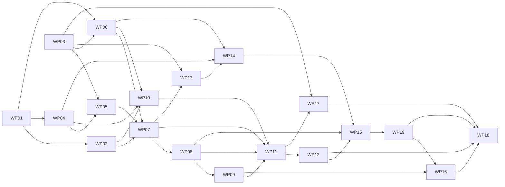

# Work Packages: Standing acceptance for automerge rules

**Mission**: `standing-acceptance-01M5VD2K` | **Planning base and merge target**: `feat/standing-acceptance`
**Inputs**: [spec.md](spec.md), [plan.md](plan.md), [research.md](research.md), [data-model.md](data-model.md), [quickstart.md](quickstart.md), [contracts/](contracts/)
**Generated**: 2026-10-26T06:54:14Z, non-interactively. The maintainer accepted the spec and the plan, including the residual risk the plan records for modified clients on ordinary remotes (`hn serve` enforces vetoes). Every remaining tasks-level choice is recorded under [Tasks decisions](#tasks-decisions).
**Revised**: 2026-10-26T09:45:00Z, after `/spec-kitty.analyze` (findings C1, C2, I1, I2, I3, I4, U1, U2) with maintainer decisions A to F. The changes are listed under [Analysis remediation](#analysis-remediation).

The plan's implementation concern map (IC-01 to IC-07) is cut into 19 work packages of 3 to 7 subtasks each, so that one implementer can finish any of them in one session. Each work package lands with its own tests and its own documentation (HN-005, C-006). Every work package must pass the full gate on its own: `gofmt -l .` prints nothing, `go vet ./...`, `go build ./...`, `go test -race ./...` and `git diff --check` pass, and no test that exists at the implementation-start snapshot `d881d9b` changes (C-003, NFR-004, NFR-007). Every work package boundary must also fail closed (FR-025): see the plan's "Activation boundaries" table.

## Concern to work package map

| Concern | Work packages |
|----|----|
| IC-01 Policy fields, validation and inspection | WP01 (fields, validation, `changedPathsInOneStore` extraction), WP02 (`hn policy show`, `hn policy check` and the policy documentation) |
| IC-02 Rule merge fact wire shape | WP03 (field and canonical claim recognition); WP07 documents it with its admission rule |
| IC-03 Shared rule evaluator | WP04 (live evaluation), WP05 (fact validation and the `admitMergeFact` union combinator) |
| IC-04 Fact admission on every verifier | WP06 (test harness, legacy and boundary fixtures), WP07 (local projection), WP08 (replication import and the `hn serve` actor-chain check), WP09 (shallow verification), WP16 (four-surface matrix and agreement) |
| IC-05 Local preview, execution and repair | WP10 (preview), WP11 (execution, recording, status), WP12 (repair and containment) |
| IC-06 hn serve rule advancement | WP13 (push option, reason codes and the interim `hn-rule` refusal), WP14 (protected verdict), WP15 (client advancement and agreement), WP19 (remote repair and the publication-only rerun) |
| IC-07 Compatibility, documentation and quality evidence | WP17 (compatibility), WP18 (timing, traceability, threat model, gate) |

## Dependency graph and lanes

Expected lanes (computed by `finalize-tasks` from ownership; the values in `lanes.json` are authoritative):

- **Roots**: WP01 and WP03 have no dependencies and own files no other WP edits (tasks decision 12), so each gets its own lane and they run in parallel.
- **Evaluator lane**: WP04 then WP05 share `rule_acceptance.go` and `rule_acceptance_test.go`; they depend only on the roots.
- **Harness lane**: WP06 owns only `standing_harness_test.go`, depends only on the roots, and runs in parallel with the evaluator lane and with WP02.
- **Main lane**: WP02 and WP07 to WP19 (WP17 joins through `docs/threat-model.md`) share `docs/governance-v0.md`, `docs/protocol-v0.md`, `policy.go`, `automerge.go`, `docs/serve-v0.md` and the `standing_*_test.go` files, so `finalize-tasks` collapses them into one lane that runs in dependency order. The collapse report in `lanes.json` names each shared file. WP13 depends on WP07 only to order their edits of `docs/protocol-v0.md`, and WP11 depends on WP09 only to order their edits of `policy.go`.
- **Why the roots own no documents**: a root that shared a file with a later WP would join the main lane, and the main lane would then both precede and follow the evaluator and harness lanes, which `finalize-tasks` refuses as a lane cycle.

## File ownership

A file listed for several work packages is edited by them in dependency order, and each later owner changes only the part named in its prompt. No two work packages that can run at the same time own the same file.

| File | Owners (in order) | What each owner changes |
|----|----|----|
| `protected_checks.go` | WP01 | Rule fields, decoders, validation and the behavior-preserving extraction of `changedPathsInOneStore` |
| `policy_commands.go` | WP02 | |
| `event.go` | WP03 | |
| `rule_acceptance.go` | WP04, WP05 | WP04 creates inputs, helpers and `evaluateRuleAcceptance`; WP05 adds `validateRuleMergeFact`, check names, the per-pass memo and `admitMergeFact` |
| `policy.go` | WP07, WP09, WP11 | WP07 extracts `maintainerMergeCheck`, adds `validateMergeEventWith` through `admitMergeFact` and the interim shallow refusal; WP09 replaces that refusal with the shallow rule-path guard; WP11 adds the status lines of `hn proposal status` |
| `store.go` | WP07 | |
| `quarantine.go` | WP08 | |
| `shallow.go` | WP09 | |
| `automerge.go` | WP10, WP11, WP12, WP15, WP19 | WP10 changes `inspectAutomerge` and `printAutomergeInspection`; WP11 wires `cmdAutomerge` to the rule authority; WP12 adds the local repair state and branch; WP15 adds the rule binding to `automergeRemote`; WP19 adds the remote repair branch and the publication-only rerun |
| `governance.go` | WP11 | |
| `serve_wire.go`, `serve_hooks.go`, `serve_reasons.go` | WP13 | |
| `serve_verdict.go` | WP13, WP14 | WP13 adds the `Rule` field on `servePushOptions` and the interim `hn-rule` refusal in `evaluateServePush`; WP14 removes that refusal with the rule steps |
| `serve_protected.go` | WP14 | |
| `serve_client.go` | WP15, WP19 | WP15 the rule binding and recording; WP19 `serveAdvancePublishOnly` |
| `docs/governance-v0.md` | WP02, WP10, WP11, WP12, WP18 | WP02 rule fields, refusals and inspection examples; WP10 preview; WP11 execution; WP12 limits and repair; WP18 traceability section |
| `docs/protocol-v0.md` | WP02, WP07, WP13, WP18 | WP02 "Optional policy rules"; WP07 the rule merge fact paragraph; WP13 `hn-rule` and the rule reason table; WP18 the `standing-rule-merge-fact` example |
| `docs/serve-v0.md` | WP14, WP15, WP19 | WP14 rewrites "Automerge rules" for the server verdict; WP15 adds client advancement; WP19 adds the rerun rows of "Interruptions and reruns" |
| `docs/threat-model.md` | WP17, WP18 | WP17 "Compatibility and recovery"; WP18 the automerge and protected-branch trust sections |
| `standing_policy_fields_test.go` | WP01 | Decoder, validation, refusal and extraction tests |
| `standing_policy_test.go` | WP02 | Inspection tests and both policy example tests |
| `standing_event_test.go` | WP03 | Parse, encoding, benchmark and audit tests |
| `standing_compat_test.go` | WP17 | Opt-out and older-client tests |
| `rule_acceptance_test.go` | WP04, WP05 | |
| `standing_harness_test.go` | WP06 | Later work packages add helpers in their own test files |
| `standing_fact_test.go` | WP07, WP08, WP09, WP16 | WP07 creates the boundary table; WP08 and WP09 each set only their own surface in it |
| `standing_automerge_test.go` | WP10, WP11, WP12 | |
| `standing_serve_test.go` | WP13, WP14, WP15, WP19 | |
| `standing_quality_test.go` | WP18 | |

All test files share `package main`, so every new helper name must be unique across the package. Prefix new helpers with `standing` plus the file's concern (`standingPolicyFields...`, `standingPolicy...`, `standingEvent...`, `standingHarness...`, `standingFact...`, `standingAutomerge...`, `standingServe...`, `standingCompat...`, `standingQuality...`, `ruleAcceptance...`). Never edit `serve_protected_test.go`, `serve_advance_test.go`, `automerge_test.go` or any other pre-existing test file.

## Requirement to work package map

| Requirement | Work packages |
|----|----|
| FR-001 Acceptance mode field | WP01 |
| FR-002 Non-maintainer executing actors | WP01 |
| FR-003 Path safety | WP01 |
| FR-004 Minimum independent review | WP01 |
| FR-005 Rule reviewers | WP01 (validation), WP04 (counting), WP10 (thresholds in both modes) |
| FR-006 Author approval excluded | WP04, WP10 |
| FR-007 Policy inspection | WP02 |
| FR-008 Preview | WP10 |
| FR-009 Execution without per-proposal acceptance | WP10, WP11, WP12 |
| FR-010 Rule merge fact | WP03 (shape and claim), WP05 (evidence rules), WP11 (recording) |
| FR-011 Rule merge signer | WP05, WP11 |
| FR-012 Re-derivation by every verifier | WP05, WP07, WP08, WP09, WP14, WP16 |
| FR-013 Evidence availability | WP08, WP09 |
| FR-014 Missing code objects | WP08, WP09 |
| FR-015 Scope of fact validation | WP04, WP05, WP16 |
| FR-016 hn serve advancement under a rule | WP13, WP14 |
| FR-017 Target policy equals base policy | WP10 (local), WP14 (server) |
| FR-018 Direct protected pushes unchanged | WP14, WP15 |
| FR-019 Bounded executing-actor authority | WP12, WP15, WP19 |
| FR-020 Interrupted rule merge recovery | WP12 (local), WP19 (remote repair and publication-only rerun) |
| FR-021 Status names the rule | WP11 |
| FR-022 Compatibility | WP01 (policy), WP03 (event), WP17 |
| FR-023 Documentation with tested examples | WP02, WP07, WP10, WP11, WP12, WP13, WP14, WP15, WP18, WP19 |
| FR-024 Union validity of merge facts | WP03 (claim), WP05 (`admitMergeFact`), WP07, WP08, WP09, WP11 (pre-sign), WP16, WP17 |
| FR-025 Fail-closed activation | WP05, WP07, WP08, WP09 (fact surfaces and boundary table), WP13 (interim `hn-rule` refusal), WP14 (removal), WP16 (final state) |
| NFR-001 Fail-closed verification | WP07, WP08, WP09, WP16 |
| NFR-002 Verdict agreement | WP04, WP05, WP11 (preview and execution), WP15 (preview and `hn serve`), WP16 (four surfaces) |
| NFR-003 Executing-actor containment | WP12, WP15, WP19 |
| NFR-004 Opt-out compatibility | WP17, WP18 |
| NFR-005 Bounded validation work | WP05, WP07, WP16 |
| NFR-006 Import cost | WP18 |
| NFR-007 Regression gate | WP18 (and the gate of every WP) |
| C-001 Toolchain | every WP; WP18 audits |
| C-002 Black-box tests | WP06 |
| C-003 Frozen assertions (snapshot `d881d9b`) | WP17, WP18 |
| C-004 Immutable signed history | WP03, WP06 (legacy fixtures), WP07, WP08, WP09, WP16, WP17 |
| C-005 Fail closed on hostile input | WP08 |
| C-006 Docs move with code | WP18 |
| C-007 Maintainers keep the big things | WP01, WP12 |
| C-008 Server signs nothing | WP15, WP19 |
| C-009 D1 is done | WP04 |
| C-010 Excluded scope | WP18 |
| C-011 Branch | WP18 |

User stories: US1 is WP10 and WP11 (local) and WP15 (hn serve); US2 is WP01, WP02 and WP12; US3 is WP07, WP08, WP09 and WP16 (US3-6 and US3-7 also WP06); US4 is WP14, WP15 and WP19 (US4-7 and US4-8); US5 is WP04 and WP10; US6 is WP10, WP12 and WP15; US7 is WP17.

## Tasks decisions

These choices were made by the tasks agent under the delegated non-interactive instruction. Each one refines the plan without changing a requirement.

1. **Instructions file.** `/home/acoliver/projects/appaday/gitium/.scratch/prompts/tasks-standing-acceptance.md` contains a single newline, as the specify and plan prompt files in the same directory do. The inline user input is treated as the complete instruction.
2. **Examples land with their behavior.** `TestServeQualityDocumentedExamplesAreExecuted` requires that some `*_test.go` file contains each `<!-- example: NAME -->` marker, so a marker added without its test breaks that work package's gate. Each example is therefore added in the work package that delivers or documents its behavior and is executed by that work package's test file, as decision `01M5VF0W7NWESJH5RAD46NSYMN` states: `standing-policy-refusals` and `standing-policy-rule` (WP02) in `standing_policy_test.go`, `standing-preview` (WP10) and `standing-execute` (WP11) in `standing_automerge_test.go`, `standing-serve-veto` (WP14) and `standing-serve-advance` (WP15) in `standing_serve_test.go`. `standing-rule-merge-fact` stays in `standing_quality_test.go` (WP18), as the contract names it. Where a contract says `standing_quality_test.go` runs the policy, preview or execute examples, this decision governs.
3. **Test file placement.** WP01's tests go in `standing_policy_fields_test.go` and WP03's in `standing_event_test.go`, two files the plan did not list, so that no later WP edits a root WP's files (decision 12). `standing_policy_test.go` (WP02) and `standing_compat_test.go` (WP17) keep the roles the plan gave them. `rule_acceptance_test.go` holds only evaluator and validator tests.
4. **Typed unmet conditions.** `evaluateRuleAcceptance` reports unmet conditions with a kind (`rule-missing`, `rule-mode`, `target-branch`, `author`, `path`, `manual-path`, `approvals`, `pipeline`) plus the contract sentence. The local preview takes only the threshold kinds, so every existing blocker keeps its text and order, and the server maps kinds to reason codes.
5. **Per-pass memo home.** The memo of changed paths per `(base, head)` and pipeline digests per `(head, pipeline)` is a type in `rule_acceptance.go` (WP05). `store.go` (WP07) and `quarantine.go` (WP08) create one memo per validation pass. The plan placed the memo in `store.go`; one shared type keeps NFR-005 identical on both surfaces.
6. **Serve fixture.** The `hn serve` standing fixture lives in `standing_serve_test.go` (WP14) and is built from the serve harness helpers (`newServeHarness`, `servePushFixture`, `serveHarnessAddKey`, `serveHarnessClient`, `serveHarnessCloneURL`). `serve_protected_test.go` and its `newServeGovernedFixture` stay unchanged.
7. **Older server message.** The client message for a server that refuses `hn-rule` is tested through the function that maps an `unsupported-command` rejection to the message, because the harness cannot host an older server. WP17 builds an older client only.
8. **Defective facts.** Semantic defects F01 to F18 are signed with the in-package `appendEvent` after `t.Chdir` into the signer's clone, as `serve_facts_test.go` does; `appendEvent` validates content only. F19 and F20 (non-canonical `rule` shapes, which carry no claim) and the legacy fixtures L01 to L06 are hand-encoded payloads signed with the identity's private key and written to the actor chain with `git hash-object`, `mktree`, `commit-tree` and `update-ref`. Every verdict is observed through the public CLI.
9. **Residual risk.** No work package tries to make fact validation see vetoes outside the evidence (OQ-8). WP18 records the accepted residual risk for modified clients on ordinary remotes in `docs/threat-model.md` and recommends `hn serve` for protected branches.
10. **Selection check unchanged.** `automergeUnselectedActors` is not extended to pipeline requesters or rule executing actors. Counted reviewers are a subset of trusted reviewers, which it already covers, and an unselected requester's results simply do not count, which fails closed (research premortem).
11. **Agent profile.** No Go-specific profile exists; every work package uses `implementer-ivan` with role `implementer`, as the hn serve mission did.
12. **Acyclic lanes.** `finalize-tasks` collapses WPs that share a file into one lane and refuses a lane cycle. If WP01 or WP03 shared any file with a later WP, the collapsed main lane would precede the evaluator and harness lanes (through WP01 or WP03) and follow them (through WP07, WP10 and WP14). So WP01 and WP03 own no document and no shared test file: WP02 writes the policy documentation of WP01's fields right after WP01, WP07 documents WP03's `rule` field together with the admission rule that gives it meaning, WP01 performs the `changedPathsInOneStore` extraction the plan assigned to IC-04 so WP08 never edits `protected_checks.go`, and WP03's fourth subtask measures the key scan and audits existing payloads. Documentation still lands in the mission before any client writes a rule merge fact (WP11).

## Analysis remediation

`/spec-kitty.analyze` returned NOT READY with eight findings. The maintainer decided each one (decisions A to F of the spec's "Analysis remediation decisions"), and the tasks changed as follows.

| Finding | Decision record | Tasks change |
|----|----|----|
| C1 Inconsistent validation while surfaces land one at a time | `01M5VSEHF5B1FM9TB52KWKQGWZ` | WP05 adds the shared `admitMergeFact` (T090) that every surface calls; WP07 adds the interim shallow refusal and the boundary table test (T092); WP08 and WP09 each enable their own surface in it; WP13 refuses every `hn-rule` push until WP14 (T093); WP14 removes that refusal with the rule steps (`serve_verdict.go` added to WP14) |
| C2 Rule-key scan rejects authenticated legacy history | `01M5VSEHEVA82N9T64ZH1P1Q2A`, `01M5VSEHF1G2YQDQW7HPVBF95K` | WP03 replaces the refusing key scan with canonical claim recognition (`Event.Rule` with `json:"-"`) and a legacy verdict audit; WP06 adds signed legacy fixtures L01 to L06 (T091); WP07, WP08, WP09, WP16 and WP17 run them |
| I1 Older clients accept rule-plus-decisions maintainer facts | `01M5VSEHEVA82N9T64ZH1P1Q2A` | Union validity: path (a) first on every surface, so old and new clients agree on such facts; boundary fixtures B2 and B3; WP17 tests the rule-plus-decisions case on both clients |
| I2 Frozen-test audit base already fails | `01M5VSEHF9P9VRVTY68PD8DZ7D` | WP17 and WP18 audit against `d881d9b`; `7a47e69` stays the older-client reference |
| I3 Remote recovery after recording is unreachable | `01M5VSEHFCZGQHQ14CKJ3MAMP7` | New WP19 owns the remote repair branch (moved from WP15) and the authorized publication-only rerun, with record and republish interruption tests (T096 to T100) |
| I4 Keyless preview cannot equal actor-authorized verdicts | `01M5VSEHFH0B1BSJ1NA923FKAA` | NFR-002 compares rule satisfaction under matched inputs: WP11 T094 (preview and execution), WP15 T095 (preview and `hn serve`, plus separate authorization and transport tests), WP16 (four surfaces) |
| U1 Older-binary lifetime | `01M5VSEHFPWQWFBNTP9ZFYP3TR` | WP17 builds the binary inside one owning parent test whose subtests are every consumer; no process-wide cache |
| U2 Shallow semantic rows may pass through gaps | `01M5VSEHFV2K03JJY0NN6DFNAT` | WP09 and WP16 run semantic rows with a complete closure and matched controls; missing-dependency rows are a separate table |

Dependency and ownership changes: WP11 now depends on WP09 (both edit `policy.go`); WP09 owns `policy.go` for the rule path only; WP14 owns `serve_verdict.go` to remove the interim refusal; WP16 and WP18 depend on WP19 instead of WP15; WP19 depends on WP15 and owns `automerge.go`, `serve_client.go`, `standing_serve_test.go` and `docs/serve-v0.md` after WP15. Lanes were recomputed with `finalize-tasks`.

## Subtask Index

| ID | Description | WP | Parallel |
|----|----|----|----|
| T001 | `AutomergeAcceptance` and `AutomergeReviewers` types, decoders and `AutomergeRule` fields | WP01 | |
| T002 | Acceptance and reviewer validation (contract rows 1 to 8) | WP01 | |
| T003 | Path safety for standing rules (rows 9 and 10) and the overlap helper | WP01 | |
| T004 | Decoder and validation unit tests | WP01 | |
| T005 | Black-box `hn policy check` refusals for US2-4, US2-5 and US2-6 | WP01 | |
| T006 | Extract `changedPathsInOneStore` without changing behavior | WP01 | [P] |
| T007 | `hn policy show` acceptance, executing actors and counted reviewers | WP02 | [P] |
| T008 | `hn policy check` acceptance and reviewer changes | WP02 | [P] |
| T009 | Black-box inspection tests for US2-1 | WP02 | |
| T010 | Governance and protocol guides for the rule fields, with both policy examples | WP02 | |
| T011 | `Event.Rule` (`json:"-"`), signing rules and encoding | WP03 | |
| T012 | `parseMergeRuleClaim` and its call in `verifyEvent` | WP03 | |
| T013 | Claim, legacy and encoding tests | WP03 | |
| T014 | Claim-walk cost and legacy verdict audit | WP03 | |
| T015 | `rule_acceptance.go` inputs, result types and rule lookup | WP04 | |
| T016 | Counting approvals and qualifying run results | WP04 | |
| T017 | Author, path and manual-path checks | WP04 | [P] |
| T018 | `evaluateRuleAcceptance`: vetoes, typed unmet conditions and evidence | WP04 | |
| T019 | Live evaluator unit tests | WP04 | |
| T020 | Check names, `ruleFactError` and the rendered message | WP05 | |
| T021 | Fact checks 1 to 7 | WP05 | |
| T022 | Fact checks 8 to 11 | WP05 | |
| T023 | Per-pass memo and object access for callers | WP05 | [P] |
| T024 | Validator unit tests and the live-to-fact property test | WP05 | |
| T025 | Participants, clones and a shared bare remote | WP06 | |
| T026 | Standing policy builder and adoption through a maintainer amendment | WP06 | |
| T027 | Candidate, review and CI helpers | WP06 | |
| T028 | Chain, ref and output inspection helpers | WP06 | [P] |
| T029 | Signed fact builder for valid and defective rule merge facts | WP06 | |
| T030 | Harness self-test | WP06 | |
| T031 | Union admission in `validateMergeEvent` and the per-pass memo in `store.go` | WP07 | |
| T032 | Protocol guide for merge facts | WP07 | [P] |
| T033 | Local-store tests for F01 to F20 and the valid fact | WP07 | |
| T034 | Maintainer merges and legacy history unchanged | WP07 | |
| T035 | Replication object access for rule facts | WP08 | |
| T036 | Missing base or head commit as a replication dependency of path (b) | WP08 | |
| T037 | Union admission in the `proposal.merged` arm | WP08 | |
| T038 | `hn sync` import tests for F01 to F22 | WP08 | |
| T039 | Import of a valid rule merge fact into a fresh clone | WP08 | |
| T040 | Rule-fact closure in shallow verification | WP09 | |
| T041 | Shallow tests for US3-4, the semantic matrix and recovery guidance | WP09 | |
| T042 | Missing commits never become an empty change list | WP09 | |
| T043 | Rule-mode blockers in `inspectAutomerge` | WP10 | |
| T044 | Rule reviewer threshold under acceptance mode `maintainers` | WP10 | |
| T045 | Additive preview lines in `printAutomergeInspection` | WP10 | [P] |
| T046 | Black-box preview tests | WP10 | |
| T047 | Governance guide preview section and `standing-preview` example | WP10 | |
| T048 | Rule authority in `proposalMergeGuard` and `mergeProposal` | WP11 | |
| T049 | `appendRuleMergeEvent` with the pre-sign self-check | WP11 | |
| T050 | `cmdAutomerge` wiring for acceptance mode `rule` | WP11 | |
| T051 | `hn proposal status` lines for rule claims | WP11 | [P] |
| T052 | Black-box execution tests for US1-1, US1-2 and US1-3 | WP11 | |
| T053 | Governance guide execution section and `standing-execute` example | WP11 | |
| T054 | Repair state in `inspectAutomerge` under acceptance mode `rule` | WP12 | |
| T055 | Repair branch of `hn automerge --execute` | WP12 | |
| T056 | Local repair tests (FR-020) | WP12 | |
| T057 | Containment and manual-path tests (US2-2, US2-3, US6-4 to US6-6) | WP12 | |
| T058 | Governance guide limits and repair section | WP12 | |
| T059 | `hn-rule` constant, `servePushOptions.Rule`, limit and sentence | WP13 | |
| T060 | `parseServePushOptions` rules for `hn-rule` | WP13 | |
| T061 | `serveRuleReasonCatalogue` and lookups | WP13 | [P] |
| T062 | Push option and catalogue tests, including the docs-table drift test | WP13 | |
| T063 | Protocol guide push option and rule reason table | WP13 | |
| T064 | Step 7a: destination digest equals base digest | WP14 | |
| T065 | Step 10 under a rule: `evaluateRuleAcceptance` with vetoes | WP14 | |
| T066 | Step 11 skip and step 13 executing-actor check | WP14 | |
| T067 | Standing serve fixture | WP14 | [P] |
| T068 | Verdict tests through direct pushes | WP14 | |
| T069 | Serve guide "Automerge rules" rewrite and `standing-serve-veto` example | WP14 | |
| T070 | Rule binding in `serveAdvanceBinding` and step 1 | WP15 | |
| T071 | `hn-rule` push, rerun text and older-server message | WP15 | |
| T072 | Step 8 records a rule merge fact | WP15 | |
| T073 | `automergeRemote` with the rule binding | WP15 | |
| T074 | Remote tests for US4-1, US4-2, US4-3 and FR-019 | WP15 | |
| T075 | Serve guide client advancement and `standing-serve-advance` example | WP15 | |
| T076 | Defect matrix runner across the four surfaces | WP16 | |
| T077 | `hn serve` actor-chain rejections with unchanged hosted refs (US3-2) | WP16 | |
| T078 | Verdict agreement over the valid and invalid sets (NFR-002) | WP16 | |
| T079 | Changed-path bound fixture (NFR-005) | WP16 | [P] |
| T080 | Execution-to-admission property over valid fixtures | WP16 | |
| T081 | Opt-out repositories yield identical outcomes (US7-1, NFR-004) | WP17 | |
| T082 | Older-client build owned by one parent test | WP17 | |
| T083 | Older client rejects the new policy fields (US7-2) | WP17 | |
| T084 | Rule-only facts, maintainer-merge agreement and legacy history across clients | WP17 | |
| T085 | Import timing test (NFR-006) | WP18 | [P] |
| T086 | `standing-rule-merge-fact` protocol example and test | WP18 | [P] |
| T087 | "Standing acceptance traceability" section and its checking test | WP18 | |
| T088 | Threat-model update | WP18 | [P] |
| T089 | Documentation consistency pass, pre-existing test audit against `d881d9b` and full gate | WP18 | |
| T090 | `admitMergeFact`, the union combinator | WP05 | |
| T091 | Legacy history and activation boundary fixture builders | WP06 | |
| T092 | Activation boundary test | WP07 | |
| T093 | Interim `hn-rule` refusal and boundary fixture B5 | WP13 | |
| T094 | Preview and local execution agree on rule satisfaction | WP11 | |
| T095 | Preview and `hn serve` agree on rule satisfaction; authorization and transport tested on their own | WP15 | |
| T096 | Publication-only rerun: authorization and selection | WP19 | |
| T097 | Publication-only rerun: publish and confirm the hosted branch | WP19 | |
| T098 | Remote repair branch in `automergeRemote` | WP19 | |
| T099 | Interruption and rerun tests | WP19 | |
| T100 | Serve guide reruns for rule advancement | WP19 | [P] |

---

## Phase 1: Foundations

### WP01: Automerge rule fields and policy validation

**Prompt**: [tasks/WP01-policy-rule-fields-and-validation.md](tasks/WP01-policy-rule-fields-and-validation.md) | **Priority**: P1 | **Concern**: IC-01 | **Estimated prompt size**: 259 lines (dense prose)
**Goal**: a policy may give a rule `acceptance` (`maintainers` or `rule`) and `reviewers`; validation refuses every malformed value and every standing rule that could cover `.hn` or a protected-check path, with messages that name the rule and field. The one-complete-store changed-path lookup is extracted for WP08.
**Independent test**: `go test -race -run 'TestStandingPolicyFields' ./...` plus the unchanged existing policy tests.
**Requirements**: FR-001, FR-002, FR-003, FR-004, FR-005, FR-022, C-007.

T001 `AutomergeAcceptance` and `AutomergeReviewers` types, decoders and `AutomergeRule` fields (WP01)
T002 Acceptance and reviewer validation (contract rows 1 to 8) (WP01)
T003 Path safety for standing rules (rows 9 and 10) and the overlap helper (WP01)
T004 Decoder and validation unit tests (WP01)
T005 Black-box `hn policy check` refusals for US2-4, US2-5 and US2-6 (WP01)
T006 Extract `changedPathsInOneStore` without changing behavior (WP01)

**Implementation sketch**: types and decoders, then validation in contract order, then path safety, then unit tests, then black-box refusals, then the extraction. No document (WP02 documents the fields).
**Parallel opportunities**: the whole WP runs in parallel with WP03.
**Dependencies**: none.
**Risks**: Go calls `UnmarshalJSON` on a named type for `null`; the decoder must record presence for `null` so validation can refuse it. The maintainer-actor message must stay byte-identical for acceptance mode `maintainers`.

### WP02: Policy inspection output and policy documentation for standing rules

**Prompt**: [tasks/WP02-policy-inspection-and-docs.md](tasks/WP02-policy-inspection-and-docs.md) | **Priority**: P2 | **Concern**: IC-01 | **Estimated prompt size**: 189 lines (dense prose)
**Goal**: `hn policy show` prints each rule's acceptance mode and counted reviewers, and `hn policy check` reports acceptance and reviewer changes per rule in deterministic order, with every existing line unchanged; the governance and protocol guides document the new fields with two executed examples.
**Independent test**: `go test -race -run 'TestStandingPolicyInspection' ./...`.
**Requirements**: FR-007, FR-023.

T007 `hn policy show` acceptance, executing actors and counted reviewers (WP02)
T008 `hn policy check` acceptance and reviewer changes (WP02)
T009 Black-box inspection tests for US2-1 (WP02)
T010 Governance and protocol guides for the rule fields, with both policy examples (WP02)

**Implementation sketch**: show output, then check output, then black-box tests, then the guides and both examples.
**Parallel opportunities**: T007 and T008 touch separate functions.
**Dependencies**: WP01.
**Risks**: existing tests assert the "Executing maintainers:" heading for maintainer rules; it must stay for acceptance mode `maintainers`.

### WP03: The rule claim on proposal.merged

**Prompt**: [tasks/WP03-rule-field-on-proposal-merged.md](tasks/WP03-rule-field-on-proposal-merged.md) | **Priority**: P1 | **Concern**: IC-02 | **Estimated prompt size**: 168 lines (dense prose)
**Goal**: `proposal.merged` carries an optional canonical rule claim; `Event.Rule` stays out of `encoding/json`; no payload is refused because of a `rule` key, so every event that verifies today keeps its verdict; Hubnot signs only canonical claims; every existing payload encodes byte-identically.
**Independent test**: `go test -race -run 'TestStandingEvent' ./...`.
**Requirements**: FR-010, FR-022, FR-024, C-004.

T011 `Event.Rule` (`json:"-"`), signing rules and encoding (WP03)
T012 `parseMergeRuleClaim` and its call in `verifyEvent` (WP03)
T013 Claim, legacy and encoding tests (WP03)
T014 Claim-walk cost and legacy verdict audit (WP03)

**Implementation sketch**: struct field and signing rules, then the claim walk, then tests, then the benchmark and audit. No document (WP07 documents the field). No admission surface changes, so every surface still refuses rule-only facts.
**Parallel opportunities**: runs in parallel with WP01.
**Dependencies**: none.
**Risks**: a `rule` JSON tag would let resource events with a `rule` key pass their strict decoder and turn `"rule": 1` into a decode error; the claim walk must be one token walk that skips values without decoding them.

---

## Phase 2: Shared derivation and test harness

### WP04: Live rule evaluator

**Prompt**: [tasks/WP04-live-rule-evaluator.md](tasks/WP04-live-rule-evaluator.md) | **Priority**: P1 | **Concern**: IC-03 | **Estimated prompt size**: 242 lines (dense prose)
**Goal**: one pure function, `evaluateRuleAcceptance`, judges current evidence for a named rule: counted approvals, qualifying run results, vetoes, author, paths, manual-path changes and thresholds, and the exact evidence list a rule merge fact would carry.
**Independent test**: `go test -race -run 'TestRuleAcceptanceLive' ./...`.
**Requirements**: FR-005, FR-006, FR-009, FR-015, NFR-002, C-009.

T015 `rule_acceptance.go` inputs, result types and rule lookup (WP04)
T016 Counting approvals and qualifying run results (WP04)
T017 Author, path and manual-path checks (WP04)
T018 `evaluateRuleAcceptance`: vetoes, typed unmet conditions and evidence (WP04)
T019 Live evaluator unit tests (WP04)

**Implementation sketch**: types, then helpers shared with WP05, then the live function, then table tests.
**Parallel opportunities**: T017 is independent of T016.
**Dependencies**: WP01.
**Risks**: `ProposalEvaluation.Approvals` includes the author when `allowAuthorApproval` is true; rule counting must recount from `currentReviews`.

### WP05: Rule merge fact validator

**Prompt**: [tasks/WP05-rule-merge-fact-validator.md](tasks/WP05-rule-merge-fact-validator.md) | **Priority**: P1 | **Concern**: IC-03 | **Estimated prompt size**: 243 lines (dense prose)
**Goal**: `validateRuleMergeFact` judges an immutable fact through path (b) against only its base policy, changed paths, pipeline digests and listed evidence, in the contract's eleven-check order, and reports the first failure by stable check name; `admitMergeFact` is the one union combinator every surface calls.
**Independent test**: `go test -race -run 'TestRuleAcceptanceFact|TestRuleAcceptanceAdmit' ./...`.
**Requirements**: FR-010, FR-011, FR-012, FR-015, FR-024, FR-025, NFR-002, NFR-005.

T020 Check names, `ruleFactError` and the rendered message (WP05)
T021 Fact checks 1 to 7 (WP05)
T022 Fact checks 8 to 11 (WP05)
T023 Per-pass memo and object access for callers (WP05)
T024 Validator unit tests and the live-to-fact property test (WP05)
T090 `admitMergeFact`, the union combinator (WP05)

**Implementation sketch**: error type and names, checks in order, memo type, the combinator, then tests that include every in-memory defect F01 to F18 and every combinator branch.
**Parallel opportunities**: T023 is independent of T021 and T022.
**Dependencies**: WP03, WP04.
**Risks**: the validator must reuse WP04's qualification helpers so live evaluation and fact validation cannot drift.

### WP06: Standing acceptance test harness

**Prompt**: [tasks/WP06-standing-test-harness.md](tasks/WP06-standing-test-harness.md) | **Priority**: P1 | **Concern**: IC-04 (shared test infrastructure) | **Estimated prompt size**: 214 lines (dense prose)
**Goal**: one black-box harness with every role of the spec (maintainer, author, two reviewers, runner, executing actor, a second executing actor, verifier), a standing policy adopted through a real maintainer amendment, candidate, review and CI helpers, chain inspection, a builder for valid and defective signed rule merge facts, and the signed legacy (L01 to L06) and boundary (B1 to B4) fixtures.
**Independent test**: `go test -race -run 'TestStandingHarness' ./...`.
**Requirements**: C-002, C-004.

T025 Participants, clones and a shared bare remote (WP06)
T026 Standing policy builder and adoption through a maintainer amendment (WP06)
T027 Candidate, review and CI helpers (WP06)
T028 Chain, ref and output inspection helpers (WP06)
T029 Signed fact builder for valid and defective rule merge facts (WP06)
T030 Harness self-test (WP06)
T091 Legacy history and activation boundary fixture builders (WP06)

**Implementation sketch**: participants and remote, policy and adoption, candidate flow, inspection helpers, fact builder, legacy and boundary fixtures, self-test.
**Parallel opportunities**: runs in parallel with WP04 and WP05; T028 is independent.
**Dependencies**: WP01, WP03.
**Risks**: the adoption helper merges a policy amendment through `hn merge`; it must not use automerge, which refuses policy amendments by design.

---

## Phase 3: Fact admission (User Story 3, P1)

### WP07: Local projection admits merge facts through the union rule

**Prompt**: [tasks/WP07-local-projection-admission.md](tasks/WP07-local-projection-admission.md) | **Priority**: P1 | **Concern**: IC-04 | **Estimated prompt size**: 187 lines (dense prose)
**Goal**: `validateMergeEvent` judges every merge fact through `admitMergeFact`: today's maintainer check first and unchanged, then path (b) with local object access and one memo per projection pass; shallow path (b) refuses until WP09; legacy history and maintainer merges with a rule claim project as before; the boundary table test starts; the protocol guide documents merge facts.
**Independent test**: `go test -race -run 'TestStandingFactLocal|TestStandingFactBoundary' ./...`.
**Requirements**: FR-012, FR-023, FR-024, FR-025, NFR-001, NFR-005, C-004.

T031 Union admission in `validateMergeEvent` and the per-pass memo in `store.go` (WP07)
T032 Protocol guide for merge facts (WP07)
T033 Local-store tests for F01 to F20 and the valid fact (WP07)
T034 Maintainer merges and legacy history unchanged (WP07)
T092 Activation boundary test (WP07)

**Implementation sketch**: extraction, union admission and memo, protocol guide, then tests and the boundary table.
**Parallel opportunities**: T032 is independent of the code.
**Dependencies**: WP02 (orders the `docs/protocol-v0.md` edits), WP05, WP06.
**Risks**: an invalid fact in a local store makes every command refuse; that is the intended fail-closed behavior, and the tests assert it.

### WP08: Replication import and the hn serve actor-chain check

**Prompt**: [tasks/WP08-replication-import-admission.md](tasks/WP08-replication-import-admission.md) | **Priority**: P1 | **Concern**: IC-04 | **Estimated prompt size**: 175 lines (dense prose)
**Goal**: replication import, which the `hn serve` actor-chain check reuses, judges every merge fact through `admitMergeFact` with today's check first; it reports absent evidence (before either path) and absent base or head commits (in path (b) only) as missing dependencies with recovery, and admits a fact through path (b) only after `validateRuleMergeFact` with one-complete-store object access; legacy history imports as before.
**Independent test**: `go test -race -run 'TestStandingFactImport|TestStandingFactBoundary' ./...`.
**Requirements**: FR-012, FR-013, FR-014, FR-024, FR-025, NFR-001, C-004, C-005.

T035 Replication object access for rule facts (WP08)
T036 Missing base or head commit as a replication dependency of path (b) (WP08)
T037 Union admission in the `proposal.merged` arm (WP08)
T038 `hn sync` import tests for F01 to F22, legacy and boundary fixtures (WP08)
T039 Import of a valid rule merge fact into a fresh clone (WP08)

**Implementation sketch**: object access with WP01's `changedPathsInOneStore`, dependency check, rule branch, then tests through real temporary remotes.
**Parallel opportunities**: none inside the WP.
**Dependencies**: WP07.
**Risks**: never read base and head from different stores; never evaluate an empty change list; never ask for commits before path (a) has failed.

### WP09: Shallow verification of rule merge facts

**Prompt**: [tasks/WP09-shallow-verification.md](tasks/WP09-shallow-verification.md) | **Priority**: P1 | **Concern**: IC-04 | **Estimated prompt size**: 153 lines (dense prose)
**Goal**: for a fact that needs path (b), a shallow clone requires every listed review, run result and answered run request, plus the base and head commits, the base policy blob and the pipeline definitions, before it evaluates the fact, and refuses with recovery guidance otherwise; this replaces WP07's interim shallow refusal; maintainer merges never wait for these inputs; semantic matrix rows run with a complete closure and matched controls.
**Independent test**: `go test -race -run 'TestStandingFactShallow|TestStandingFactBoundary' ./...`.
**Requirements**: FR-012, FR-013, FR-014, FR-024, FR-025, NFR-001, C-004.

T040 Rule-fact closure in shallow verification (WP09)
T041 Shallow tests for US3-4, the semantic matrix and recovery guidance (WP09)
T042 Missing commits never become an empty change list (WP09)

**Implementation sketch**: closure rules, then shallow tests, then the missing-commit audit across local and shallow paths.
**Parallel opportunities**: none inside the WP.
**Dependencies**: WP08.
**Risks**: merge facts without a rule claim must keep classifying evidence as `decision` dependencies; a semantic row refused through a gap would hide missing derivation coverage (U2).

---

## Phase 4: Local standing acceptance (User Stories 1, 5 and 6, P1 and P2)

### WP10: Keyless preview under a standing rule

**Prompt**: [tasks/WP10-local-preview.md](tasks/WP10-local-preview.md) | **Priority**: P1 | **Concern**: IC-05 | **Estimated prompt size**: 176 lines (dense prose)
**Goal**: `hn automerge PROPOSAL --rule NAME` under acceptance mode `rule` needs no maintainer acceptance, counts approvals as FR-005 and FR-006 define, keeps every other blocker, and prints the acceptance mode, counted reviewers and counted approvals; rules with `reviewers` under acceptance mode `maintainers` also check the rule threshold.
**Independent test**: `go test -race -run 'TestStandingAutomergePreview' ./...`.
**Requirements**: FR-005, FR-006, FR-008, FR-009, FR-017, FR-023.

T043 Rule-mode blockers in `inspectAutomerge` (WP10)
T044 Rule reviewer threshold under acceptance mode `maintainers` (WP10)
T045 Additive preview lines in `printAutomergeInspection` (WP10)
T046 Black-box preview tests (WP10)
T047 Governance guide preview section and `standing-preview` example (WP10)

**Implementation sketch**: inspection, then the maintainers-mode threshold, then output, then tests and the guide.
**Parallel opportunities**: T045 is independent of T043 and T044.
**Dependencies**: WP02, WP04, WP06.
**Risks**: existing blocker text and order must not change; existing automerge tests use substring checks.

### WP11: Local execution, rule merge fact and status

**Prompt**: [tasks/WP11-local-execution-and-recording.md](tasks/WP11-local-execution-and-recording.md) | **Priority**: P1 | **Concern**: IC-05 | **Estimated prompt size**: 234 lines (dense prose)
**Goal**: an executing actor that is not a maintainer runs `hn automerge --execute`, the target advances to a native two-parent merge commit, and its client records a rule merge fact after checking it with the same `admitMergeFact` order every verifier runs; `hn proposal status` names the rule and signer, and marks a rule claim on a maintainer merge as not verified; the preview and local execution agree on rule satisfaction; `hn merge` is unchanged.
**Independent test**: `go test -race -run 'TestStandingAutomergeExecute|TestStandingAutomergeAgreement' ./...`.
**Requirements**: FR-009, FR-010, FR-011, FR-021, FR-023, FR-024, NFR-002.

T048 Rule authority in `proposalMergeGuard` and `mergeProposal` (WP11)
T049 `appendRuleMergeEvent` with the pre-sign self-check (WP11)
T050 `cmdAutomerge` wiring for acceptance mode `rule` (WP11)
T051 `hn proposal status` lines for rule claims (WP11)
T052 Black-box execution tests for US1-1, US1-2 and US1-3 (WP11)
T053 Governance guide execution section and `standing-execute` example (WP11)
T094 Preview and local execution agree on rule satisfaction (WP11)

**Implementation sketch**: authority in the guard, recording function, command wiring, status lines, tests, agreement, guide.
**Parallel opportunities**: T051 is independent.
**Dependencies**: WP07, WP08, WP09 (orders the `policy.go` edits), WP10.
**Risks**: `mergeProposal` backs `hn merge`; with no guard or an acceptance-mode guard, behavior must stay byte-identical.

### WP12: Local repair and executing-actor containment

**Prompt**: [tasks/WP12-local-repair-and-containment.md](tasks/WP12-local-repair-and-containment.md) | **Priority**: P1 | **Concern**: IC-05 | **Estimated prompt size**: 177 lines (dense prose)
**Goal**: rerunning the same `hn automerge --execute` after an interruption records the missing rule merge fact once with no second merge, and every forbidden command of an executing actor is refused with no countable event and no ref change.
**Independent test**: `go test -race -run 'TestStandingAutomergeRepair|TestStandingAutomergeContainment' ./...`.
**Requirements**: FR-009, FR-019, FR-020, FR-023, NFR-003, C-007.

T054 Repair state in `inspectAutomerge` under acceptance mode `rule` (WP12)
T055 Repair branch of `hn automerge --execute` (WP12)
T056 Local repair tests (FR-020) (WP12)
T057 Containment and manual-path tests (US2-2, US2-3, US6-4 to US6-6) (WP12)
T058 Governance guide limits and repair section (WP12)

**Implementation sketch**: repair recognition, repair execution, repair tests, containment tests, guide.
**Parallel opportunities**: T057 can be written while T054 and T055 are in review.
**Dependencies**: WP11.
**Risks**: the repair state must apply only under acceptance mode `rule`; the maintainers-mode blocker that directs to `hn merge` stays.

---

## Phase 5: hn serve rule advancement (User Story 4, P1)

### WP13: hn-rule push option and rule reason codes

**Prompt**: [tasks/WP13-hn-rule-push-option-and-reasons.md](tasks/WP13-hn-rule-push-option-and-reasons.md) | **Priority**: P1 | **Concern**: IC-06 | **Estimated prompt size**: 198 lines (dense prose)
**Goal**: the hook accepts `hn-rule=NAME` only with `hn-advance`, at most once, with the rule-name grammar; until WP14 lands, every push carrying `hn-rule` is refused with `unsupported-command` before any protected check; three new reason codes live in a second catalogue that every lookup consults and a second documented table.
**Independent test**: `go test -race -run 'TestStandingServeWire' ./...` plus the unchanged `TestServePushOptions` and `TestServeReasons*`.
**Requirements**: FR-016, FR-023, FR-025.

T059 `hn-rule` constant, `servePushOptions.Rule`, limit and sentence (WP13)
T060 `parseServePushOptions` rules for `hn-rule` (WP13)
T061 `serveRuleReasonCatalogue` and lookups (WP13)
T062 Push option and catalogue tests, including the docs-table drift test (WP13)
T063 Protocol guide push option and rule reason table (WP13)
T093 Interim `hn-rule` refusal and boundary fixture B5 (WP13)

**Implementation sketch**: constants, parser, interim refusal, catalogue, tests, protocol guide.
**Parallel opportunities**: T061 is independent of T059 and T060.
**Dependencies**: WP03, WP07 (orders the `docs/protocol-v0.md` edits).
**Risks**: `serveReasonCatalogue` must stay byte-identical; the first reason table in `docs/protocol-v0.md` must stay the first table.

### WP14: Protected-branch verdict under a named rule

**Prompt**: [tasks/WP14-protected-verdict-under-rule.md](tasks/WP14-protected-verdict-under-rule.md) | **Priority**: P1 | **Concern**: IC-06 | **Estimated prompt size**: 208 lines (dense prose)
**Goal**: with `hn-rule`, the server checks destination digest equals base digest (step 7a), evaluates the rule itself including vetoes it holds (step 10), skips step 11, and requires the requester to be an executing actor of the rule (step 13); WP13's interim refusal is removed in the same change; direct pushes and advancement without `hn-rule` are unchanged.
**Independent test**: `go test -race -run 'TestStandingServeVerdict|TestStandingServeWire' ./...`.
**Requirements**: FR-012, FR-016, FR-017, FR-018, FR-023, FR-025.

T064 Step 7a: destination digest equals base digest (WP14)
T065 Step 10 under a rule: `evaluateRuleAcceptance` with vetoes (WP14)
T066 Step 11 skip and step 13 executing-actor check (WP14)
T067 Standing serve fixture (WP14)
T068 Verdict tests through direct pushes (WP14)
T069 Serve guide "Automerge rules" rewrite and `standing-serve-veto` example (WP14)

**Implementation sketch**: remove the interim refusal, steps in contract order, fixture, verdict tests, guide.
**Parallel opportunities**: T067 can be drafted alongside T064 to T066.
**Dependencies**: WP04, WP06, WP13.
**Risks**: the rule steps must run only with `hn-rule`; every existing serve test runs unchanged.

### WP15: Client rule advancement through hn serve

**Prompt**: [tasks/WP15-client-rule-advancement.md](tasks/WP15-client-rule-advancement.md) | **Priority**: P1 | **Concern**: IC-06 | **Estimated prompt size**: 209 lines (dense prose)
**Goal**: `hn automerge --execute --remote` under a standing rule advances the hosted branch to the exact head with `hn-rule`, records a rule merge fact with `commit` equal to the head, publishes it, and leaves `hn merge --remote` unchanged; under matched inputs the keyless preview and the server verdict agree on rule satisfaction, and authorization and transport refusals are tested on their own.
**Independent test**: `go test -race -run 'TestStandingServeAdvance' ./...`.
**Requirements**: FR-018, FR-019, FR-023, NFR-002, NFR-003, C-008.

T070 Rule binding in `serveAdvanceBinding` and step 1 (WP15)
T071 `hn-rule` push, rerun text and older-server message (WP15)
T072 Step 8 records a rule merge fact (WP15)
T073 `automergeRemote` with the rule binding (WP15)
T074 Remote tests for US4-1, US4-2, US4-3 and FR-019 (WP15)
T075 Serve guide client advancement and `standing-serve-advance` example (WP15)
T095 Preview and `hn serve` agree on rule satisfaction; authorization and transport tested on their own (WP15)

**Implementation sketch**: binding, push, recording, automerge wiring, tests, agreement, guide. Reruns after an interruption are WP19.
**Parallel opportunities**: none inside the WP.
**Dependencies**: WP08, WP12, WP14.
**Risks**: `serve_replication_test.go` pins the push options `hn merge --remote` sends; that path must never send `hn-rule`.

### WP19: Remote rule merge recovery and the publication-only rerun

**Prompt**: [tasks/WP19-remote-recovery-and-publication-rerun.md](tasks/WP19-remote-recovery-and-publication-rerun.md) | **Priority**: P1 | **Concern**: IC-06 | **Estimated prompt size**: 175 lines (dense prose)
**Goal**: rerunning `hn automerge PROPOSAL --rule NAME --execute --remote R` recovers every interruption: when the server advanced but no fact was recorded, the remote repair branch records it once; when the executing actor's own rule merge fact is already recorded, an authorized publication-only rerun skips the merged blockers, publishes or republishes the fact and confirms the hosted branch, with no new fact and no new advancement. The local already-merged refusal stays.
**Independent test**: `go test -race -run 'TestStandingServeRecovery' ./...`.
**Requirements**: FR-019, FR-020, FR-023, NFR-003, C-008.

T096 Publication-only rerun: authorization and selection (WP19)
T097 Publication-only rerun: publish and confirm the hosted branch (WP19)
T098 Remote repair branch in `automergeRemote` (WP19)
T099 Interruption and rerun tests (WP19)
T100 Serve guide reruns for rule advancement (WP19)

**Implementation sketch**: authorization and fact selection, publish and confirm, remote repair, interruption tests, guide.
**Parallel opportunities**: T100 is independent of the code.
**Dependencies**: WP15.
**Risks**: the publication-only branch runs before `inspection.eligible()`; its conditions must stay narrow and each refusal row must have a test.

---

## Phase 6: Evidence, compatibility and quality

### WP16: Four-surface fixture matrix and verdict agreement

**Prompt**: [tasks/WP16-four-surface-matrix-and-agreement.md](tasks/WP16-four-surface-matrix-and-agreement.md) | **Priority**: P1 | **Concern**: IC-04 and IC-07 | **Estimated prompt size**: 176 lines (dense prose)
**Goal**: every defect fixture F01 to F22 is refused by local projection, replication import, shallow verification and the `hn serve` actor-chain check with zero promoted facts and zero changed hosted refs, with shallow semantic rows on a complete closure; every surface agrees on every valid, invalid, legacy and boundary fixture; the 8 MiB changed-path bound refuses.
**Independent test**: `go test -race -run 'TestStandingFactMatrix|TestStandingFactBoundary' ./...`.
**Requirements**: FR-012, FR-015, FR-024, FR-025, NFR-001, NFR-002, NFR-005, C-004.

T076 Defect matrix runner across the four surfaces (WP16)
T077 `hn serve` actor-chain rejections with unchanged hosted refs (US3-2) (WP16)
T078 Verdict agreement over the valid, invalid, legacy and boundary sets (NFR-002) (WP16)
T079 Changed-path bound fixture (NFR-005) (WP16)
T080 Execution-to-admission property over valid fixtures (WP16)

**Implementation sketch**: runner, serve surface, agreement, bound, property.
**Parallel opportunities**: T079 is independent.
**Dependencies**: WP09, WP19.
**Risks**: the matrix is slow; share one fixture repository per surface and build each defect from it.

### WP17: Opt-out repositories and older clients

**Prompt**: [tasks/WP17-compatibility-and-older-clients.md](tasks/WP17-compatibility-and-older-clients.md) | **Priority**: P3 | **Concern**: IC-07 | **Estimated prompt size**: 163 lines (dense prose)
**Goal**: repositories without the new fields behave exactly as before; an `hn` built from commit `7a47e69` rejects policies with `acceptance` or `reviewers` and every fact valid only through path (b), and agrees with the new client on maintainer merges that carry a rule claim and on legacy history; the older binary lives in one owning parent test; the pre-existing test audit runs against `d881d9b`; the threat model's compatibility section says so.
**Independent test**: `go test -race -run 'TestStandingCompat' ./...`.
**Requirements**: FR-022, FR-024, NFR-004, C-003, C-004.

T081 Opt-out repositories yield identical outcomes and the `d881d9b` test audit (US7-1, NFR-004) (WP17)
T082 Older-client build owned by one parent test (WP17)
T083 Older client rejects the new policy fields (US7-2) (WP17)
T084 Rule-only facts, maintainer-merge agreement and legacy history across clients (US7-3 to US7-5) (WP17)

**Implementation sketch**: one parent test that builds the older binary, then opt-out, policy-field, rule-only, agreement and legacy subtests; the audit test.
**Parallel opportunities**: T081 is independent of T082 to T084.
**Dependencies**: WP03, WP11.
**Risks**: the older build must skip with a visible reason under `-short` and when the commit object is absent; no test outside the parent may use the binary.

### WP18: Import timing, traceability, threat model and regression gate

**Prompt**: [tasks/WP18-quality-traceability-threat-model.md](tasks/WP18-quality-traceability-threat-model.md) | **Priority**: P1 | **Concern**: IC-07 | **Estimated prompt size**: 178 lines (dense prose)
**Goal**: measured NFR-006 import cost, the executed `standing-rule-merge-fact` example, a checked traceability section for every FR, NFR, SC and US of this mission, the threat-model update including the accepted residual risk, and a green gate on the integrated candidate.
**Independent test**: `go test -race -run 'TestStandingQuality' ./...`, then the full gate.
**Requirements**: FR-023, NFR-004, NFR-006, NFR-007, C-001, C-003, C-006, C-010, C-011.

T085 Import timing test (NFR-006) (WP18)
T086 `standing-rule-merge-fact` protocol example and test (WP18)
T087 "Standing acceptance traceability" section and its checking test (WP18)
T088 Threat-model update (WP18)
T089 Documentation consistency pass, pre-existing test audit against `d881d9b` and full gate (WP18)

**Implementation sketch**: timing, example, traceability, threat model, final audit and gate.
**Parallel opportunities**: T085, T086 and T088 are independent.
**Dependencies**: WP12, WP16, WP17, WP19.
**Risks**: the timing test must be stable on the gate host; the prompt fixes the fixture and the measurement.

---

## MVP and sequencing notes

- **MVP**: WP01 to WP11 deliver User Story 1 locally (US1-1 to US1-4), the policy side of User Story 2, fact admission of User Story 3 and User Story 5. WP12 completes local containment and repair. WP13 to WP15 deliver User Story 4, and WP19 its recovery (US4-7 and US4-8).
- **Size check**: 19 WPs with 3 to 7 subtasks each (100 subtasks, T001 to T100), prompts of 153 to 259 lines of dense prose. No WP exceeds 10 subtasks or 700 lines.
- **Gate for every WP**: `gofmt -l .` prints nothing, `go vet ./...`, `go build ./...`, `go test -race ./...` and `git diff --check` pass, and no pre-existing test assertion changes.
- **Next command**: `/spec-kitty.analyze --mission standing-acceptance-01M5VD2K` is the required gate before any implementation.
